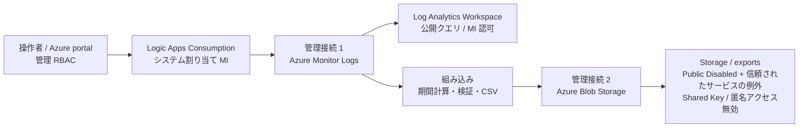

# Log Analytics 月次 CSV エクスポート：Consumption 評価用サンプル

Logic Apps **Consumption（従量課金）**で前月のログを日本時間の暦月で抽出し、Storage の `exports` コンテナーに UTF-8 BOM 付き CSV を保存します。ログ取得と Blob 保存は**管理コネクタ＋システム割り当てマネージド ID（MI）**、期間計算・検証・CSV 変換は組み込みアクションです。HTTP による REST API の直書き、共有キー、SAS、ユーザーの接続資格情報は使いません。

## 評価前に確認してください

**2026-10-22 に Consumption の実環境を portal から構築し、10/26 に固定列順版も実機確認しました。** キー順が異なるダミー 4 / 0 / 1 件・同月再実行、明細4列・集計3列の CSV 保存・実行内読み戻しに成功し、列設定不整合は保存前に停止しました。不正 KQL は10/22に確認済みです。操作者による独立したファイル取得・実データの KQL・実月次発火・本番量は未検証です。検証環境の6資源と専用RGは portal から削除完了し、成功通知とRGの直接再表示で404を確認しました。[受入結果と残項目](docs/validation.md)を参照し、本番対応済み・独立したファイル取得まで portal 完結実証済みとは説明しません。

Storage は初回から **Public network access: Disabled**、既定拒否、**信頼された Azure サービスの例外: 有効**にします。Private Endpoint による通信ではなく、対応サービスに公開エンドポイントの例外を許可する設計です。データ認可には別途 MI の RBAC が必要です。

[Blob の公式手順](https://learn.microsoft.com/en-us/azure/connectors/connectors-create-api-azureblobstorage#access-blob-storage-in-same-region-with-system-managed-identities)は Consumption＋システム MI の方法を案内していますが、「選択したネットワークから有効」の例です。[Storage の注意事項](https://learn.microsoft.com/ja-jp/azure/storage/common/storage-network-security-limitations)は Disabled 変更後も既存例外が有効と説明しています。**今回の評価環境では初回から Disabled で保存・読み戻しに成功しました。導入先ごとに同じ接続ゲートを確認し、失敗した場合は停止します。一時的な Public 有効化やキー認証で回避しません。**

## 読む順序・同梱物

1. [導入手順](docs/setup.md)：承認、3 段階 ARM、MI・権限・接続、開始日時。
2. [受入確認・ダミーテスト](docs/validation.md)：実データ不要の 4 件／0 件／1 件と異常系。
3. [運用・取得・削除](docs/operations.md)：再実行、保存済みデータの確認、取得経路、後片付け。
4. [KQL パターンの変更](docs/query-patterns.md)：前月計算は共通のまま、KQL と CSV 列を差し替える。明細・失敗のみ・操作別集計の例と portal 手順。

| 配布資材 | 用途 |
|---|---|
| [基盤 ARM](infra/01-foundation.json) / [入力例](infra/01-foundation.parameters.json) | 保存用 Storage、exports、評価用 LAW |
| [ワークフロー ARM](infra/02-workflow.json) / [入力例](infra/02-workflow.parameters.json) | 無効状態の Consumption と MI 管理接続 2 個 |
| [権限 ARM](infra/03-access.json) / [入力例](infra/03-access.parameters.json) | アプリ MI の Blob / LAW ロール |
| [ワークフロー定義](logicapp/monthly-export/definition.json) | Consumption の定義正本の配布コピー。接続は ARM が設定 |
| [ダミー設定](settings/sample.json) / [明細](settings/azureactivity.json) / [失敗のみ](settings/azureactivity-failures.json) / [操作別集計](settings/azureactivity-summary.json) | KQL・列・対象月の設定例。各設定に同名の貼り付け用 `.kql` を同梱 |

操作は端末のブラウザーと Azure portal のみです。CLI、Cloud Shell、Run Command、ローカルコマンドは不要です。各 JSON の `<...>` は転記先の環境の値に置き換えます。生成元や提供者向けスクリプトは配布しません。

**通常は `MONTH_OVERRIDE=""` で前月の暦月を自動計算**します。28 / 29 / 30 / 31 日に合わせた毎月の変更は不要です。顧客の業務 KQL は `KQL_BODY` で変更します。列構成を変える場合は `COLUMNS` と CSV アクションのカスタム列を合わせます。貼り付け用 `.csv-columns.json` も同梱し、月ごとの列順を固定します。1 ワークフロー 1 パターンであり、複数パターンの一括実行ではありません。同月にパターンを切り替えると `current.json` は最後の成功 run を指すため、[切り替えと保存の注意](docs/query-patterns.md)を確認してください。

## 構成図

図は設計上の接続を示し、実機接続の成功を保証するものではありません。操作者の Storage データ取得経路は含めていません。

| 実行に必要な資源 | 数・目的 |
|---|---|
| Logic App Consumption | 1 個。月次 Recurrence と実行履歴、システム MI |
| 保存用 Storage / exports | アカウント 1 個、コンテナー 1 個。ホスト用途なし |
| 管理 API 接続 | 2 個。Monitor Logs と Blob |
| Log Analytics Workspace（LAW） | 1 個。本一式は隔離した評価用を作成 |
| アプリ MI のデータ権限 | LAW の Log Analytics Reader、exports の Storage Blob Data Contributor |

WS1、顧客所有のホスト用 Storage、ホスト用 Queue / Table、ユーザー割り当て MI、実行用 VNet / PE / Private DNS、ASE、VM、Bastion、NAT、AMPLS は作成しません。既存 LAW を使う本番化は対象範囲・権限・テンプレートを別途確認し、評価用 LAW を無断で置換しません。

## 設計上の制限

- 信頼されたサービスの例外は「この Logic App 1 個だけ」のネットワーク許可ではありません。例外の範囲と既存の RBAC を確認します。
- Consumption はマルチテナントです。Logic App 自体に Private Endpoint を要求する場合、この構成をそのまま採用しません。
- Blob は Consumption では管理コネクタを使います。CSV 変換は組み込みです。
- Monitor Logs は最大約 16 MiB、500,000 行、クエリ 100 秒／コネクタ 110 秒。Basic / Auxiliary テーブルは非対応です。500,000 行以上を停止し、自動分割しません。
- 1 回の処理で 1 CSV。run ごとに保存し、完了後に `current.json` を更新します。旧 run の自動削除・自動失敗通知はありません。
- 実行履歴にはログや CSV が残り得ます。閲覧権限・保持・Secure Inputs / Outputs を本番前に確認します。
- **担当者のブラウザーは Logic App の例外を利用できません。** Public Disabled の Storage からの CSV ファイル取得は、既存の承認済み取得経路が必要です。[取得条件](docs/operations.md#3-csv-の取得と完了判定)を確認してください。

## 公開情報

- [Consumption の portal 作成](https://learn.microsoft.com/en-us/azure/logic-apps/quickstart-create-example-consumption-workflow)
- [信頼された Azure サービス一覧](https://learn.microsoft.com/ja-jp/azure/storage/common/storage-network-security-trusted-azure-services)
- [MI 対応コネクタと Consumption の接続](https://learn.microsoft.com/en-us/azure/logic-apps/authenticate-with-managed-identity)
- [Blob 管理コネクタ](https://learn.microsoft.com/en-us/connectors/azureblobconnector/)
- [Monitor Logs の制限](https://learn.microsoft.com/en-us/azure/connectors/connectors-azure-monitor-logs)
- [Recurrence の開始日時・タイムゾーン](https://learn.microsoft.com/en-us/azure/connectors/connectors-native-recurrence)
