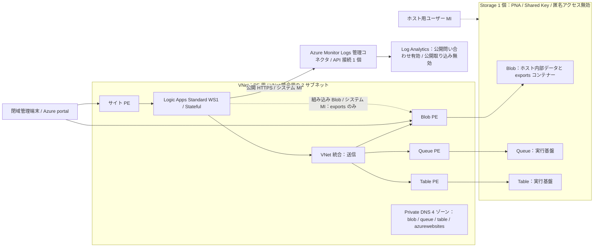

# Log Analytics 月次 CSV エクスポート：顧客評価用サンプル

Log Analytics の前月分を日本時間の暦月で問い合わせ、非公開 Blob Storage に UTF-8 BOM 付き CSV として保存するサンプルです。Logic Apps Standard（WS1）、Azure Blob Storage **組み込み**コネクタ、Azure Monitor Logs **管理**コネクタとマネージド ID を使います。ワークフローに HTTP による REST API の直書きはありません。

## 最初にお読みください

> **導入前の停止条件：WS1 のサポート確認が必要です。**
>
> [Microsoft Learn のホスト Storage 認証の説明](https://learn.microsoft.com/en-us/azure/logic-apps/create-single-tenant-workflows-azure-portal#set-up-managed-identity-access-to-your-storage-account)は、通常の Workflow Service Plan ではホスト Storage のキーアクセスを無効化できないと記載しています。本サンプルはコンテンツ共有を設定しない ARM 構成で起動・実行・再起動に成功した PoC を基にしていますが、**公式サポート範囲は未確認**です。お客様の要件を満たすサポート構成と確認できるまで、デプロイしないでください。キー認証や公開アクセスを一時的に許可して進める手順はありません。

本資料は**評価用サンプル**です。2026-10-21 に単一 Storage・コネクタ構成を Azure へ実投入し、ダミー実行と保存済み CSV の独立読み戻しに成功しました。1 月 4 件・0 件月・2 月 1 件を照合し、BOM・特殊文字・manifest / current も確認しています。Query の時間範囲「Set in query / クエリで設定」は実コネクタのメタデータで `"3"` と確認して配布しています。[導入手順](docs/setup.md)に従い環境設定・接続・時間範囲を確認してください。**提供者の管理 API による検証であり、portal 完結の実機受入は未実施**です。公式サポート確認の停止条件も変わりません。証拠の区分は[受入確認](docs/validation.md)を参照してください。

## 読む順序

1. [導入手順](docs/setup.md)：サポート・費用・権限の承認、閉域管理経路、基盤、設定、ワークフローの配置。
2. [受入確認](docs/validation.md)：§2.1 に**実データ不要のダミーデータによるテスト実行手順**（設定・手動実行・CSV 確認・終了）を記載。正常・異常・閉域・再起動の確認、本番化前の条件も含む。
3. [運用・後片付け](docs/operations.md)：対象月の変更、手動実行、CSV 取得、障害対応、削除。

読者は Azure の基本操作と IAM / VNet の知識がある管理者を想定しています。顧客側はブラウザーのみを使い、ローカルコマンド、Cloud Shell、Run Command、VS Code、CLI は不要です。

**実ログがなくてもテスト可能です。** 同梱の KQL が `datatable` でダミーデータを生成するため、ログ取り込みや診断設定は不要です。構築済み LAW / Logic App / Storage と閉域接続・権限は必要で、サポート確認・承認条件は変わりません。

## 同梱物

| 資材 | 用途 |
|---|---|
| [01-foundation.json](infra/01-foundation.json) / [入力例](infra/01-foundation.parameters.json) | VNet、Storage、ホスト用 ID、LAW（公開クエリ）、Storage 用 DNS / PE、ホスト用 RBAC |
| [02-app-ws.json](infra/02-app-ws.json) / [入力例](infra/02-app-ws.parameters.json) | WS1、Logic App、送信用 VNet 統合サブネット |
| [03-access.json](infra/03-access.json) / [入力例](infra/03-access.parameters.json) | アプリ MI のデータ権限、Monitor Logs API 接続とアクセスポリシー、アプリ受信用 PE / DNS |
| [sample.json](settings/sample.json) | 初回評価用の全 8 設定。デプロイ出力に置換して使う |
| [azureactivity.json](settings/azureactivity.json) | 任意の実ログ試験用の KQL / 列設定の差分 |
| [workflow.json](logicapp/monthly-export/workflow.json) | Stateful ワークフローのファイル全体 |
| [definition.json](logicapp/monthly-export/definition.json) | コードビューが定義本体だけを表示する場合の貼り付け用 |
| [host.json](logicapp/host.json) / [connections.json](logicapp/connections.json) | 元プロジェクトのランタイム設定参照用。portal への配置手順は導入手順を参照 |

このフォルダーをまとめて渡せます。同梱 ARM JSON に外部テンプレートの取得やコンパイルは不要です。`<...>` は入力時に置換するプレースホルダーで、そのまま投入する値ではありません。内部 PoC のスクリプト・個人パス・実環境 ID は配布しません。

## 構成と制約

Private Endpoint の対象リソースは VNet 外ですが、PE の NIC を VNet 内に置いて非公開で接続します。DNS の各ゾーンは同じ VNet にリンクします。認証・管理用には Entra ID / Azure 管理系への承認済み送信も必要です。

- **Storage と Logic App サイトは非公開、Log Analytics の問い合わせは閉域対象外**です。LAW の公開クエリは有効、公開取り込みは不要なので無効のままにします。公開 API でも匿名・キー認証は使わず、マネージド ID と Log Analytics Reader で認証・認可します。
- Storage の Shared Key を最初から無効にします。ホスト ID はユーザー割り当て、クエリ / 出力 ID はアプリのシステム割り当てです。
- **Storage は 1 個**。ホスト内部データと CSV の `exports` コンテナーを同居させ、アプリ MI と取得者のデータ権限は `exports` に限定します。管理用のアカウント全体権限を取得者へ付与しません。強い管理境界・別の保管規制が必要な場合は別アカウントへの再設計が必要です。
- 閉域接続は **Blob / Queue / Table / サイトの PE 計 4 個・DNS ゾーン計 4 個**。Blob PE はホストと出力で共用し、Queue / Table は Stateful 実行基盤に必要です。AMPLS・Monitor 系 DNS、File PE / DNS、未使用の ASE・管理 VM・Bastion 用サブネットは作成しません。[必要性と内訳](docs/setup.md)を参照してください。
- Blob の保存には組み込み `uploadBlob`、CSV 変換には組み込みデータ操作を使います。Azure Monitor Logs は組み込み版がないため管理コネクタ `Run query and list results`（V2）を使い、その API 接続 1 個とアクセスポリシーのみ追加します。これは Storage へ接続する管理コネクタではありません。
- 日時は毎月 5 日 09:00 JST を意図した設定です。実月次の自動発火と初回発火は未検証です。
- 現在は **1 回の問い合わせで 1 CSV**。500,000 行以上は失敗扱いで、自動分割はありません。管理コネクタの応答は最大約 16 MiB、クエリは最大 100 秒（コネクタ全体 110 秒）で、以前の HTTP 版より制限が小さくなります。本番量を処理できるとは保証しません。
- 同月の実行ごとに run を作り、成功後に `current.json` を更新します。トリガーの同時実行数は 1。`error` / `PartialError`、必須 `value` 配列と各行の `bag` 欠損は失敗にし、無応答を 0 件に変換しません。旧 run の自動削除・失敗通知は未実装です。
- 管理経路は別途必要です。管理 VM / Bastion / NAT はテンプレートに含めません。実行専用 VM は不要です。
- ASE v3 はキー無効化に関する公式記載がある別候補ですが、本一式には含めません。WS1 の確認が取れなければ停止し、別設計と費用を承認してください。

## 公式資料

- [Standard のホスト Storage を MI 認証にする](https://learn.microsoft.com/en-us/azure/logic-apps/create-single-tenant-workflows-azure-portal#set-up-managed-identity-access-to-your-storage-account)
- [非公開 Storage を使う Standard のデプロイ](https://learn.microsoft.com/en-us/azure/logic-apps/deploy-single-tenant-logic-apps-private-storage-account)
- [Standard の Private Endpoint と VNet 統合](https://learn.microsoft.com/en-us/azure/logic-apps/secure-single-tenant-workflow-virtual-network-private-endpoint)
- [Log Analytics 公開 Query API と認証](https://learn.microsoft.com/en-us/azure/azure-monitor/logs/api/access-api)
- [Azure Blob Storage 組み込みコネクタ](https://learn.microsoft.com/en-us/azure/logic-apps/connectors/built-in/reference/azureblob/)
- [Azure Monitor Logs コネクタと制限](https://learn.microsoft.com/en-us/azure/connectors/connectors-azure-monitor-logs)
- [コネクタの MI 接続・アクセスポリシー](https://learn.microsoft.com/en-us/azure/logic-apps/authenticate-with-managed-identity)
- [Standard の Storage 利用（Blob / Queue / Table）](https://learn.microsoft.com/en-us/azure/logic-apps/estimate-storage-costs)
- [Stateful / Stateless の状態保持と実行方式](https://learn.microsoft.com/en-us/azure/logic-apps/single-tenant-overview-compare#stateful-stateless)
- [Private Endpoint のサービス別 Private DNS ゾーン](https://learn.microsoft.com/en-us/azure/private-link/private-endpoint-dns)
- [Recurrence の開始日時・タイムゾーン](https://learn.microsoft.com/en-us/azure/connectors/connectors-native-recurrence)

導入時にも最新仕様・対象契約の提供状況・組織ポリシーを確認してください。
