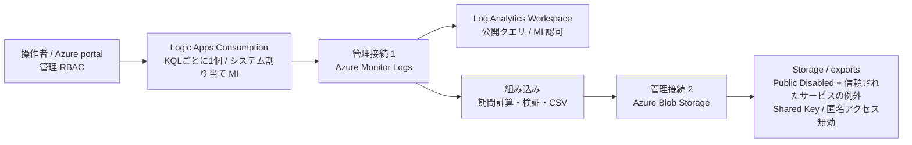

# Log Analytics 月次 CSV エクスポート：Consumption 評価用サンプル

Logic Apps **Consumption（従量課金）**で前月のログを日本時間の暦月で抽出し、Storage の `exports` コンテナーに UTF-8 BOM 付き CSV を保存します。ログ取得と Blob 保存は**管理コネクタ＋システム割り当てマネージド ID（MI）**、期間計算・検証・CSV 変換は組み込みアクションです。HTTP による REST API の直書き、共有キー、SAS、ユーザーの接続資格情報は使いません。

## 本サンプルの使い方

**1つのStorage Account・`exports`コンテナーを共有し、KQLごとに1つのワークフローを作成します。** 基盤の第1段階は1回だけ、第2・3段階をKQLごとに実施します。通常は `MONTH_OVERRIDE=""` でJSTの前月を自動計算するため、月の日数に合わせた変更は不要です。

CSVの列順はカスタム列で固定します。KQL本文は `KQL_BODY`、出力列は `COLUMNS` とCSVアクションのカスタム列に指定します。保存先は `exports/<workflowName>/<YYYY-MM>/...`、CSV名は **`<workflowName>_<対象月>_<実行日時yyyyMMdd-HHmmss>-JST.csv`** です。最新のCSVはワークフロー・月ごとの `current.json` から参照します。

Storage は初回から **Public network access: Disabled / Deny / AzureServices**、共有キー・匿名アクセス無効にします。信頼されたサービスの例外とMIのRBACを併用する設計で、Private Endpointによる通信ではありません。接続に失敗しても、Public有効化やキー認証で回避しません。

**構築・設定・手動テスト・運用はAzure portalで行います。** 実データがなくても同梱のダミーKQLで接続とCSV保存を試験できます。操作者によるCSVファイル取得には、別途承認済みのネットワーク経路とデータ権限が必要です。[確認範囲と受入条件](docs/validation.md)を確認してから導入してください。

## 読む順序・同梱物

1. [導入手順](docs/setup.md)：承認、3 段階 ARM、MI・権限・接続、開始日時。
2. [受入確認・ダミーテスト](docs/validation.md)：実データ不要の 4 件／0 件／1 件と異常系。
3. [KQL の設定・追加](docs/query-patterns.md)：Perf・操作履歴などの本文と固定列、複数KQLの追加、個別の受入確認。
4. [運用・取得・削除](docs/operations.md)：月次確認、再実行、CSV取得、障害対応、後片付け。

| 配布資材 | 用途 |
|---|---|
| [基盤 ARM](infra/01-foundation.json) / [入力例](infra/01-foundation.parameters.json) | 保存用 Storage、exports、評価用 LAW |
| [ワークフロー ARM](infra/02-workflow.json) / [入力例](infra/02-workflow.parameters.json) | 無効状態の Consumption と MI 管理接続 2 個 |
| [権限 ARM](infra/03-access.json) / [入力例](infra/03-access.parameters.json) | アプリ MI の Blob / LAW ロール |
| [ワークフロー定義](logicapp/monthly-export/definition.json) | 定義の参照用。初回構築と接続設定はARMを使用 |
| [ダミー設定](settings/sample.json) / [明細](settings/azureactivity.json) / [失敗のみ](settings/azureactivity-failures.json) / [操作別集計](settings/azureactivity-summary.json) / [Perf 日次CPU平均](settings/perf-cpu-daily.json) | KQL・列・対象月の設定例。各設定に同名の貼り付け用 `.kql` を同梱 |

操作は端末のブラウザーと Azure portal のみです。CLI、Cloud Shell、Run Command、ローカルコマンドは不要です。各 JSON の `<...>` は転記先の環境の値に置き換えます。生成元や提供者向けスクリプトは配布しません。

## 構成図

図はKQL1本分の処理を示し、複数KQLではStorage・LAWを共用します。操作者のCSV取得経路は別に確認します。

| 実行に必要な資源 | 数・目的 |
|---|---|
| Logic App Consumption | KQLごとに1個。各々の月次 Recurrence と実行履歴、システム MI |
| 保存用 Storage / exports | アカウント 1 個、コンテナー 1 個 |
| 管理 API 接続 | ワークフローごとに2個。Monitor Logs と Blob |
| Log Analytics Workspace（LAW） | 1 個。本一式は隔離した評価用を作成 |
| アプリ MI のデータ権限 | ワークフローごとのMIにLAWのLog Analytics Reader、exportsのStorage Blob Data Contributor |

本一式は専用RGに評価用LAWを作成します。本番の取得元・権限・接続設定は別途確認し、評価用LAWを無断で置換しません。

## 設計上の制限

- 信頼されたサービスの例外は「この Logic App 1 個だけ」のネットワーク許可ではありません。例外の範囲と既存の RBAC を確認します。
- Consumption はマルチテナントです。Logic App 自体に Private Endpoint を要求する場合、この構成をそのまま採用しません。
- Monitor Logs は最大約 16 MiB、500,000 行、クエリ 100 秒／コネクタ 110 秒。Basic / Auxiliary テーブルは非対応です。500,000 行以上を停止し、自動分割しません。
- 1回の処理で1CSV。ワークフロー名・月・runごとに保存し、完了後にそのワークフロー・月の `current.json` を更新します。プレフィックスは論理分離でありアクセス権の境界ではありません。旧runの自動削除・自動失敗通知はありません。
- 実行履歴にはログや CSV が残り得ます。閲覧権限・保持・Secure Inputs / Outputs を本番前に確認します。
- **担当者のブラウザーは Logic App の例外を利用できません。** Public Disabled の Storage からの CSV ファイル取得は、既存の承認済み取得経路が必要です。[取得条件](docs/operations.md#3-csv-の取得と完了判定)を確認してください。

## 公開情報

- [Consumption の portal 作成](https://learn.microsoft.com/en-us/azure/logic-apps/quickstart-create-example-consumption-workflow)
- [信頼された Azure サービス一覧](https://learn.microsoft.com/ja-jp/azure/storage/common/storage-network-security-trusted-azure-services)
- [MI 対応コネクタと Consumption の接続](https://learn.microsoft.com/en-us/azure/logic-apps/authenticate-with-managed-identity)
- [Blob 管理コネクタ](https://learn.microsoft.com/en-us/connectors/azureblobconnector/)
- [Monitor Logs の制限](https://learn.microsoft.com/en-us/azure/connectors/connectors-azure-monitor-logs)
- [Recurrence の開始日時・タイムゾーン](https://learn.microsoft.com/en-us/azure/connectors/connectors-native-recurrence)
