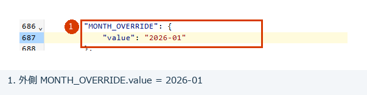
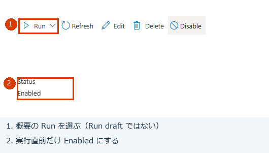
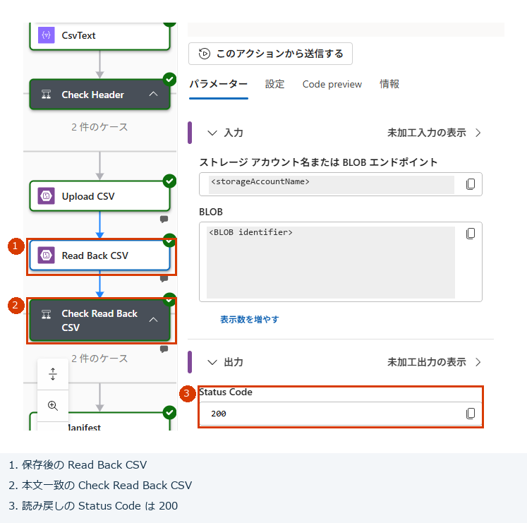
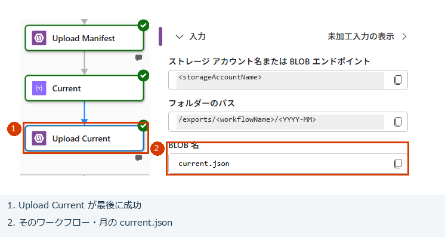
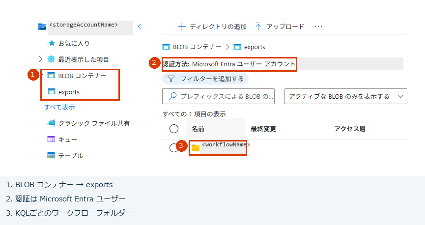
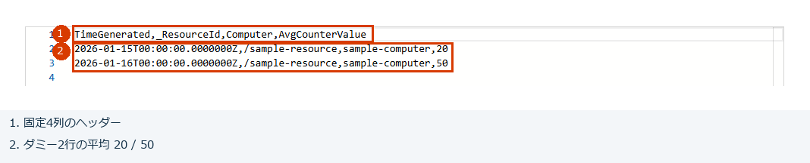
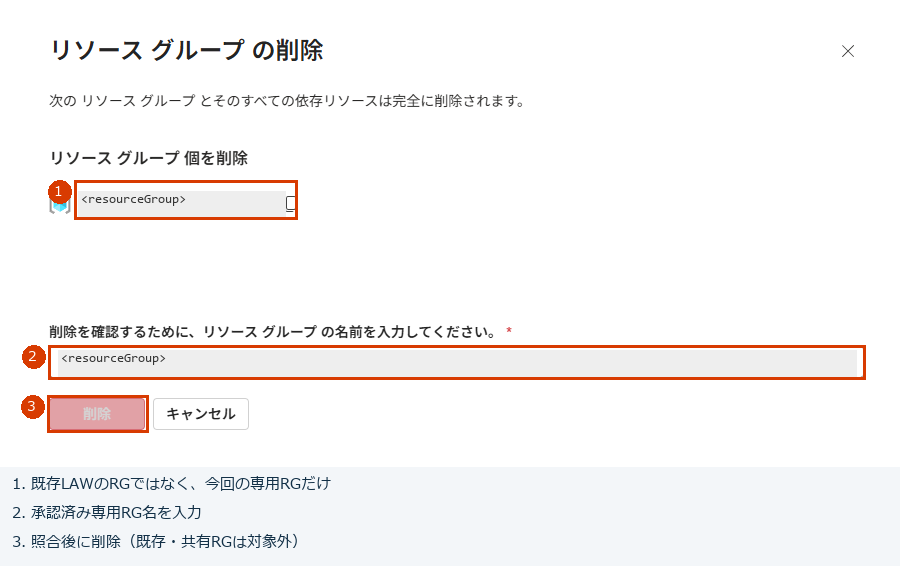
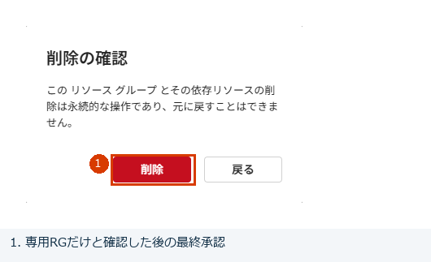

# Consumption の運用・障害対応・後片付け

[入口](../README.md) / [導入](setup.md) / [ダミーテスト・受入確認](validation.md)

操作はAzure portalで行います。初回は[ダミーテスト](validation.md#2-実データ不要のダミーテスト)を完了し、業務KQL・固定列・対象月・次回予定を受入確認してから月次運用を開始します。

この文書の **current** は「そのワークフロー・対象月で最後に正常終了したCSVへの案内ファイル」、**manifest** は「CSV名・対象月・行数などの結果記録」、**run** は「ワークフロー1回分の実行」を意味します。対象月や実行IDの照合が難しい場合は、CSVを選んだり削除したりする前に管理者へ確認してください。

## 1. 通常の月次処理

- MONTH_OVERRIDE が空なら実行開始時点の JST 前月を処理します。開始を含み、翌月開始を含みません。
- 定期実行は毎月5日09:00 JSTです。[Recurrenceの開始日時・タイムゾーン](https://learn.microsoft.com/en-us/azure/connectors/connectors-native-recurrence)と次回予定を確認し、初回の月次実行結果を記録します。
- 遅延取り込みがある場合、5 日時点で前月データが完全とは限りません。締め・再抽出・保持は顧客で決定します。
- 自動失敗通知・旧 run 自動削除は未実装です。管理者が履歴・件数・current を確認します。
- 実行履歴に本文が残り得るため、閲覧権限・保持・[Secure Inputs / Outputs](https://learn.microsoft.com/en-us/azure/logic-apps/set-up-security-permissions#secure-data-in-run-history)を本番前に確認します。

## 2. 対象月を指定して手動実行する

1. Logic App を無効化し、履歴に Running がないことを確認する。
2. 現在の設定・有効状態を[作業メモ](setup.md#1-評価用-rg-と入力の準備)へ控える。変更前の値を保全できない場合は、変更を始めない。
3. 概要 → **Edit → Code**で、外側の`parameters.MONTH_OVERRIDE.value`を `yyyy-MM`（例 `2026-01`）にします。対象月だけの再取得ではKQL・列を変えません。LAW_RESOURCE_ID、STORAGE_ACCOUNT_NAME、`$connections` はそのままにします。変更箇所を判別できない場合は保存せず管理者へ確認します。
4. 保存・Publish成功後に再表示して値を確認する。Draftの自動保存だけでは反映完了としない。
5. 初回開始日時が将来であることを確認し、有効化する。想定外の自動実行がないか履歴を確認してから、1 回だけ手動実行する。
6. 実行 ID、対象月、UTC 窓、RowCount、最終状態を記録し、次節で保存内容を確認する。
7. 評価中は再度無効化する。通常運用へ戻す場合は元の KQL / COLUMNS と MONTH_OVERRIDE の空文字、開始日時・次回予定を確認してから有効化する。

同時実行数は 1 を維持します。履歴からの再送・別ワークフロー・接続先変更まで排他が保証されたものではありません。定期予定と重ならない作業枠で操作し、手動実行を重ねません。





**操作例：** 対象月を設定・Publishして再表示した後、将来の予定とRunningなしを確認して概要のRun → Runを使います。画像の`2026-01`は例で、台帳の対象月を指定します。

## 3. CSV の取得と完了判定

```text
exports（コンテナー）
  <workflowName>/
    <YYYY-MM>/
      current.json
      runs/<実行日時yyyyMMdd-HHmmss>-JST_<run-id>/
        <workflowName>_<対象月yyyy-MM>_<実行日時yyyyMMdd-HHmmss>-JST.csv
        manifest.json
```

保存はワークフロー名・対象月・runごとです。CSV名の例は `lawexp-perf-cpu_2026-09_20261026-232101-JST.csv`。日時は処理開始時に1回だけ取得するため、処理中や再試行で名前を変えません。実行フォルダーは日時を先頭にし、同じ秒の別実行による上書きを防ぐため末尾に完全な実行IDを残します。CSV名には実行IDを入れません。

CSVの保存・読み戻し一致を確認してからmanifestを保存し、最後にそのワークフロー・月のcurrentを更新します。manifestのrowCountはJSON数値、filesは実際のCSV名1個の配列です。manifestとcurrentにはworkflowNameとrunIdを記録し、currentのpathはコンテナー基準の相対パス、csvFileNameはCSV名です。命名時刻はmanifest.startedAtUtcに記録した先頭アクションのUTC時刻をJSTへ変換します。概要履歴の受付時刻と秒がずれる場合があります。

### 実行履歴での保存内容確認

1. CSV の Blob 読み戻しアクションが成功したことと、読み戻した本文が CSV 作成結果と一致したことを確認する。アップロード入力だけでは判断しない。
2. 対象月・runId・期間・RowCount と manifest / current の保存結果を確認する。
3. 読み戻しを含む実行の Succeeded と、独立した取得による current / manifest の確認は区別する。





**実行内の確認例：** CSV読み戻し・本文一致を確認した後、manifestとUpload Currentの成功を確認します。画像のフォルダーパスの伏せ字は、ご自身のワークフロー・月と照合してください。これは実行履歴の確認であり、独立したcurrent / manifest / CSV取得の代わりではありません。

### CSV ファイルを取得する条件

**信頼されたサービスの例外は、操作者のブラウザーを許可しません。** データ RBAC があっても、Public Disabled の Storage の CSV を通常の端末から portal で直接取得できるとは限りません。

ファイル取得が必要なら、**既存の承認済みネットワーク経路**から Blob の Private Endpoint 等へ到達できる端末と DNS を用意します。本テンプレートは取得用ネットワークを作成しません。経路がなければ、ファイル取得の受入を未達として停止し、別途設計します。Public 有効化、SAS 発行、匿名 HTTP 取得口で代替しません。

承認済み経路がある場合：

1. portal の Storage ブラウザーで **Microsoft Entra ユーザーアカウント**認証を使う。必要な管理プレーン権限と exports の Storage Blob Data Reader を管理者が付与する。
2. 対象KQLのワークフロー名と対象月を台帳で確認し、`<workflowName>/<YYYY-MM>/current.json` を読む。workflowName・runId・path（コンテナー基準の相対パス）が一致することを確認する。
3. **そのpathの**manifestを取得する。current.csvFileNameとmanifest.filesの1個の名前が一致することを確認し、**その名前のCSV**を取得する。ファイル名を決め打ちしたり、最新時刻の別runを勝手に選んだりしない。
4. manifestのworkflowName / month / runId / startedAtUtc / UTC窓 / rowCount / filesを履歴と照合する。CSV名の実行日時はJST、manifestのstartedAtUtcはUTCなので9時間差を考慮する。
5. CSV 対応ソフトで列順・論理件数・全値・BOM を確認する。改行数で件数を数えない。数式・日付の自動解釈を避ける。

取得したCSVの本文・文字コード・サイズと、連携先で必要なContent-Type等を確認します。実行履歴のJSONを表示・保存したことを、CSVファイルの取得成功と扱わないでください。



**取得操作の入口：** ①BLOBコンテナー → exports、②Microsoft Entraユーザーアカウント認証、③目的のワークフローフォルダーです。そこから対象月のcurrent.jsonを開き、**そのpath**のmanifestと**そのcsvFileName**のCSVへ進みます。


**取得するファイルを照合した後：** ダウンロードを使用します。削除やSASの生成へ進みません。ダウンロードの受付だけでなく、実ファイルを保存できたことと本文を確認してください。



**内容例：** 画像はPerfダミーの4列・2行です。ご自身のKQLの列・件数・全値と照合します。これらの画像は操作・内容の例で、**Public DisabledのStorageへ通常端末からアクセスできることの証明ではありません。** 承認済み経路が成立しなければ停止し、Public有効化・キー・SASで回避しません。BOMや特殊文字は画面だけで合格にせず、取得したCSVで確認します。

公式：[portal の Blob データ認証と権限](https://learn.microsoft.com/en-us/azure/storage/blobs/authorize-data-operations-portal)、[ネットワーク制限と portal のデータ操作](https://learn.microsoft.com/en-us/azure/storage/common/storage-network-security-limitations)。

### KQL パターンを変更する場合

[KQL パターンの変更](query-patterns.md)に従い、`KQL_BODY` と `COLUMNS` を差し替えます。列構成が変わる場合は `Create_CSV_table` のカスタム列も更新します。CSV は明示したカスタム列の配列順で生成し、bag のキー順には依存しません。接続と前月計算は共通です。毎月独立して取得するKQLは別ワークフローへ割り当て、同じStorage Accountのワークフロー名別パスに保存します。currentもワークフロー・月ごとに独立します。同一ワークフロー内でKQLを切り替えると、その月のcurrentは最後の成功runを指す点は変わりません。台帳にワークフロー名・KQL・列・対象月・run IDを残してください。1ワークフローでの複数KQL一括実行、ワークフロー間の全体排他は実装していません。

## 4. 失敗時の扱い

| 症状 | 確認・対応 |
|---|---|
| Blob の 403 | PNA Disabled / AzureServices、Consumption のシステム MI、exports の Data Contributor と反映、V1 接続の MI 認証を確認。Public 有効化・キー・ユーザー割り当て MI に変更しない |
| Monitor Logs の 401 / 403 | 既存LAWのARM ID（GUIDではない）、対象MIのLog Analytics Reader、公開クエリ設定、管理接続のMI認証を確認。既存LAWを作り直したり取り込み・ネットワーク設定を変更したりして回避しない |
| 接続作成でユーザーのサインインやキーを要求 | 誤った認証方式として停止。Logic Apps MI 対応の接続を確認 |
| Query の時間範囲エラー | Set in query と KQL の start / end を確認。無関係な相対期間で絞らない |
| KQL / SchemaMismatch / Parse JSON 失敗 | COLUMNS・project・CSV のカスタム列の一致、bag 列・必須 value 配列を確認。`Check_Header` はカスタム列と COLUMNS の列順不一致でも失敗する。自動列推定や空配列へ変更して隠さない |
| RowCap / タイムアウト / 応答超過 | 約 16 MiB、500,000 行、クエリ 100 秒 / 全体 110 秒を確認。自動分割はないため別設計 |
| CSV 読み戻し・一致確認の失敗 | 保存済みの実体・型・エンコードを確認し、成功扱いにしない |
| current 更新時の失敗 | 書き込まれた可能性があるため、current と run を再取得。前回のままと断定しない |
| portal で CSV を開けない | ネットワークとデータ権限を別々に確認。Logic App の例外を端末が使えると考えない |

クエリや CSV 保存の途中で失敗した run は正式成果物として採用しません。通常その段階では前回 current が残りますが、通信障害時の最終状態は必ず再取得で確認します。初回失敗で current が存在しないことを「0 件」と読み替えません。

再試行は定義の有限回数・固定間隔に従います。[Logic Apps の再試行と制限](https://learn.microsoft.com/en-us/azure/logic-apps/logic-apps-limits-and-config)と、[Monitor Logs コネクタ固有の制限](https://learn.microsoft.com/en-us/azure/connectors/connectors-azure-monitor-logs)は別です。自動分割・通知・本番性能を備えた基盤ではありません。

## 5. 後片付け

**既存LAWは削除しません。** そのLAWのRG、ログ、保持日数、取り込み・ネットワーク設定、他の利用者の権限も保持します。既存LAWの画面からそのRG全体を削除する操作は行わず、今回追加したMIのロール割り当てだけを台帳に従って整理します。

複数KQLで基盤を共有している場合、**1本だけの廃止で共通Storage・exports・LAW・RGを削除しません。** 対象ワークフローを無効化してRunningなしを確認し、承認された対象のワークフロー・専用API接続・MIのロール割り当てだけを整理します。保存済みデータは保持ルールに従います。専用RG全体の削除は、その中の全ワークフローと共通基盤を廃止する承認がある場合だけです。

1. Logic App を無効化し、実行中でないことを確認する。
2. 必要な CSV と証拠を承認済み経路で保全する。取得不能ならその事実を記録し、保全前の削除は承認を得る。
3. **既存LAW → IAM → ロールの割り当て**で、台帳の `lawRoleAssignmentId` と対象MIのプリンシパルID・スコープが一致する今回追加分だけを削除する。別ワークフローのMI、既存のユーザー・アプリ、継承権限を削除しない。既存LAWのRG → **デプロイ**には `lawAccessDeploymentName` の権限用子デプロイ履歴もあるため、証跡保全後に台帳の今回分だけを整理する。履歴の削除は既存LAWの削除ではない。
4. **新規の専用RG**に無関係な資源や既存LAWがないことと、削除ロック・保持ルールを確認する。RGの **リソース グループの削除**で対象名を入力し、ボタンの有効化を待って最終確認後に削除する。操作できない場合は対象・権限を確認して停止し、無効ボタンの強制操作やCLI / RESTへの切り替えをしない。
5. RG外に今回追加した取得用ネットワーク設定等があれば、台帳の今回作成分だけ削除する。本一式はサブスクリプション診断設定を作らない。LAW側の権限削除を専用RG削除だけで完了扱いにしない。
6. 削除成功通知と、元の専用RG画面を再読み込みした「見つかりません」を確認する。**既存LAWを再表示し、ARM ID・保持・取り込み・ネットワーク設定が作業前と一致すること**、そのRGと他の利用者の権限が保持されていることを確認する。今回作成分の残存有無を台帳へ記録し、課金画面が即時0であることを完了条件にしない。

共有資源が混在するRGは丸ごと削除しません。台帳で今回作成したConsumption・専用接続・Storage・権限だけを特定し、承認済みの範囲を個別に削除します。既存LAWはこの削除リストに入れず、失敗時も削除範囲を広げません。





**専用評価環境を全て廃止する場合だけの画面例：** 専用RGの指定と削除確認の操作箇所を抜粋しています。実画面の対象一覧と台帳を照合し、既存LAWが含まれていないことを確認してから、RG名を入力し検証・ボタンの有効化を待ちます。画像の灰色の無効ボタンを強制操作しません。継続利用する既存・共有RGや、一部KQLだけの廃止にはこのRG全体削除を使わないでください。
