# 前月分 KQL のパターンを変更する（Azure portal のみ）

[入口](../README.md) / [導入](setup.md) / [受入確認](validation.md) / [運用](operations.md)

**取得条件だけなら `KQL_BODY`、列構成も変える場合は `COLUMNS` と CSV のカスタム列設定も変更します。** 接続、期間計算、Blob 保存アクションは共通です。CSV の列順は明示的なカスタム列配列で固定し、`pack_all()` のキー順には依存しません。パターンは以下の例を出発点に、顧客の既存 KQL に置き換えてください。AzureActivity は説明用であり、本番の対象テーブルを指定するものではありません。

複数の業務KQLを毎月実行する場合は、**KQLごとに別の Consumption ワークフロー**を作り、同じ Storage Account と `exports` コンテナーを使います。Blob名を `<ワークフロー名>/<対象月>/...` に分け、CSVだけでなく manifest と current も独立させます。構築は[本書 §5](#5-複数kqlを1つのstorage-accountへ保存する)に従います。1つのワークフローで複数KQLを一括処理する方式ではありません。

## 0. ダミー実行が終わったら、ここから始める

**初回の3列ダミーが成功した環境で、実データなしでKQL変更を試す場合は、[§3.2の手順1](#手順1-停止して公開済み設定を控える)から順に進めます。** 新しいRG・LAW・Storage・接続の作成やARMの再投入は不要です。3列・4行のダミーを、Perf形式の**4列・2行・平均20 / 50**へ切り替えます。

| やりたいこと | 読む場所 | 変更するもの |
|---|---|---|
| 実データなしで、列も変わるKQLへの切り替えを試す | §3.2 | KQL_BODY、COLUMNS、CSVカスタム列、試験対象月 |
| Perfテーブルの実データを取得する | §3.1、試験後の§3.2手順7 | 本番KQLと4列設定。対象テーブル・権限・保持期間を確認 |
| 出力列は同じで抽出条件だけ変える | §2の例A、§4 | KQL_BODYだけ。対象月の指定は必要時のみ |
| 別KQLを既存KQLと並行して定期実行する | §5 | 別ワークフローを追加。既存ワークフローを上書きしない |

**編集する場所は「概要 → Edit → Code」です。** 概要の「JSON ビュー」と実行履歴の「Code preview」は参照専用です。「パラメーター」画面のActual valueが灰色の場合も、そこで入力せずCodeを使います。

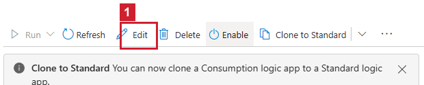

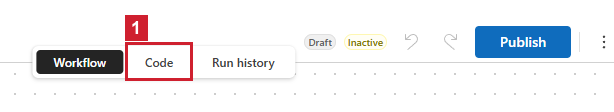

**入口の画面例：** 上の画像のEditを押し、次の画面のCodeを選びます。無効化後の概要ではEnableが表示されます。編集画面のRun draftは使いません。

## 1. 月ごとに変更しない設定

| 項目 | 通常運用の設定・動作 |
|---|---|
| MONTH_OVERRIDE | **空文字 `""`**。実行時点の日本時間から前月を選択 |
| 期間 | 前月 1 日 00:00 以上、当月 1 日 00:00 未満（JST） |
| start / end | ワークフローが上記の境界を UTC に変換し、KQL の先頭に自動追加 |
| 月の日数 | 28 / 29 / 30 / 31 日を自動処理。固定の「過去 30 日」ではない |
| 実行日 | 配布例は毎月 5 日 09:00 JST。顧客の月初業務日に変える場合は Recurrence の開始日時・次回予定を別途確認 |

たとえば 2026 年 3 月の実行では、2 月 1 日 00:00 JST 以上～3 月 1 日 00:00 JST 未満です。2028 年なら 2 月 29 日も含みます。日数を毎月手入力する必要はありません。

手動で過去月を再取得する場合だけ `MONTH_OVERRIDE` に `2026-01` などを指定し、終了後は空文字へ戻します。再送時も実行時点で期間を計算するため、月をまたいで再実行する場合は対象月を明示してください。

## 2. パターンを選ぶ

`.kql` は **KQL_BODY の入力欄にそのまま貼る本文**です。`.json` は KQL と列を対にしたワークフローパラメーターの参考設定です。ファイルを置くだけで自動選択される仕組みではありません。

| パターン | 貼り付け用 KQL | 対応する設定 JSON | 用途 |
|---|---|---|---|
| ダミー | [sample.kql](../settings/sample.kql) | [sample.json](../settings/sample.json) | 実データなしの接続・CSV 試験。対象月は `2026-01` |
| 明細 | [azureactivity.kql](../settings/azureactivity.kql) | [azureactivity.json](../settings/azureactivity.json) | 前月の操作履歴を 1 ログ 1 行で出力 |
| 失敗のみ | [azureactivity-failures.kql](../settings/azureactivity-failures.kql) | [azureactivity-failures.json](../settings/azureactivity-failures.json) | 前月の `ActivityStatusValue` が `Failed` の明細 |
| 操作別集計 | [azureactivity-summary.kql](../settings/azureactivity-summary.kql) | [azureactivity-summary.json](../settings/azureactivity-summary.json) | 前月の操作名・状態ごとの件数 |
| Perf 日次CPU平均 | [perf-cpu-daily.kql](../settings/perf-cpu-daily.kql) | [perf-cpu-daily.json](../settings/perf-cpu-daily.json) | 前月の `% Processor Time` をリソース・コンピューター・UTC日別に平均 |

CSV のカスタム列設定（列構成を変更する場合に使用）：

- [ダミー](../settings/sample.csv-columns.json)
- [明細](../settings/azureactivity.csv-columns.json)
- [失敗のみ](../settings/azureactivity-failures.csv-columns.json)
- [操作別集計](../settings/azureactivity-summary.csv-columns.json)
- [Perf 日次CPU平均](../settings/perf-cpu-daily.csv-columns.json)

毎月同じパターン・列設定を使う限り、0件でも非0件でもCSVの列順は同じです。初回の第2段階ARM投入では `columns` 入力からカスタム列設定も生成します。デプロイ後にパラメーター `COLUMNS` を変更するだけでは、アクション定義のカスタム列は自動更新されません。

明細・失敗のみの `COLUMNS`：

```json
["TimeGenerated","OperationNameValue","ActivityStatusValue","CategoryValue"]
```

操作別集計の `COLUMNS`：

```json
["OperationNameValue","ActivityStatusValue","RecordCount"]
```

### 例 A：明細から失敗だけに絞る

変更箇所は時間条件の次に追加する `where` です。出力列が同じなら `COLUMNS` は変更しません。

```kusto
AzureActivity
| where TimeGenerated >= start and TimeGenerated < end
| where ActivityStatusValue =~ "Failed"
| project TimeGenerated, OperationNameValue, ActivityStatusValue, CategoryValue
| project bag=pack_all()
```

### 例 B：前月分を操作名・状態で集計する

**月の絞り込みを集計より前に行います。** 明細と異なる列になるため `COLUMNS` も変更します。

```kusto
AzureActivity
| where TimeGenerated >= start and TimeGenerated < end
| summarize RecordCount=count() by OperationNameValue, ActivityStatusValue
| project OperationNameValue, ActivityStatusValue, RecordCount
| project bag=pack_all()
```

この場合、manifest の `rowCount` は **集計後の CSV 行数**です。元ログ件数ではありません。元ログ件数は `RecordCount` に出力します。グループ付き集計なので入力 0 件なら出力も 0 行です。グループなしの `summarize count()` は入力 0 件でも 1 行を返すため、顧客 KQL の期待値を別途決めます。

## 3. 顧客の既存 KQL を使う

### 3.1 Perfの日次CPU平均を設定する

次の本文を `KQL_BODY` に設定します。期間はワークフローが付加するstart / endを使い、平均列を `AvgCounterValue` と明示します。

```kusto
Perf
| where TimeGenerated >= start and TimeGenerated < end
| where CounterName == "% Processor Time"
| summarize AvgCounterValue=avg(CounterValue) by _ResourceId, Computer, bin(TimeGenerated, 1d)
| project TimeGenerated, _ResourceId, Computer, AvgCounterValue
| project bag=pack_all()
```

対応する `COLUMNS` は次です。

```json
["TimeGenerated","_ResourceId","Computer","AvgCounterValue"]
```

CSVアクションのカスタム列も同じ順にします。[配布用の配列](../settings/perf-cpu-daily.csv-columns.json)を使うか、コードビューの `definition.actions.Export.actions.Create_CSV_table.inputs.columns` に次の配列を設定します。

```json
[
  {"header":"TimeGenerated","value":"@item()['TimeGenerated']"},
  {"header":"_ResourceId","value":"@item()['_ResourceId']"},
  {"header":"Computer","value":"@item()['Computer']"},
  {"header":"AvgCounterValue","value":"@item()['AvgCounterValue']"}
]
```

`Create_CSV_table` が「`Id` が存在しない」などの `InvalidTemplate` で失敗する場合は、旧3列のカスタム列が残っていないか確認してください。`COLUMNS` パラメーターを4列へ変更しても、このアクションの列定義は自動更新されません。上の4列配列へ置き換えてPublishし、再表示で確認します。この列不整合をStorageのネットワーク設定やキー認証の変更で回避しないでください。

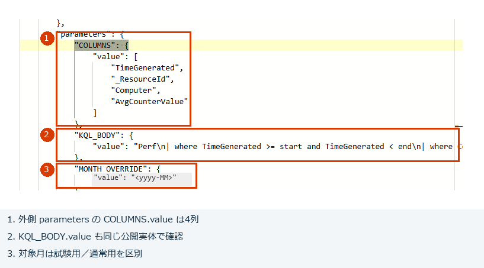

**確認例①：** 公開済みJSONの外側 `parameters.COLUMNS.value` がPerf用4列であることを確認します。KQLは画像で一部しか表示されていないため、本文は同梱のファイルから全文を使います。

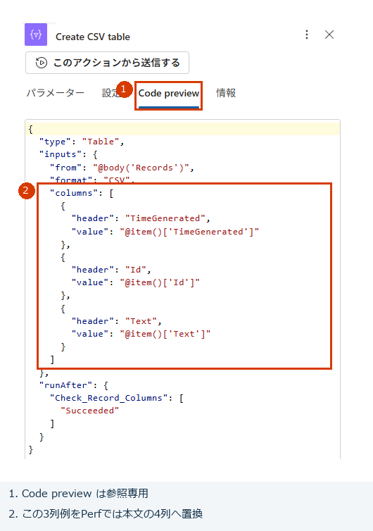

**確認例②・置換前：** この画像は3列ダミーのCSV列定義で、Perf用の完成形ではありません。①実行履歴のCode previewは**参照専用**です。②`columns`にId / Textが残っている場合は、**コードビューで**上のPerf用4列配列へ置き換えます。COLUMNSだけの変更では不十分です。

**月の抽出期間と、日別集計の区切りは別です。** 抽出期間はJSTの前月をUTCへ変換します。`bin(TimeGenerated, 1d)` による日別集計は **UTCの00:00区切り**で、CSVの `TimeGenerated` もUTCの日開始です。JST日単位の集計が必要な場合は、集計式と期待値を別途確認してください。JST暦月の端ではUTC日グループが一部の時間だけを含むことがあります。

`MONTH_OVERRIDE` もJST暦月を指定します。過去月の実データを試験する場合は保持期間を確認し、データ不存在とクエリエラーを区別してください。

### 3.2 Perf の実データがない場合の試験

既存の3列ダミーからPerfへ切り替える場合も、以下の手順を使います。**[共通ダミーテスト](validation.md#2-実データ不要のダミーテスト)のAに戻って設定し直さないでください。** 本試験は4列・2行で、共通ダミーの3列・4件とは期待値が異なります。

#### 手順1 停止して公開済み設定を控える

Logic Appの概要で **Disable** を押し、**Refresh → Status: Disabled**、実行履歴にRunningがないことを確認します。有効なまま編集すると、変更途中の設定で定期実行されるおそれがあります。

概要 → **JSON ビュー**で公開済みJSONを全文控えます。`properties.definition`、`properties.parameters`、元のEnabled / Disabled、Recurrenceの頻度・間隔・開始日時・タイムゾーン・同時実行1を保全します。JSONビューは参照用です。閉じて **Edit → Code**へ進みます。

**1時間ごとのトリガーを試験中なら、KQL変更のために月次へ戻す必要はありません。** Hour / 1を含む元の予定を維持し、作業中だけ停止します。月次への復帰は手順7で別に判断します。

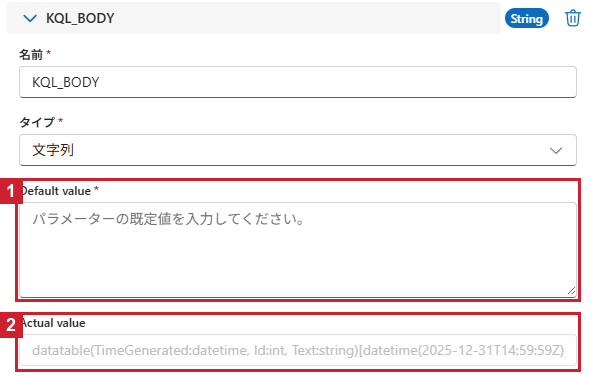

**ここには貼り付けません：** Actual valueは灰色の参照値です。上のDefault valueを変更しても、外側にActual valueが設定されていれば実行値は変わりません。パラメーターの名前・型も変更せず、パネルを閉じてCodeへ戻ります。

#### 手順2 外側parametersの3つの値を変更する

Codeには `parameters` が**2か所**あります。前半の **`definition.parameters`（type / defaultValue）ではなく、`definition` の閉じ括弧の後にある外側の `parameters`（value）**を編集します。Ctrl+Endで末尾へ移動して少し上へスクロールすると見つけやすくなります。Ctrl+Fで検索する場合は、Findへ入力後に **next** を押し、検索された場所の前後を確認します。

次の3つの **`value`の値だけ**を変更します。外側parameters全体やエディター全体をサンプルJSONで置き換えません。`LAW_RESOURCE_ID`、`STORAGE_ACCOUNT_NAME`、`$connections` は実環境の値を保持します。

| 変更箇所 | 設定値 |
|---|---|
| 外側 `parameters.COLUMNS.value` | 配列 `["TimeGenerated","_ResourceId","Computer","AvgCounterValue"]` |
| 外側 `parameters.KQL_BODY.value` | 以下のダミーKQL全文。Codeに貼る場合は、その下のJSON文字列を使用 |
| 外側 `parameters.MONTH_OVERRIDE.value` | 文字列 `"2026-01"` |

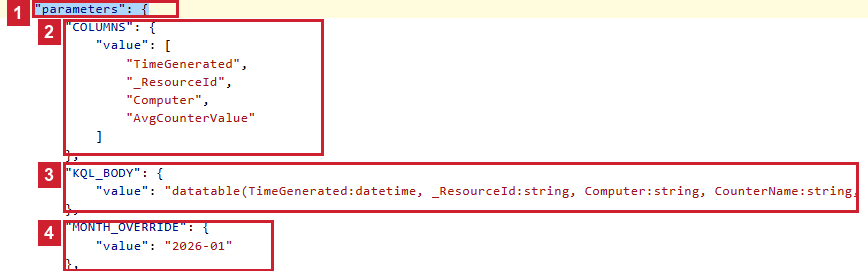

**貼り付け位置：** ①外側parameters、②COLUMNS.valueの配列、③KQL_BODY.valueの文字列、④MONTH_OVERRIDE.valueです。画像のKQLは横に長く、先頭しか見えていません。全文は以下を使います。

`KQL_BODY` には**次の全文**を貼り付けます。datatableだけで終わらず、時間条件・カウンター条件・集計・project・bagまで含めます。先頭の `Perf` を残して二重にしないでください。

```kusto
datatable(TimeGenerated:datetime, _ResourceId:string, Computer:string, CounterName:string, CounterValue:real)
[
  datetime(2026-01-15T00:10:00Z), "/sample-resource", "sample-computer", "% Processor Time", 10.0,
  datetime(2026-01-15T00:20:00Z), "/sample-resource", "sample-computer", "% Processor Time", 30.0,
  datetime(2026-01-16T00:10:00Z), "/sample-resource", "sample-computer", "% Processor Time", 50.0,
  datetime(2026-01-15T00:30:00Z), "/sample-resource", "sample-computer", "Other Counter", 999.0
]
| where TimeGenerated >= start and TimeGenerated < end
| where CounterName == "% Processor Time"
| summarize AvgCounterValue=avg(CounterValue) by _ResourceId, Computer, bin(TimeGenerated, 1d)
| project TimeGenerated, _ResourceId, Computer, AvgCounterValue
| project bag=pack_all()
```

**Codeへ貼り付けるJSON文字列（上のKQLと同じ内容）：** 既存の `KQL_BODY` の `"value":` の後にある**文字列を、開始の `"` から終了の `"` まで**選択し、次の1行で置き換えます。`"value":`、その前後の `{ }`、後ろのカンマは残します。引用符と改行をエスケープ済みなので、上の複数行KQLをJSONの引用符内へ直接貼り付ける必要はありません。

```json
"datatable(TimeGenerated:datetime, _ResourceId:string, Computer:string, CounterName:string, CounterValue:real)\n[\n  datetime(2026-01-15T00:10:00Z), \"/sample-resource\", \"sample-computer\", \"% Processor Time\", 10.0,\n  datetime(2026-01-15T00:20:00Z), \"/sample-resource\", \"sample-computer\", \"% Processor Time\", 30.0,\n  datetime(2026-01-16T00:10:00Z), \"/sample-resource\", \"sample-computer\", \"% Processor Time\", 50.0,\n  datetime(2026-01-15T00:30:00Z), \"/sample-resource\", \"sample-computer\", \"Other Counter\", 999.0\n]\n| where TimeGenerated >= start and TimeGenerated < end\n| where CounterName == \"% Processor Time\"\n| summarize AvgCounterValue=avg(CounterValue) by _ResourceId, Computer, bin(TimeGenerated, 1d)\n| project TimeGenerated, _ResourceId, Computer, AvgCounterValue\n| project bag=pack_all()"
```

`.kql` は生のKQL本文、上のJSON文字列はCode用です。`\n` はJSON上の改行表現で、実行時のKQLには改行として渡されます。`sample.json`や`perf-cpu-daily.json`は参考値であり、接続を含むワークフロー全体ではありません。

#### 手順3 CSVアクションのカスタム列を4列にする

**COLUMNSだけの変更では未完了です。** Code内で `Create_CSV_table` を検索し、`definition.actions.Export.actions.Create_CSV_table.inputs.columns` の **`[` から対応する `]` までの配列だけ**を、[perf-cpu-daily.csv-columns.json](../settings/perf-cpu-daily.csv-columns.json)の全文へ置き換えます。§3.1にも同じ配列を掲載しています。

`inputs.from`、`format: "CSV"`、`runAfter` は保持します。旧 `Id` / `Text` が残っていないこと、TimeGenerated / _ResourceId / Computer / AvgCounterValueの順で、各headerとvalueの列名が一致することを確認します。

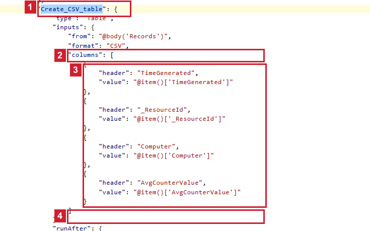

**配列の範囲：** ①Create_CSV_table、②inputs.columnsの開始 `[`、③4列のheader / value、④終了 `]`。これは編集用Codeの画面で、実行履歴の参照専用Code previewではありません。

#### 手順4 Publishして公開済みの値を再確認する

変更前の控えと照合し、上の3値とCSV列以外を変更していないことを確認します。**Show draft diff**は比較の補助です。キーの並び替えや`evaluatedRecurrence`の表示差も出るため、色だけで予定変更と判断せず、recurrenceの頻度・間隔・開始日時・タイムゾーンと同時実行1の値を照合します。アクションのinputsなどが欠落していれば公開せず、[公開済み全文からの復元](setup.md#5-パラメーターと保存内容の確認)を行います。

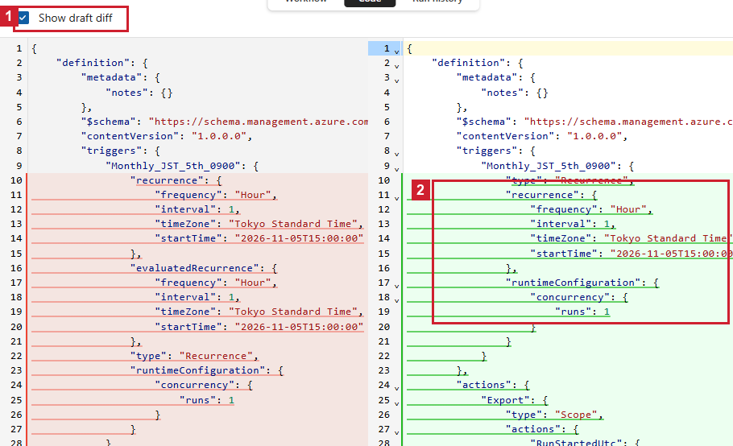

**比較例：** 1時間ごとの既存設定を保持した画面です。この画像を根拠に月次運用をHourへ変更するものではありません。

**Publish**を押し、通知の **Successfully saved workflow**を確認します。Autosaved / Draftは公開完了ではありません。

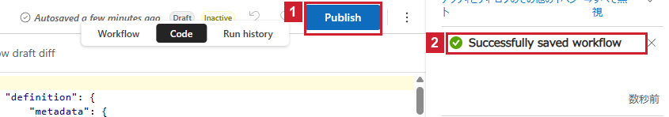

概要へ戻り、Refresh後のJSONビューで**公開済み**のKQL・4列のCOLUMNS・4列のCSVカスタム列・対象月2026-01を再表示します。公開済みJSONでは `properties.parameters` と `properties.definition.actions` の下にあります。Queryの時間範囲 **Set in query**、元のトリガー予定・Tokyo Standard Time・同時実行1、MI接続も保持していることを確認し、試験直前までDisabledにします。

#### 手順5 公開済みワークフローを1回実行する

概要で **Enable**を押し、反映後に **Run → Run**を1回だけ押します。Edit画面のRun draftやアクション単体の再送は使いません。Runが無効ならRefreshし、状態と通知を確認します。要求が失敗した場合は、履歴に新しいrunがないことを確認してから再試行し、連打しません。

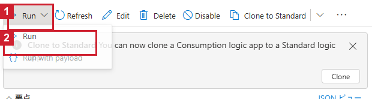

実行履歴をRefreshし、**いま開始した行**のSucceededを確認して開きます。古い3列ダミーの成功行を見ないでください。実行が終了したら、一旦概要でDisableに戻すと、結果確認中や次の設定変更中の定期実行を防げます。

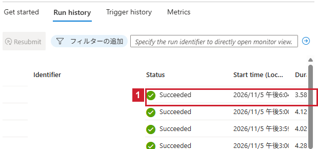

実行画面の **Search workflow actions（虫眼鏡）**を押し、「操作の検索」で **Manifest**、**Create CSV table**、**Read Back CSV**を選びます。見つからなければ検索欄にアクション名を入力します。詳細パネルを閉じてから次のアクションを選びます。

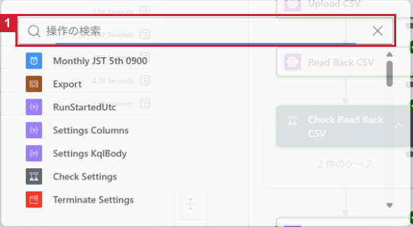

Manifestの**出力**と実行されたQueryTextを次の期待値へ照合します。3列ダミー用の「RowCount=4」は使いません。

| 確認箇所 | Perfダミーの期待値 |
|---|---|
| 期間 | `2025-12-31T15:00:00` 以上、`2026-01-31T15:00:00` 未満（UTC） |
| CSVヘッダー | `TimeGenerated,_ResourceId,Computer,AvgCounterValue` |
| 1月15日開始（UTC）の行 | `/sample-resource`、`sample-computer`、平均 `20` |
| 1月16日開始（UTC）の行 | `/sample-resource`、`sample-computer`、平均 `50` |
| RowCount / manifest.rowCount | JSON数値の **2**。元のdatatableの4レコードではない |
| 保存・読み戻し | Succeeded、本文一致、manifestの `csvReadBackVerified=true` |
| CSV名・参照 | 現在のworkflowName・対象月・開始日時JSTを含み、manifest.filesとcurrent.csvFileNameが実CSV名と一致 |

行順は保証しないため、日時・リソース・コンピューターで照合します。日時は小数部を含むUTC表記となる場合があります。操作者によるファイル取得は[承認済みの取得経路](operations.md#3-csv-の取得と完了判定)で別途確認します。

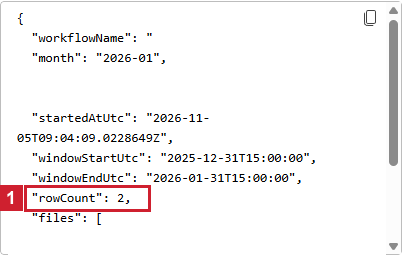

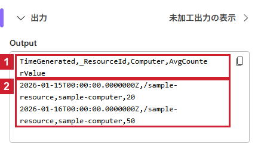

**今回の操作画面例：** ManifestのrowCountは2です。Create CSV tableのOutputでヘッダーと2行の平均を確認できますが、これはCSV生成結果です。**保存成功は別に**Read Back CSVの実BodyとCheck Read Back CSVのSucceeded、Manifestの`csvReadBackVerified=true`を確認します。Outputの表示上の折り返しはデータ行の追加ではありません。

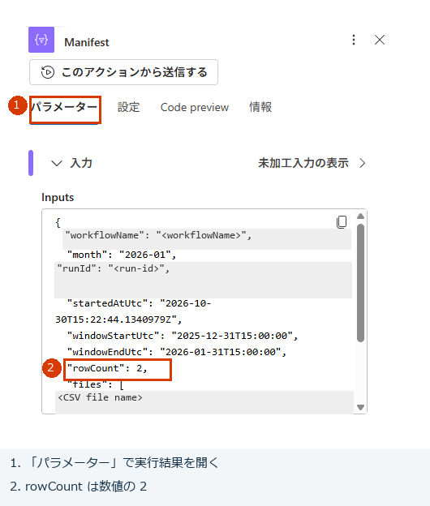

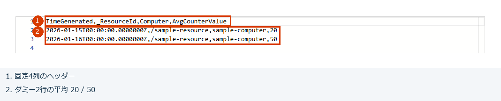

**Perfの結果例：** manifestは`rowCount=2`、CSVは固定4列・平均20 / 50の2行です。CSV画像はダミーの**内容例**であり、取得経路・NW条件やBOMの確認を証明するものではありません。導入先では承認済み経路で実ファイルを確認します。

#### 手順6 0件と正常復元を確認する

Disabled・Runningなしを確認し、Codeで外側 `parameters.MONTH_OVERRIDE.value` **だけ**を `"2025-11"` にしてPublishします。KQLと4列設定は変えません。手順4～5と同じ公開値の確認・通常Runを行い、0行・BOM＋上記4列ヘッダー＋CRLF、数値rowCount=0、読み戻し成功を確認します。

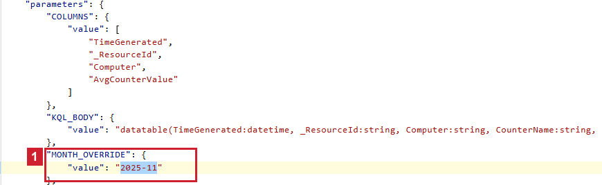

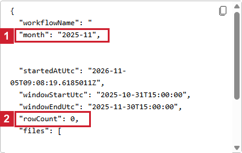

0件の確認後、無効化し、対象月だけ `"2026-01"` へ戻せば同じPerfダミーの2行試験に戻れます。KQL・COLUMNS・CSV列を3列ダミーへ戻す必要はありません。

**列不整合も試す場合だけ：** 無効化して対象月を2026-01へ戻し、COLUMNSは正しいまま**カスタム列だけ逆順**にします。Publish・実行後にFailed / SchemaMismatch、Upload CSV / Upload CurrentのSkippedを確認します。無効化し、正しいカスタム列へ戻してPublish・再実行し、2行・平均20 / 50の成功へ復元します。

#### 手順7 試験前へ戻すか、本番Perfへ進む

**試験前の3列ダミー環境へ戻す場合：** 無効化し、手順1で控えた `properties.definition` をCodeの `definition`、`properties.parameters` を外側 `parameters` へ戻してPublishします。公開済みJSONを控えと照合し、元のKQL・3列・対象月・接続・トリガー予定を確認します。元がEnabledなら、設定復元後に有効化します。1時間ごとの試験を続ける場合も、元のHour / 1を維持します。公開済みのリソースJSON全体をCodeへ貼らないでください。

**本番Perfへ進む場合：** 無効化し、KQL_BODYを§3.1の **Perfから始まる全文**、MONTH_OVERRIDEを空文字へ戻してPublishします。COLUMNSとカスタム列は4列を維持します。Codeでは[perf-cpu-daily.json](../settings/perf-cpu-daily.json)の `KQL_BODY.value` の**引用符付きJSON文字列だけ**をコピーして、外側 `parameters.KQL_BODY.value` の文字列だけを置き換えます。ファイル全体やエスケープされていない生KQLを貼りません。実テーブルの存在・権限・保持期間・データ・結果の受入前は無効のままにし、ダミーKQLのまま本番運用を開始しません。Hourly試験をしていた場合は、**本番運用開始前に**毎月5日09:00 JSTなど承認済みの月次予定へ戻し、将来の開始日時・次回予定・同時実行1を確認します。

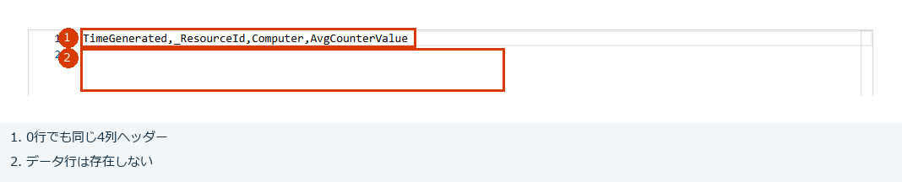

**手順5の内容例：** データ行がなくてもヘッダーは4列のままです。0件をエラーの代替結果として扱わず、正常応答・数値rowCount=0・読み戻し成功を合わせて確認します。

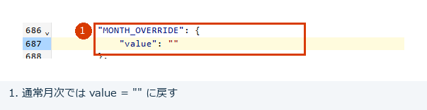

**手順7の復元例：** `MONTH_OVERRIDE.value`は空文字です。KQLは本番Perf本文へ戻し、COLUMNSとCSVカスタム列は4列を維持してPublishします。対象月だけの解除で、ダミーKQLのまま本番化しないでください。

### 3.3 他の業務 KQL に適用する

以下の 3 箇所を顧客の業務に合わせます。

```kusto
<対象テーブル>
| where <UTC の日時列> >= start and <UTC の日時列> < end
// ここに顧客の抽出条件・集計を入れる
| project <CSV に出す列を順番に列挙>
| project bag=pack_all()
```

山括弧の箇所を実際の名前へ置換します。これは説明用のひな形で、そのままでは実行できません。

- 既存の `ago(30d)`、`now()` や固定日付による対象期間指定は、上記の `start` / `end` を使う条件へ置き換える。`let start` / `let end` はワークフローが付加するので本文に重複宣言しない。
- 時間条件は対象の日時列に適用する。`join` / `union` 等で別テーブルも参照する場合は、その入力にも必要な期間条件を適用する。任意の KQL 全体へワークフローが自動で時間フィルターを挿入するわけではない。
- 最後から 2 行目の `project` と `COLUMNS` の名前・列順を一致させる。集計後に `TimeGenerated` がなくても、出力列を合わせればよい。
- `Create_CSV_table` のカスタム列配列も同じ順にする。各要素の `header` は列名、`value` は `@item()['列名']`。プロパティバッグ内のキー順は保証されないため、CSV の「自動」列設定は使用しない。余分な入力キーはCSVに出さず、必要列の不足は検査で失敗させる。
- 最後の `| project bag=pack_all()` はコネクタ応答を共通化するため残す。CSV に `bag` という列を出す意味ではない。
- `COLUMNS` は重複のない文字列配列。列名にはカンマ・引用符・改行を避け、単純な名前を使う。列不足やヘッダー不一致は失敗として扱い、検査を削除して回避しない。
- 対象テーブルの存在、Analytics プラン、MI の閲覧権限、取り込み・保持期間を確認する。評価 LAW には実データの AzureActivity があるとは限らない。実データがなければ[ダミー試験](validation.md#2-実データ不要のダミーテスト)を使う。
- 約 16 MiB / 500,000 行 / クエリ 100 秒・コネクタ 110 秒の制限と、サンプルの 500,000 行以上停止は変わらない。自動分割・任意 KQL の自動修正はない。

## 4. portal で切り替える

1. Logic App を **Disabled** にし、Running がないことを確認する。現在の KQL、列、対象月、有効状態、公開済みの定義全体を台帳へ控える。
2. 対象パターンの `.kql` と対応する `COLUMNS` を上表から選ぶ。まず試験対象月を `MONTH_OVERRIDE` に指定する。
3. Logic App の **パラメーター**画面で実際の値を編集できる場合は、`KQL_BODY` に `.kql` 本文を、`COLUMNS` に対応する配列を入力する。KQL 本文入力欄には JSON の外側の引用符や `\n` を貼らず、改行された本文を使う。**Actual value が編集不可の場合は次のコードビューを使い、Default value だけを変更して代替しない。** 外側の設定値がある場合、既定値を変更しても実際の値は置き換わらない。
4. パラメーター画面から編集できない場合は **開発ツール → ロジック アプリ コード ビュー**で、外側の `parameters.KQL_BODY.value` と `parameters.COLUMNS.value` を変更する。JSON 文字列では改行・引用符のエスケープが必要なため、対応する `.json` の **この 2 項目だけ**を転記する。`MONTH_OVERRIDE` は試験対象月を別途指定する。

   **列の名前・数・順序が変わる場合は追加で**、デザイナーの `Export → Create_CSV_table` を開き、**列 / Columns をカスタム / Custom**にする。ヘッダーと対応する値の式を `COLUMNS` と同じ順で設定する。コードビューの場合は `definition.actions.Export.actions.Create_CSV_table.inputs.columns` を、対応する `.csv-columns.json` の配列で置き換える。他の入力や `runAfter` を消さない。たとえば操作別集計は次の配列を使う。

   ```json
   [
     {"header":"OperationNameValue","value":"@item()['OperationNameValue']"},
     {"header":"ActivityStatusValue","value":"@item()['ActivityStatusValue']"},
     {"header":"RecordCount","value":"@item()['RecordCount']"}
   ]
   ```

   顧客独自の列では `header` と `value` の列名を両方合わせる。ヘッダーだけを並べ替えると、見出しと値の対応を壊すため行わない。

5. `definition.parameters` は型・既定値の定義なので、実設定と混同しない。`LAW_RESOURCE_ID`、`STORAGE_ACCOUNT_NAME`、`$connections`、期間計算アクションは保持する。設定 JSON 全体で置き換えて実 ID をプレースホルダーへ戻したり、ワークフロー定義全体を上書きしたりしない。
6. 保存前にエディターへフォーカスし、KQL・列・対象月・接続を含む全文が意図どおりであることを確認する。貼付で旧内容が残ったり JSON が二重になったりした場合は修正し、自動保存エラーがないことを確認してから **Publish** する。公開成功通知と、再表示した値・型・カスタム列を確認する。Draft 自動保存だけで完了としない。Query の時間範囲は **Set in query** を維持する。
7. 将来の開始日時と次回予定を確認後、[手動実行](validation.md#b-月次を待たずに手動実行する)の1～3に従って有効化し、1回だけ実行する。実行履歴の `QueryText` で今回公開したKQLと期間を確認し、**そのKQL用の期待値**で列・件数・保存・読み戻し・manifest / currentを照合する。Perfの実データがない場合は§3.2を使い、共通3列ダミーの設定・期待値に戻さない。
8. 問題があれば無効化して控えた KQL・列・対象月へ戻し、再度 Publish して確認する。ネットワーク公開・キー認証や検査削除で回避しない。
9. 合格後は本番 KQL と列を維持し、`MONTH_OVERRIDE` を **空文字**へ戻して Publish する。承認した月初業務日の次回予定を確認してから有効化する。評価のままなら無効で保持する。

実行履歴の `QueryText` 出力で、ワークフローが付加した UTC の `start` / `end` と実際の KQL を確認できます。Log Analytics のログ画面で事前確認する場合は、UTC の期間宣言を別途付けた試験用コピーを使います。試験用の宣言を `KQL_BODY` に戻さないでください。履歴・クエリには機密情報が含まれ得るため、共有先と権限に注意します。

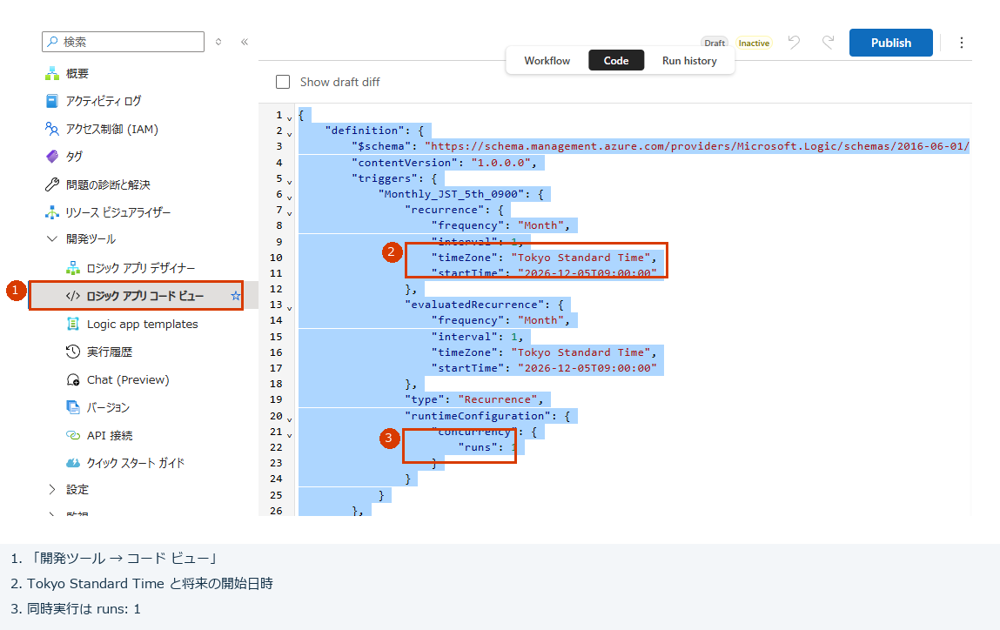

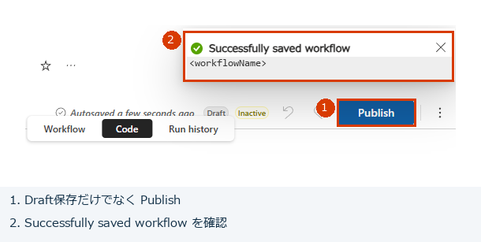

**切替操作の例：** コードビューではKQL・COLUMNSの**外側の実値**と、CSVアクションの**内側のカスタム列**を別々に更新します。画像は定義の先頭と公開通知の例です。実値・型・CSV列はPublish後の再表示まで確認します。

## 5. 複数KQLを1つのStorage Accountへ保存する

**1ワークフロー1KQL、1実行1CSV** とし、KQLごとに月次実行を有効にします。基盤は共有し、KQLごとにワークフロー、システムMI、管理接続2個、ロール割り当て2個を用意します。すべてのワークフローで同じStorage Account名と**既存LAWのARM ID**を指定します。追加KQLのためにLAWを作成したり、既存LAWの保持・取り込み・ネットワーク設定を変更したりしません。

| KQLの例 | workflowName の例 | 同じ exports 内の current |
|---|---|---|
| Perf 日次CPU平均 | `lawexp-perf-cpu` | `lawexp-perf-cpu/<YYYY-MM>/current.json` |
| 操作履歴の明細 | `lawexp-activity` | `lawexp-activity/<YYYY-MM>/current.json` |
| 別の顧客KQL | `lawexp-<用途>` | `lawexp-<用途>/<YYYY-MM>/current.json` |

```text
<共通のStorage Account>
  exports（共通コンテナー）
    lawexp-perf-cpu/<YYYY-MM>/
      current.json
      runs/<実行日時JST>_<run-id>/
        lawexp-perf-cpu_<対象月>_<実行日時JST>.csv
        manifest.json
    lawexp-activity/<YYYY-MM>/
      current.json
      runs/<実行日時JST>_<run-id>/
        lawexp-activity_<対象月>_<実行日時JST>.csv
        manifest.json
```

`workflow().name` をBlob名の先頭に自動で付けます。コンテナーを追加せず、仮想フォルダーを含む **Blob名** で分離する方式です。manifest と current にも `workflowName` を記録し、current の `path` はワークフロー名を含むコンテナー基準の相対パスになります。

### CSVと実行フォルダーの命名

用途名は **`workflowName` そのもの**です。KQL追加時に分かりやすい名前を指定すれば、保存先とCSV名へ自動で反映されます。別のファイル名パラメーターを追加したり、BlobアクションをKQLごとに書き換えたりする必要はありません。

| 対象 | 規則・例 |
|---|---|
| CSV名 | `<workflowName>_<対象月yyyy-MM>_<実行日時yyyyMMdd-HHmmss>-JST.csv` |
| 例 | `lawexp-perf-cpu_2026-09_20261026-232101-JST.csv` |
| 実行フォルダー | `runs/<実行日時yyyyMMdd-HHmmss>-JST_<run-id>/` |
| 最新の利用対象 | `<workflowName>/<対象月>/current.json` の `path` と `csvFileName` |

対象月と実行日時は別の情報です。9月分を10月26日に再取得した場合も、対象月は `2026-09`、実行日時は10月26日となります。日時は処理開始時に1回だけ取得し、JSTへ変換します。KQLの実行やコネクタの再試行で日をまたいでも、同じ実行のCSV名・格納先は変えません。

日時の照合元は、先頭アクション `RunStartedUtc` の値を記録する **manifest.startedAtUtc** です。概要履歴の受付時刻と秒がずれる場合があるため、CSV名はこの値のJST換算と比較してください。

**CSV名には実行IDを入れません。** 実行フォルダーは一覧の先頭を日時にし、末尾に完全な実行IDを残します。秒単位の日時だけでは同じ秒の別実行を識別できないためであり、短縮IDや日時だけのフォルダーにはしません。同じ秒のCSV名が一致しても、別フォルダーに保存され上書きしません。manifest/currentにも実行IDを保持し、監査や実行履歴との照合に使います。複数runを端末へ取得する場合はフォルダーを維持し、同名CSVを同じ場所へ上書きコピーしないでください。

### 新しいKQLで指定する項目

追加KQLの登録先は、**第2段階ARMの入力欄**です。設定ファイルを置くだけで自動登録する仕組みや、KQL一覧をまとめて実行する機能ではありません。次の入力シートをKQLごとに用意します。

| 準備する内容 | 新規デプロイのARM入力 | 作成後の設定箇所 | 指定例 |
|---|---|---|---|
| 用途を表す一意な名前 | `workflowName` | 新しいLogic Appの名前。後から別名へ変更する場合は別リソースとして扱う | `lawexp-perf-memory` |
| KQL本文 | `kqlBody` | `KQL_BODY` | §3の共通形で、期間条件・集計・project・bagを含む本文 |
| CSVの列名・順序 | `columns` | `COLUMNS` と `Create_CSV_table` のカスタム列 | `["TimeGenerated","_ResourceId","Computer","AvgCounterValue"]` |
| 試験対象月 | `monthOverride` | `MONTH_OVERRIDE` | 試験は `2026-01`、通常運用は空文字 |
| 初回の実行予定 | `startTime` | Recurrenceの開始日時 | 承認済みの将来の5日09:00 JST。Zや時差を末尾に付けない |
| 共通の保存先 | `storageAccountName` | `STORAGE_ACCOUNT_NAME` | 第1段階のStorage名をそのまま使う |
| 共通の取得元 | `lawResourceId` | `LAW_RESOURCE_ID` はARMが設定 | 導入手順§1で控えた既存LAWの完全なARM IDをそのまま使う。第1段階の出力ではない |

用途名は英小文字・数字・ハイフンで内容が分かる名前を推奨します。アカウント内で重複しない名前を台帳で確認し、機密情報は名前に入れません。列が同じなら既存の `.csv-columns.json` を再利用できます。列が異なる場合、新規ARM入力の `columns` からカスタム列も生成されます。作成後に列を変える場合だけ、§4に従いカスタム列も変更します。

### 追加例：CPUとは別にメモリのKQLを登録する

`workflowName="lawexp-perf-memory"` とし、次を `kqlBody` に指定します。`columns` は上表の4列です。これは指定方法の例であり、対象環境に該当カウンターがあることを別途確認してください。

```kusto
Perf
| where TimeGenerated >= start and TimeGenerated < end
| where CounterName == "Available MBytes"
| summarize AvgCounterValue=avg(CounterValue) by _ResourceId, Computer, bin(TimeGenerated, 1d)
| project TimeGenerated, _ResourceId, Computer, AvgCounterValue
| project bag=pack_all()
```

CSV名は自動で `lawexp-perf-memory_<対象月>_<実行日時JST>.csv`、currentは `lawexp-perf-memory/<対象月>/current.json` になります。CPU用ワークフローのKQLやBlobアクションは変更しません。別テーブルの業務KQLでも同じ入力シートを使い、本文・列・期待値をその業務に合わせます。

### portalでKQLを追加する

1. [導入手順](setup.md)§1で取得元の既存LAWを確認し、第1段階は **1回だけ**実施して共通のStorage Account・exportsを作る。LAWは作成しない。2本目以降で第1段階を繰り返したり、別のStorage Accountを作ったりしない。
2. 業務KQLごとに用途を表す `workflowName` を決め、**同じStorage Accountを使う全ワークフローで一意**にする。例の名前は説明用。別RGでも同じ名前を再利用しない。同じ名前で第2段階を再デプロイすると既存ワークフローを上書きするため、追加時は必ず新しい名前にする。
3. 同じ専用RG・リージョンで第2段階 `02-workflow.json` をデプロイする。`storageAccountName` は共通Storageの名前、`lawResourceId` は既存LAWの完全なARM IDを転記し、上表の `workflowName`・`kqlBody`・`columns`・`monthOverride`・`startTime` を追加KQLの内容に合わせる。LAWが別RGでもワークフローの配置先は専用RGのまま。初回は既存のダミー設定で接続を確認してよい。初回のカスタム列は `columns` から生成される。
4. 各ワークフローについて同じ専用RGで第3段階 `03-access.json` を実施する。`workflowName` は今回の名前、`storageAccountName` / `lawResourceId` は第2段階と同じ値を指定する。MIごとにexportsと既存LAWの限定権限を確認し、LAW側の割り当てID・子デプロイ名を台帳へ控える。1本目のMIへの権限だけでは2本目は認可されない。
5. 無効状態で、[§4の変更手順](#4-portal-で切り替える)に従い、そのワークフロー専用のKQL・列へ変更して Publish。ダミーからPerfへ変更する場合は§3.1の4列も反映する。`$connections` はそのワークフロー自身の接続参照を保持し、1本目から流用しない。
6. KQLごとに手動試験し、`OutputNames` と保存済みCSVの用途名・対象月・JST日時、manifestのfiles、currentのpath/csvFileNameを確認する。他KQLのcurrentが変わらないことも確認する。実行内の保存・読み戻しと、承認済み経路からの独立取得は区別する。
7. 合格したワークフローごとに本番KQL、空の `MONTH_OVERRIDE`、承認した開始日時・次回予定を確認して有効化する。すべてのワークフローを毎月手動で切り替える必要はない。監視・再実行もKQLごとに行う。

同じワークフローのKQLを書き換えると、引き続き **そのワークフローの月別current** を更新します。別の業務成果物として毎月残すKQLは、新しいワークフローにしてください。ワークフロー名を変えると保存先も変わります。KQL・列・対象月・ワークフロー名・run IDを台帳で対応付けます。

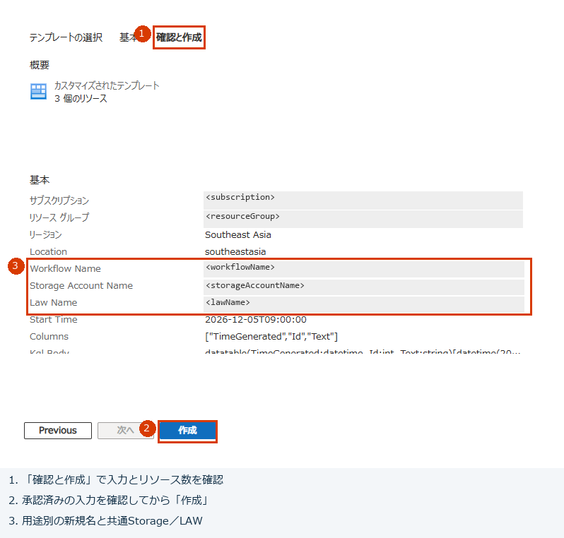

**追加時の入力例：** 画像は新しい一意のworkflowNameと共通Storage名を抜粋しています。実画面では`lawResourceId`も共通の既存LAWのARM IDにします。追加KQLの本文・列・対象月は入力シートとそのKQL用の手順に合わせ、第3段階の権限も新しいMIに対して実施します。

分離は上書き・取り違えを防ぐための論理分離で、アクセス権の分離ではありません。各MIには共通exportsのContributorを付与するため、他のプレフィックスへの操作も権限上可能です。相互のアクセス禁止が要件なら、コンテナー別RBAC等を別途設計します。1ワークフロー内の一括実行、複数ワークフロー間の一括完了・全体排他は実装していません。

## 6. KQLごとの受入

KQLを追加・変更するたびに次を確認します。

| 確認 | 合格条件 |
|---|---|
| 月境界 | 前月開始を含み、当月開始を含まない。JST / UTC の対応が正しい |
| 抽出・集計 | 顧客 KQL の想定件数・値と一致。集計時は元件数と出力行数を区別 |
| 出力列 | `project`・`COLUMNS`・CSV のカスタム列が一致。見出しと値の対応を確認。bag のキー順が変わっても同じ列順。BOM、日本語、特殊文字も保持 |
| 0 件 | 意図した 0 行または集計行となり、CSV ヘッダーが期待どおり |
| 保存 | 読み戻し一致後に manifest / current が成功 |
| 命名 | 用途名・対象月・開始時刻のJST日時がCSV名と一致。manifest.filesとcurrent.csvFileNameが実在するCSVを指す。再実行で旧CSVを上書きしない |
| KQL間の分離 | 同じ月でもワークフロー名別にCSV・manifest・currentが保存され、一方の再実行・0件・失敗で他方のcurrentを更新しない |
| 異常系 | 存在しない列・不正 KQL を失敗扱いとし、成功成果物にしない |
| 復元 | 試験用対象月を空へ戻し、次回予定・有効状態を確認 |

0 件だけでは実データの列や抽出条件を検証できません。想定値が分かる非 0 件の対象月でも確認してください。

ダミーテストの成功だけで本番KQLの正しさを判断しません。実データの非0件・0件、集計値、独立したCSV取得を導入先で受入確認し、[受入確認表](validation.md#3-受入確認表)へ記録してください。

## 公開情報

- [ワークフローの parameters と実行時の値](https://learn.microsoft.com/en-us/azure/logic-apps/workflow-definition-language-schema#parameters)
- [AzureActivity の列とテーブル仕様](https://learn.microsoft.com/en-us/azure/azure-monitor/reference/tables/azureactivity)
- [Perf の列とテーブル仕様](https://learn.microsoft.com/en-us/azure/azure-monitor/reference/tables/perf)
- [Kusto の datetime はUTC](https://learn.microsoft.com/en-us/kusto/query/scalar-data-types/datetime?view=azure-monitor)
- [bin() による時間の区切り](https://learn.microsoft.com/en-us/kusto/query/bin-function?view=azure-monitor)
- [workflow() の name プロパティ](https://learn.microsoft.com/en-us/azure/logic-apps/expression-functions-reference#workflow)
- [convertTimeZone() と日時の書式指定](https://learn.microsoft.com/en-us/azure/logic-apps/expression-functions-reference#converttimezone)
- [Blob名と仮想ディレクトリ](https://learn.microsoft.com/en-us/azure/storage/blobs/storage-blobs-introduction#blobs)
- [KQL の summarize](https://learn.microsoft.com/en-us/kusto/query/summarize-operator?view=azure-monitor)
- [KQL の pack_all()](https://learn.microsoft.com/en-us/kusto/query/pack-all-function?view=azure-monitor)
- [CSV テーブルのカスタム列と値](https://learn.microsoft.com/en-us/azure/logic-apps/logic-apps-perform-data-operations#create-csv-table-action)
- [Monitor Logs コネクタの制限](https://learn.microsoft.com/en-us/azure/connectors/connectors-azure-monitor-logs)
- [Recurrence の設定](https://learn.microsoft.com/en-us/azure/connectors/connectors-native-recurrence)
