# Consumption 導入手順（Azure portal のみ）

[入口](../README.md) → 本書 → [ダミーテスト・受入確認](validation.md) → [運用・削除](operations.md)

## 0. 承認・停止条件

本一式は**既存のLog Analyticsワークスペース（LAW）を取得元とし、保存基盤・ワークフローだけを新規作成**します。導入先ごとに次の条件を確認し、承認を得てから作成します。本番利用の条件は[受入確認](validation.md)を参照してください。

| 確認事項 | 条件 |
|---|---|
| ネットワーク要件 | Storage の Public 拒否と信頼されたサービスの例外の併用を許容。Private Endpoint 必須ではない |
| 認証 | システム割り当て MI。Shared Key / SAS / ユーザー接続の利用不可 |
| 配置・費用 | 新規の専用RG、承認済みリージョン（例Southeast Asia）、Storage・Consumption・接続2個と削除範囲を承認。既存LAWは作成・削除対象外。既存LAWへのクエリによる負荷・費用も確認 |
| 既存LAW | 同じテナント内の承認済みLAW。別RG・別サブスクリプションでもARM IDで指定。管理コネクタからの公開クエリが許可されていることを確認し、保持・取り込み・ネットワーク設定を変更しない |
| 権限 | 専用RGのリソース作成とexportsのロール割り当て、既存LAWのロール割り当てが可能。第3段階の子デプロイを実施する既存LAWのRGにもデプロイ権限が必要。[Contributorだけではロール割り当て不可](https://learn.microsoft.com/en-us/azure/role-based-access-control/built-in-roles/privileged#contributor)。不足時は対象スコープの管理者に実施を依頼 |
| 管理 | portal / Entra ID / Azure 管理へのブラウザーアクセス。組織 Policy・リージョン・プロバイダー制限に適合 |
| CSV 取得 | 保存の評価とファイル取得の評価を区別し、[承認済みの取得経路](operations.md#3-csv-の取得と完了判定)を決定 |

Storage の Public network access は初回から **Disabled** にします。例外接続に失敗しても Enabled に変更しません。設定の一時解除を目的とするタグも付けません。

信頼されたサービスの例外とMIの権限は別条件です。[BlobのシステムMI接続](https://learn.microsoft.com/en-us/azure/connectors/connectors-create-api-azureblobstorage#access-blob-storage-in-same-region-with-system-managed-identities)と[Storageのネットワーク制限](https://learn.microsoft.com/ja-jp/azure/storage/common/storage-network-security-limitations)を確認し、構築後はダミーテストで接続を受入確認します。

## 1. 評価用 RG と入力の準備

1. Azure portalで **Log Analyticsワークスペース**から取得元の既存LAWを開く。名前だけで選ばず、サブスクリプション・RG・所有者と利用承認を照合する。
2. LAWの **概要 → JSONビュー**で `id` をコピーし、台帳へ控える。形式は `/subscriptions/<LAW_SUBSCRIPTION_ID>/resourceGroups/<LAW_RESOURCE_GROUP>/providers/Microsoft.OperationalInsights/workspaces/<LAW_NAME>`。これを第2・3段階の `lawResourceId` に使う。概要の「ワークスペースID」（GUID）やカスタマーIDは使わない。
3. LAWのIAM、公開クエリ設定、保持日数、取り込み・ネットワーク設定を作業前に記録する。**既存LAWの設定は変更しません。** 公開クエリが無効、またはネットワーク制限により管理コネクタから接続できない場合は、取り込みやPublic設定を変更して回避せず、所有者と確認して停止する。
4. 保存基盤の対象サブスクリプションを確認し、承認された**新規の専用RG**を作成する。既存LAWのRGを保存基盤の作成先や削除対象として指定しない。LAWとStorage・Logic Appのリージョンを一致させるためにLAWを移動・再作成しない。
5. 新規リソース名、作成者、費用承認、削除対象、作業前の資源一覧を台帳へ記録する。既存LAWとそのRGは「継続利用・削除対象外」と明記する。
6. 各段階で **カスタム テンプレートのデプロイ → エディターで独自のテンプレートを作成する**を開き、対象ARM JSONの全文を貼り付けて保存する。入力例は参考で、`<...>` を残したまま投入しない。
7. **確認と作成**で検証結果を確認する。失敗したら詳細を保全して停止する。CLI / Cloud Shellに切り替えない。

空の既定テンプレートのまま進めず、貼り付けたリソース・パラメーターが表示されたことを確認してください。

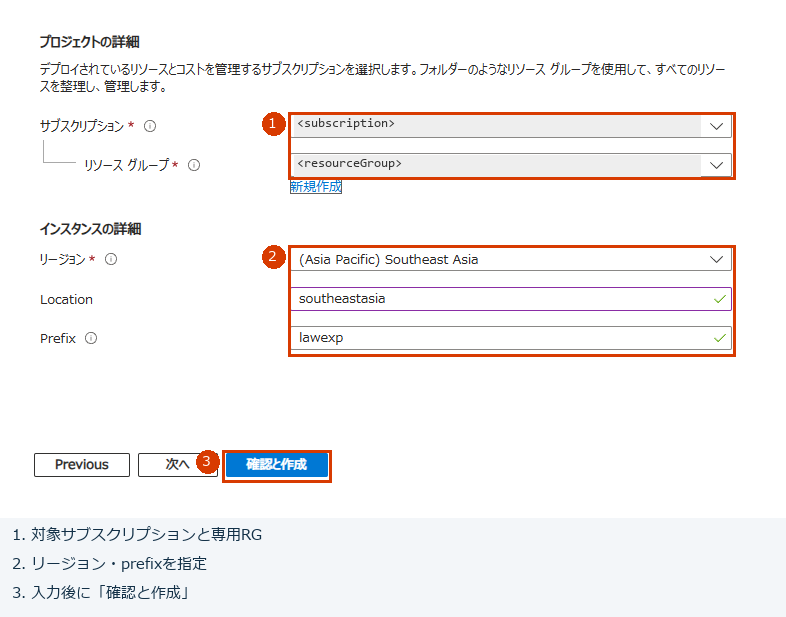

**画面例：** テンプレート全文を保存した後の「基本」です。①対象サブスクリプション・専用RG、②その段階の入力、③確認と作成の順に進みます。第2・3段階も同じ入口を使います。

公式：[portal から ARM テンプレートをデプロイ](https://learn.microsoft.com/en-us/azure/azure-resource-manager/templates/deploy-portal)。

## 2. 第 1 段階：保存用Storageとexports

[01-foundation.json](../infra/01-foundation.json) と [入力例](../infra/01-foundation.parameters.json)を使用します。

| ARM 入力 | 内容 |
|---|---|
| location | 承認済みリージョン（例 `southeastasia`） |
| prefix | Storageの名前生成用プレフィックス。入力欄の文字数・文字種制限に従う |

1. 専用 RG と承認されたリージョンを選ぶ。名前の一意性・文字数制限に従って入力する。
2. デプロイ成功後、**出力**のStorage名とexportsのリソースIDを台帳へ控える。既存LAWのIDは§1で控えたものを使い、この段階の出力から取得しない。
3. Storage → **ネットワーク**と **構成**で次を確認する。

   | 設定 | 必須値 |
   |---|---|
   | Public network access | Disabled |
   | 既定ネットワーク動作 | Deny |
   | 信頼されたサービス一覧の Azure サービスによるアクセス | 許可（AzureServices） |
   | ストレージ アカウント キーへのアクセスを許可 | 無効 |
   | Blob 匿名アクセス | 無効 |
   | 安全な転送 / 最小 TLS | 必須 / 1.2 |

4. 作成対象がStorage・Blobサービス・exportsの3リソースだけで、LAWが作成されていないことを確認する。既存LAWへのログ取り込み・テーブル作成はダミー試験にも不要。

出力名は `storageAccountName` / `exportsContainerResourceId` です。LAW名・LAW ID・保持日数の入力や出力はありません。

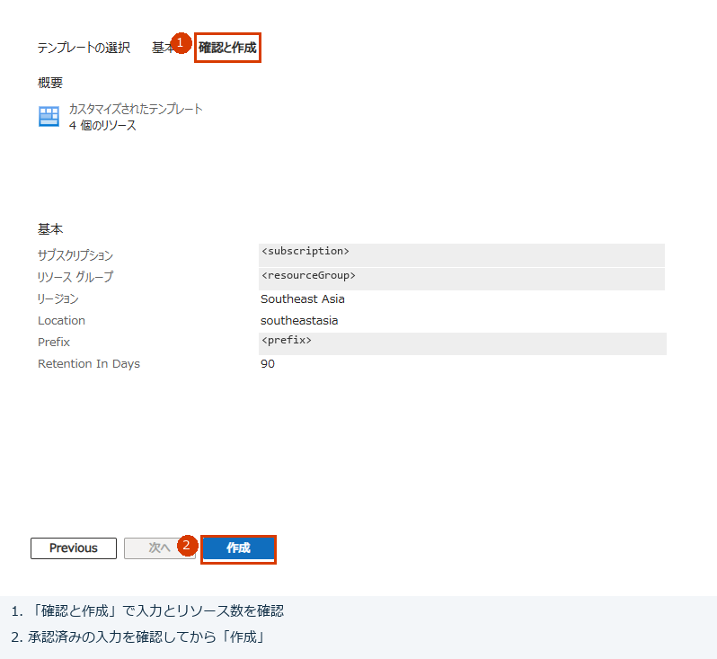

**画面例：** 第1段階の「確認と作成」。確認対象の入力と作成ボタンを抜粋しています。実画面ではStorage・Blobサービス・exportsの3リソースであることを確認して作成します。他の段階ではリソース数・入力が異なります。

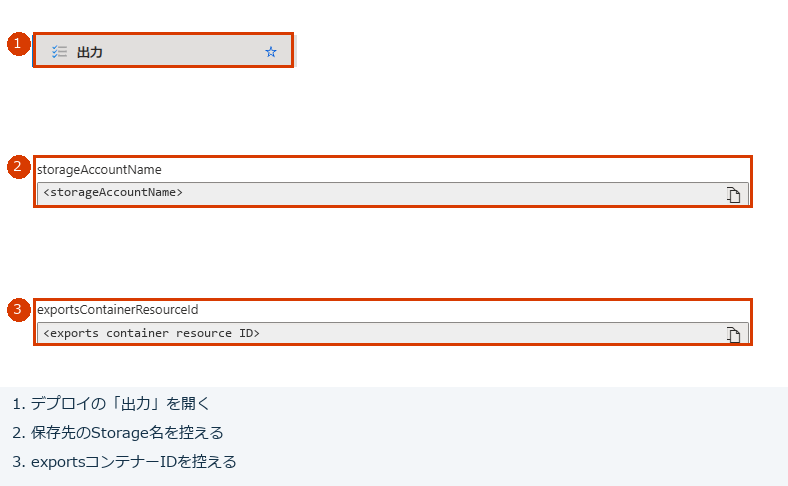

**画面例：** デプロイ成功後に①出力を開き、②Storage名と③exports IDを台帳へ控えます。確認対象だけを抜粋した画像です。既存LAWのARM IDはLAWの概要から別に控え、画像の伏せ字を入力値として使用しないでください。

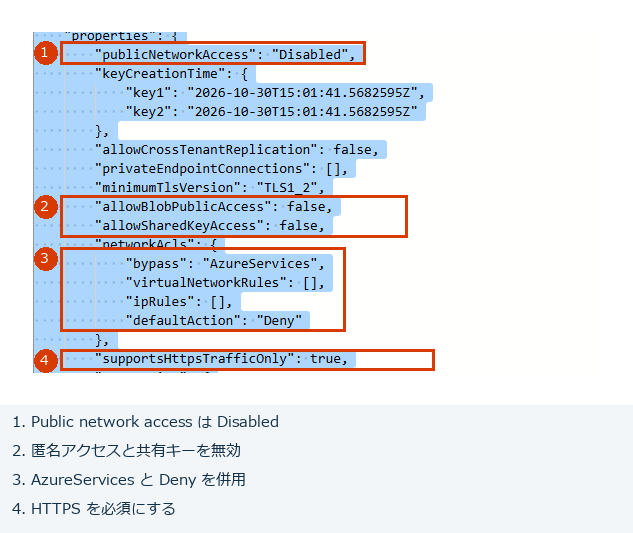

**確認の補助：** Storageの概要 → **JSON ビュー**でも `properties.publicNetworkAccess`、`allowBlobPublicAccess`、`allowSharedKeyAccess`、`networkAcls`、`supportsHttpsTrafficOnly` を参照できます。赤枠①～④を上の必須値と照合します。JSONビューは参照専用で、設定変更やアクセス制限の解除に使いません。

Storage ブラウザーでデータが見えないことを、コンテナーの作成失敗と即断しません。管理プレーンでのコンテナー存在確認と、データプレーンのアクセスは別です。

## 3. 第 2 段階：Consumption と管理接続

[02-workflow.json](../infra/02-workflow.json) と [入力例](../infra/02-workflow.parameters.json)を使用します。

| ARM 入力 | 内容 |
|---|---|
| location | 第 1 段階と同じリージョン |
| workflowName | 新規 Consumption の名前兼KQL識別名。同じStorage Accountを使う全ワークフローで一意にする。Blob名の先頭にも使う |
| storageAccountName | 第1段階の同名出力 |
| lawResourceId | §1で控えた既存LAWの完全なARM ID。LAW名だけやワークスペースGUIDではない |
| startTime | 初回の承認済み JST 日時（以下の例参照） |
| columns / kqlBody / monthOverride | ダミー評価用の値は入力例に同梱。columns は文字列配列、kqlBody は文字列。評価後の本番設定は別途行う |

1. 第1段階と同じ専用RG・リージョンを選ぶ。Storage名は第1段階の出力、`lawResourceId` は§1で控えた既存LAWのARM IDを入力する。既存LAWのRGが別でも、デプロイ先は専用RGのままにする。
2. ワークフロー名を決める。管理接続名はテンプレートがワークフロー名から生成する。既存の資源と衝突する名前を使わない。
3. 開始日時には、例えば **`2026-12-05T09:00:00`** をコピーする。これは **2026 年 12 月 5 日 09:00 JST**。実施時点で少なくとも 1 か月先の、承認済みの月の 5 日 09:00 に変更する。末尾 **Z / +09:00 は付けず**、timeZone は **Tokyo Standard Time** を維持する。
4. デプロイする。Logic App は**無効状態**で作成される。第 3 段階を終えるまで有効化しない。
5. Logic App → **ID**でシステム割り当てが有効であることを確認し、プリンシパル ID を台帳へ控える。
6. **API 接続**に Monitor Logs と Blob の 2 個があることを確認する。認証は **Logic Apps Managed Identity / マネージド ID**。ユーザーによるサインインやキー入力を要求されたら、その方法で認可せず停止する。

出力は `workflowName` / `workflowResourceId` / `workflowPrincipalId` / `monitorConnectionId` / `blobConnectionId`。台帳と実リソースの ID が一致することを確認します。

Monitor LogsとBlobはMI認証の**管理コネクタ**です。接続はテンプレートが作成し、ワークフローの `$connections` に設定します。

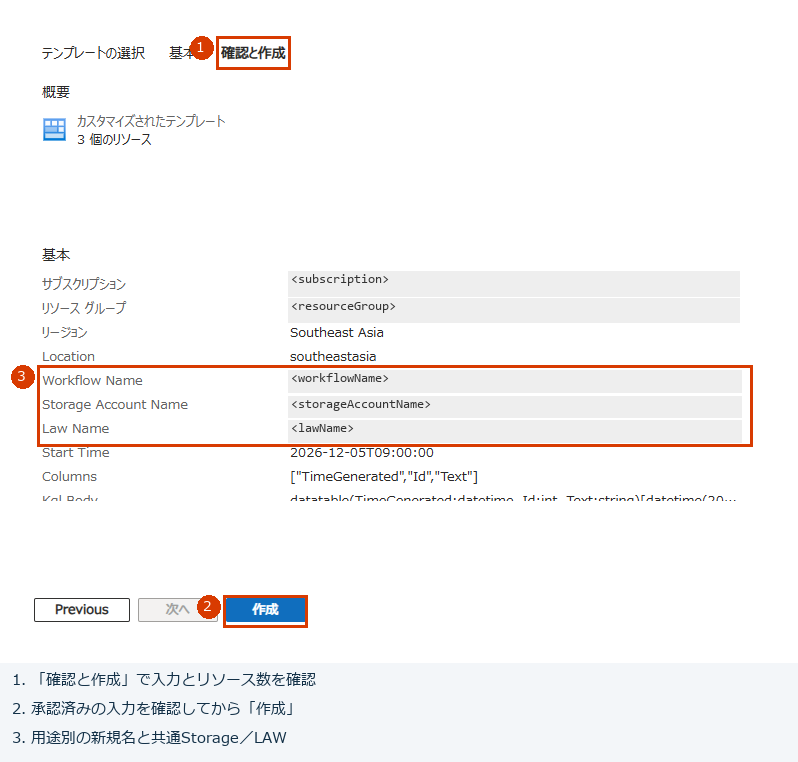

**画面例：** 第2段階の確認から、新しい一意の`workflowName`と共通Storage名を抜粋しています。実画面では`lawResourceId`に既存LAWのARM ID、開始日時に承認済みの将来日時、列に初回ダミーの3列も指定します。LAW IDは第1段階の出力ではありません。

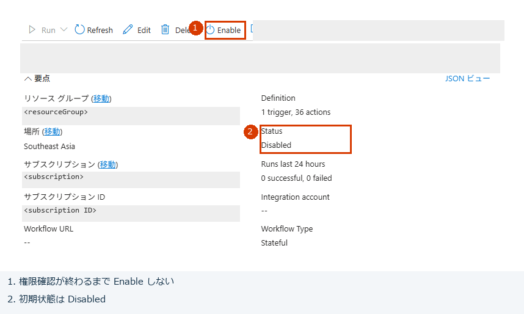

**画面例：** 作成直後の概要。②StatusがDisabledであることを確認し、第3段階の権限確認まで①Enableを押しません。

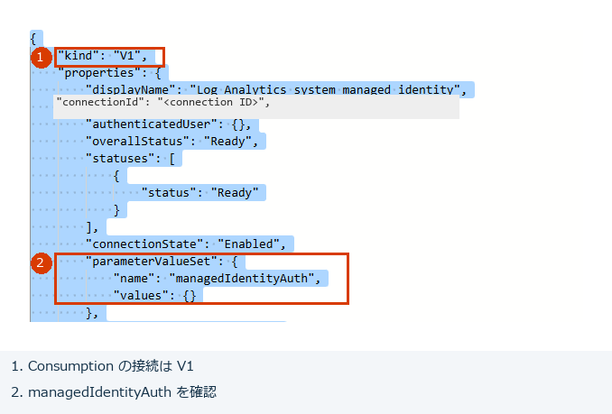

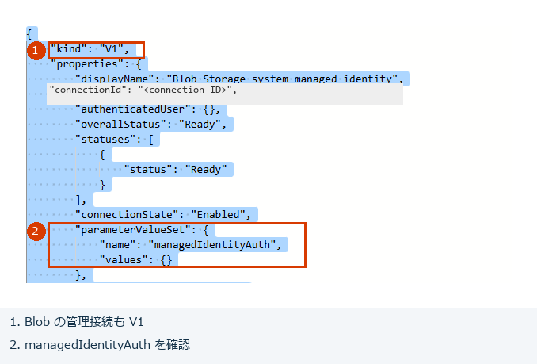

**認証の確認例：** 各API接続の概要 → JSON ビューで①`kind: V1`、②`parameterValueSet.name: managedIdentityAuth`を参照します。ユーザーのサインインやキー認証へ切り替えず、システムMIであることはLogic AppのID画面と合わせて確認してください。

公式：[Consumption の portal 管理](https://learn.microsoft.com/en-us/azure/logic-apps/quickstart-create-example-consumption-workflow)、[MI 認証と接続 ARM](https://learn.microsoft.com/en-us/azure/logic-apps/authenticate-with-managed-identity)、[Recurrence の初回実行](https://learn.microsoft.com/en-us/azure/connectors/connectors-native-recurrence)。

## 4. 第 3 段階：アプリ MI の権限

[03-access.json](../infra/03-access.json) と [入力例](../infra/03-access.parameters.json)を使用します。

1. 第1・2段階と同じ専用RGでデプロイする。ARM入力の `workflowName` / `storageAccountName` は今回の名前、`lawResourceId` は第2段階と同じ既存LAWのARM IDを正確に転記する。プリンシパルIDはワークフローから取得するため、入力しない。
2. 第3段階はexportsへの権限を専用RGで付与し、既存LAWのRGへ内包した権限用の子テンプレートをデプロイして、LAWスコープのLog Analytics Readerだけを付与する。既存LAW本体や設定をデプロイし直さない。既存LAWのRGでのデプロイ権限がない場合は管理者へ実施を依頼し、LAWを新規作成して回避しない。
3. デプロイ後、**exportsコンテナー**のIAMでそのMIに **Storage Blob Data Contributor（ストレージ BLOB データ共同作成者）**、**既存LAW**のIAMで **Log Analytics Reader（Log Analytics 閲覧者）**があることを確認する。
4. 権限は上記2つの対象スコープに限定し、Storageアカウント・RG・サブスクリプション全体へ広げない。既存のユーザー・アプリの割り当てを削除／変更しない。
5. RBACの反映を待つ。接続エラー時は反映・対象・スコープを確認し、ネットワーク制限を解除しない。

出力の `blobRoleAssignmentId` / `lawRoleAssignmentId` / `lawAccessDeploymentName` を台帳に控えます。割り当て先が第2段階の `workflowPrincipalId` と一致し、LAW側のIDが既存LAWのサブスクリプション・RG・名前を含むことを確認します。既存LAWのRGに残る今回の権限割り当てと子デプロイ履歴は、専用RGの削除では消えないため後片付けの台帳にも記録します。

**MI側から確認する方法：** Logic Appの **設定 → ID → システム割り当て済み**で、状態オンとオブジェクト（プリンシパル）IDを照合し、**Azure ロールの割り当て**を開きます。対象サブスクリプションを選び、上記2ロールの割り当て先が今回のMIであることを確認します。Blob側はリソース名が `<STORAGE_ACCOUNT_NAME>/default/exports`、種類が `Microsoft.Storage/storageAccounts/blobServices/containers`、LAW側は承認済みLAWの名前と種類であることを台帳の完全なIDと照合してください。Storageアカウント全体への割り当てで代用しません。保存基盤とLAWのサブスクリプションが異なる場合は、選択を切り替えて両方を確認します。この画面は権限の確認であり、CSVの取得成功を示すものではありません。

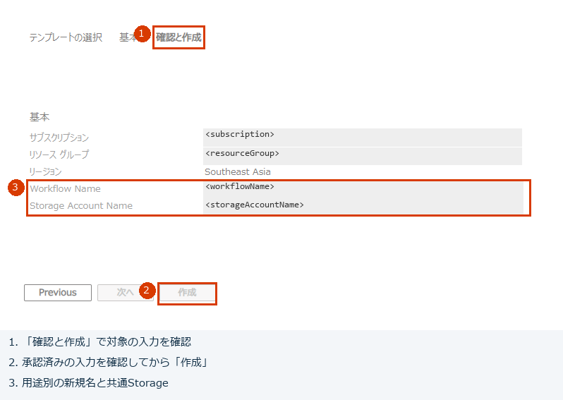

**画面例：** 第3段階からワークフロー名・Storage名と作成ボタンを抜粋しています。実画面では`lawResourceId`も第2段階と照合します。画像では作成ボタンが無効ですが、検証成功後に有効になるのを待ちます。有効にならない場合はエラーを確認して停止し、強制操作しません。

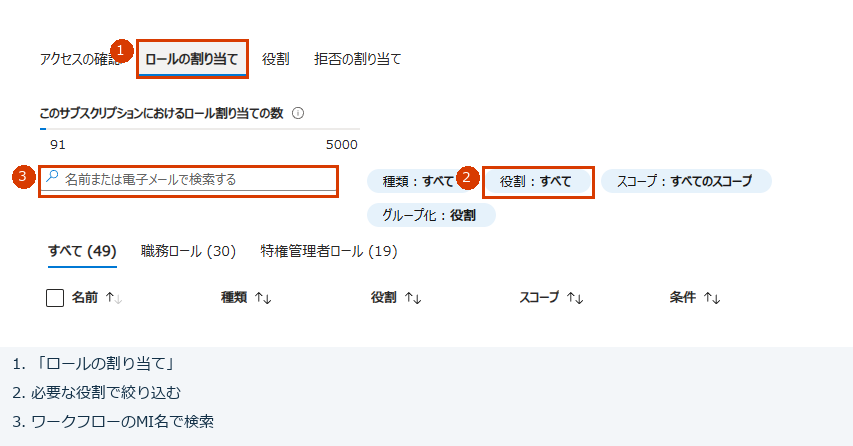

**画面例：** 絞り込み前のIAMです。①ロールの割り当て、②必要な役割、③そのワークフローのMI名で検索します。exportsではStorage Blob Data Contributor、LAWではLog Analytics Readerを選び、対象MIとスコープを確認します。別のユーザーや継承ロールの表示だけで合格にしません。

公式：[Blobデータのロール割り当て](https://learn.microsoft.com/en-us/azure/storage/blobs/assign-azure-role-data-access)、[別RG・別サブスクリプションへの内包テンプレートのデプロイと必要権限](https://learn.microsoft.com/en-us/azure/azure-resource-manager/bicep/deploy-to-resource-group#deployment-scopes)。

## 5. パラメーターと保存内容の確認

Logic App の **パラメーター**、または **ロジック アプリ コード ビュー**で定義と値を確認します。画面名は portal の版で異なります。`definition.parameters` は型・既定値、外側の `parameters` は設定値です。部分 JSON で定義全体や `$connections` を消さないでください。

パラメーター画面の **Actual value** が編集不可の場合はコードビューを使います。外側に設定値があるパラメーターは、**Default value だけを変更しても実際の値を変更できません。**

**編集入口は概要 → Edit → Code**です。開発ツール → ロジック アプリ コード ビューが表示される版では、そこからも変更できます。変更前の全文を控え、外側の `parameters.<名前>.value` を編集して **Publish** します。**Draftの自動保存だけでは反映完了としません。** 公開成功と再表示した値を確認し、試験直前までDisabledを維持します。概要のJSONビューと実行履歴のCode previewは参照専用です。

**3列ダミーの実行が成功し、別KQLへの変更を試す場合は、[Perf形式ダミーへの変更手順](query-patterns.md#手順1-停止して公開済み設定を控える)を順に実施します。** 編集画面・外側parameters・KQLのJSON文字列の貼り付け範囲・CSVカスタム列・Publish・通常Run・結果確認を画像付きで説明しています。COLUMNSとCSVアクションのカスタム列は別設定で、列変更時は両方を合わせます。

概要の **Edit → Code**からもコードビューを開けます。変更前に概要 → **JSON ビュー**で**公開済み**の `properties.definition` と `properties.parameters` を控えてください。Draftとの差分では、変更する値以外に各アクションの `inputs`、接続参照、トリガーの `runtimeConfiguration.concurrency.runs: 1`、予定が欠落していないことを確認します。欠落しているDraftは公開しません。コードビューの `definition` に保全した `properties.definition`、外側の `parameters` に `properties.parameters` を戻してから、必要な値だけを編集します。**リソースJSON全体の `id` / `type` / `properties` を編集用JSONへ貼り付けないでください。** 同時実行設定の削除を理由にPublishが拒否された場合も、設定を削除・無効化せずこの方法で保持します。公開後のJSONビューで変更対象と保持対象を再確認してください（[トリガーの同時実行設定](https://learn.microsoft.com/en-us/azure/logic-apps/logic-apps-workflow-actions-triggers#change-trigger-concurrency)）。

`MONTH_OVERRIDE` を空文字へ戻した後、公開済みコードで外側の設定が省略される場合は、`definition.parameters.MONTH_OVERRIDE.defaultValue` が空文字で、外側に対象月の非空の設定値が残っていないことを確認します。設定値が省略された場合は既定値が使われます（[公式のパラメーター仕様](https://learn.microsoft.com/en-us/azure/logic-apps/workflow-definition-language-schema#parameters)）。

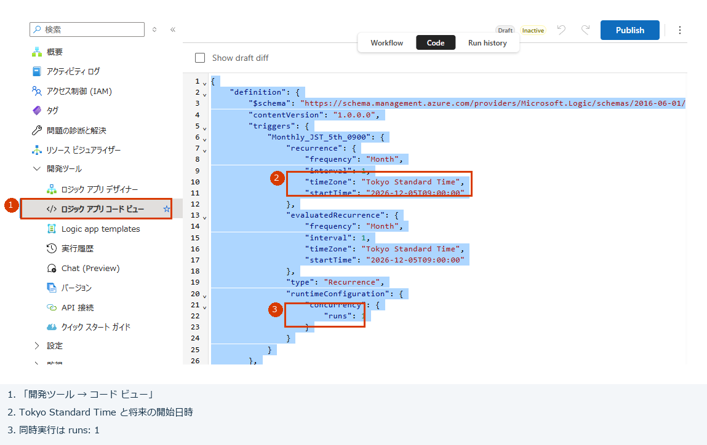

**画面例：** ①コードビューを開き、②タイムゾーン・将来の開始日時、③同時実行1を確認します。画像は定義の先頭です。KQLの貼り付け先はこの範囲ではなく外側の `parameters.KQL_BODY.value` で、定義全体をKQL本文で上書きしません。

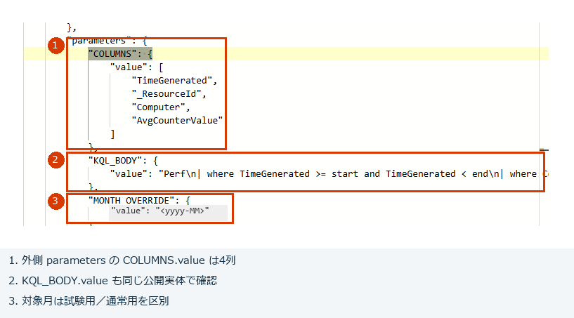

**公開後の確認例：** 概要 → JSON ビューの外側 `parameters` です。①COLUMNS、②KQL_BODY、③対象月を照合します。画像はPerf用4列で、初回ダミーは上の表の3列を使います。JSONビューは参照専用であり、値の編集はコードビューで行います。

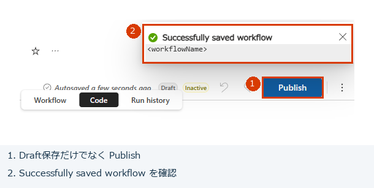

**画面例：** ①Publish後に②公開成功通知を確認し、公開済みの値を再表示します。自動保存の表示だけで試験を開始しないでください。

| ワークフローパラメーター | 用途 |
|---|---|
| LAW_RESOURCE_ID | §1で控えた既存LAWのARM IDと一致。ワークスペースGUIDではない |
| STORAGE_ACCOUNT_NAME | 出力 Storage のアカウント名。URL やコンテナー名ではない |
| MONTH_OVERRIDE | 試験時 `2026-01`、通常月次は空文字 |
| COLUMNS | **配列**。ダミー時 `["TimeGenerated","Id","Text"]`。カンマ区切りの 1 文字列にしない |
| KQL_BODY | [ダミー設定](../settings/sample.json)の KQL。`start` / `end` 宣言はワークフローが付加 |
| $connections | ARM が生成する 2 接続の参照。手動で消さない |

開始日時はワークフローパラメーターではなく、トリガーの `recurrence.startTime` に設定されます。`START_TIME` パラメーターは追加しません。

1. Query の **Time Range Type** が **Set in query / クエリで設定**であることを確認する。配布定義の内部値は `"3"`、timerange は `{}`。KQL本文のstart / endで期間を指定する。
2. Blob の V2 操作のアカウント名はカスタム値として指定される。キー認証へ変更しない。
3. ワークフローが無効、Recurrence が承認した将来日時、同時実行数が 1 であることを確認する。
4. [ダミーテスト](validation.md#2-実データ不要のダミーテスト)へ進む。接続や画面操作が成立しない場合は未達として記録し、停止する。

ダミー評価後は無効化します。本番運用にするには実テーブルの KQL・列・遅延取り込み・保持・容量を承認し、MONTH_OVERRIDE を空にして、次回予定を確認したうえで有効化してください。ダミーのまま自動運用へ移行しません。

本番 KQL の準備・変更は [KQL パターンの変更](query-patterns.md)に従います。明細・失敗のみ・操作別集計の貼り付け用 KQL と対応する列を同梱しています。期間計算は変更せず、`KQL_BODY` と `COLUMNS` を差し替えます。CSV の列順はカスタム列で固定します。初回 ARM は入力 `columns` からカスタム列も生成しますが、構築後に列構成を変更する場合は `Create_CSV_table` のカスタム列も対応する `.csv-columns.json` で更新します。

## 6. 同じStorage Accountへ複数KQLを出力する

**第1段階は1回だけ、第2・3段階はKQLごと**に実施します。同じ専用RG・リージョンで、Storage名と既存LAWの `lawResourceId` は共通、`workflowName` は用途別の一意な名前にします。LAWは新規作成せず、1つのStorage Account・exportsコンテナーを共用し、追加のStorage Accountも作りません。既存LAWのRGはワークフローの配置先ではありません。2本目に1本目と同じ `workflowName` を指定すると既存ワークフローを上書きするため停止してください。

保存先は `exports/<workflowName>/<YYYY-MM>/runs/<実行日時JST>_<run-id>/`、CSV名は `<workflowName>_<対象月>_<実行日時JST>.csv`、currentは `exports/<workflowName>/<YYYY-MM>/current.json` です。CSV名に実行IDは入れず、実行フォルダーには同一秒の衝突防止用として残します。各ワークフローに別のシステムMI・管理接続2個・ロール2個が必要です。追加KQLの入力シート（ARM入力と作成後のパラメーターの対応）、メモリKQLの追加例、Perfの日次CPU平均、列設定、実データなしの試験は [KQLカスタマイズ手順 §5](query-patterns.md#5-複数kqlを1つのstorage-accountへ保存する)を参照してください。用途名はworkflowNameで指定し、Blobアクションの手修正は不要です。

各ワークフローのダミーテストと、KQL間で保存先・currentが分かれることを[受入確認](validation.md)に記録します。
