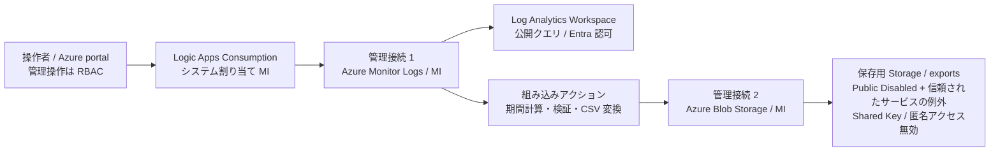

# Log Analytics 月次CSVエクスポート：構成案と検証計画

## 1. 目的・計画の状態

Log Analytics の前月分ログをAzureサービスで毎月抽出し、CSVとして非公開Blob Storageに保存する。運用担当者がAzure portalのブラウザー操作で構築・運用でき、端末へのAzure CLI／Az PowerShell導入やローカルコマンド実行を不要とする。

**現行は §22 の Consumption 版。§1～§21 は過去の計画・実績・再検討の履歴であり、以下の「現在」「最新」は各記録時点を指す。** 本書の §1～§11 は当初の設計・検証計画、§12・§13 は実機検証の記録、§14 は当時の顧客提供資料の整備状況である。過去の計画と現在の検証結果を区別する。有償リソースの新規作成には対象サブスクリプション・構成・費用・権限の追加承認を必要とする。

現在の顧客提供方針は **WS1 を主サンプルとし、公式サポート範囲の確認を導入前の必須条件とする**。当初の ASE 推奨や WS 不採用の記述は当時の判断として残す。顧客向け入口は [customer/README.md](../customer/README.md)。

2026-10-21 の追加指示で **Log Analytics は閉域対象外**へ変更した。現行の顧客用資材は LAW の MI 認証付き公開クエリを使い、Storage / サイトの閉域を維持する。File PE / DNS と AMPLS / Monitor DNS を除外し、PE 5 個・DNS 4 ゾーン・サブネット 2 個とする（§18）。過去の LAW 閉域前提の実績・判断は履歴として区別する。

インターネット復旧後に[Microsoft Learn のホスト Storage 認証の公式資料](https://learn.microsoft.com/en-us/azure/logic-apps/create-single-tenant-workflows-azure-portal#set-up-managed-identity-access-to-your-storage-account)を再取得して見直した。通常のWorkflow StandardプランではホストStorageのキーアクセスを無効化できないことが確認され、追加要件「ホストを含めキー認証不可」と不適合になったため、前回案をそのまま採用しない。

改訂後の主候補は **Logic Apps Standard＋内部向けApp Service Environment v3（Windows／Isolated v2プラン）**。公式資料はASE v3でのマネージドID設定後のStorageキーアクセス無効化を明記している。ただし「後から無効化できる」と「初回から一度もキー認証を使わず構築できる」は同義ではない。後者のARMテンプレート設計と実機検証を必須ゲートにする。現時点で完成済み・実証済みとは扱わない。

ASE v3のSoutheast Asia提供は公式のリージョン表で確認できた。一方、対象サブスクリプションでのLogic Apps on ASEの選択可否、Isolated v2のクォータ／容量、ポリシー適合は未確認。商品別提供表の取得結果ではLogic Appsの詳細を確認できなかったため、これらを確認済みとは表示しない。

既存コードベースは対象外。新規検証環境のサービス構成・ポータル手順・受入条件を設計する。

## 2. 確定した要件・境界

- 新規検証環境。リージョンは Southeast Asia。
- ログ取得・CSV保存のデータ通信はプライベートネットワークのみ。
- Entra ID認証、Azure管理などに必要な外向き通信は許可可能。データ面のPublic Network Accessは無効化する。
- Automation実行用VMは追加しない。一時的な管理用VM＋Azure Bastionは候補として許容する。
- 現在VPN等の閉域接続はない。お客様端末へのモジュール追加やコマンド実行は行わない。
- 第一候補はLogic Apps Standard。Automationは不採用理由を整理し、Functionsは比較のみ。
- CSV保管先は非公開Azure Blob Storage。本番では社内ネットワークからPrivate接続で取得する。
- 月次ログ量・対象テーブル・本番KQL・保持期間は未定。少量サンプルで機能・閉域性を検証し、本番全量処理の保証とは分ける。
- 初期仕様は毎月5日09:00日本時間に、前月の日本時間の暦月を抽出する。UTF-8、分割CSV可、0件はヘッダーのみ。
- 同月再実行は同じ論理出力先の結果を置換する。失敗・部分結果を成功にしない。
- 固定費のある候補構成は許容。実デプロイ前に費用と構成を別途確認する。
- ホストStorageを含めキー認証を禁止する。出力用とホスト用の双方でShared Keyアクセスを無効化し、SAS・接続文字列へのフォールバックを行わない。
- 非公開Storageを初期構築するため、準備したARMテンプレートJSONをAzure portalのカスタムデプロイ画面から投入することを許容する。ローカルCLI、Cloud Shell、PowerShell実行は使用しない。
- サンプルAzureActivityの取り込みは、診断設定のMicrosoft非公開サービス間チャネルを許容する。Private Endpoint経由ではない例外として記録する。月次の問い合わせとCSV保存はPrivate Endpoint経由のまま。
- 管理用VMの外向き通信にNAT Gatewayを候補として使用する。これは送信経路でありVMへの着信公開ではない。NATは宛先制限機能を持たない。[NAT Gateway の概要](https://learn.microsoft.com/en-us/azure/nat-gateway/nat-overview)を参照。
- 本番対象テーブルのAnalytics保持は90日を候補にし、設定・課金は別途承認する。CSV側の保持期間は別途決定する。
- Logic Apps優先を維持し、ASE v3案を主候補にすること、キー認証なしの初期構築検証と費用承認を必須とすることをユーザーと確認した。

## 3. 候補比較

| 候補 | 閉域データ通信との適合 | 運用担当者への適合 | 本計画での扱い |
|---|---|---|---|
| Azure Automation クラウドRunbook | AutomationアカウントにPrivate Endpointを作るだけでは、クラウド実行環境から利用者VNet内の非公開Log Analytics／Storageへ到達できない | PowerShell中心の運用には向くが、今回のネットワーク制約を満たさない | 採用しない。Private Endpointと実行環境のVNet接続を混同しない |
| Automation＋Hybrid Runbook Worker | 利用者ネットワーク内の実行ホストから閉域接続可能 | Runbookの保守に加え実行ホストの保守が必要 | 実行用VM追加不可の条件から対象外。既存Workerが将来利用できる場合のみ再評価 |
| Logic Apps Consumption | 共有マネージドコネクタを使った単純構成では、今回必要な任意の閉域接続を満たす前提にできない | デザイナー中心で扱いやすい | 今回は採用しない |
| Logic Apps Standard／Workflow Standardプラン | VNet統合とPrivate Endpointは利用可能だが、ホストStorageのキーアクセスを無効化できない | ブラウザー中心で扱いやすい | 追加されたキー認証禁止要件に不適合。不採用 |
| Logic Apps Standard／ASE v3（Windows） | 内部VIPによる受信、VNet内の実行、Private Endpoint経由のデータ接続。ホストStorageのMI認証とキーアクセス無効化に公式の記載あり | デザイナー中心で運用可能だが初期基盤は大きくなる | 改訂後の条件付き第一候補。初回からのキー認証なし構築・費用承認が必要 |
| Azure Functions | 対応プランのVNet統合等で実現候補になる | コード・デプロイ・例外処理の保守が増える | ユーザー希望により比較のみ。Standardで満たせない場合も勝手に切り替えない |
| Log AnalyticsのネイティブData Export | 月次KQL実行＋CSV生成の代替ではない。継続エクスポートは目的と出力形式が異なる | 別途変換処理が必要 | 今回の主案にはしない |

## 4. 推奨構成

```text
運用端末（ブラウザー、追加CLIなし）
  └─ Azure portal／Azure Bastion
       └─ 一時的なWindows管理用VM（Public IPなし、VNet内）
            ├─ Azure portalのデザイナー／実行確認
            └─ Private接続でCSVをVM内へダウンロードして検証

内部向けASE v3（Windows／Isolated v2）
  └─ Logic Apps Standard：Statefulワークフロー
  Recurrence → 対象月確定 → 分割してKQL問い合わせ → CSV生成 → Blobへ保存
       │ ASEのVNet内から送信（通常のWSプランのVNet統合とは別構成）
       ├─ AMPLS Private Endpoint → Log Analyticsクエリ
       └─ Blob Private Endpoint → 非公開出力Storage

Logic Appsの受信：ASE内部VIP（外部VIPは使用しない）
Logic Appsの実行基盤：非公開・Shared Key無効のホストStorage
名前解決：AMPLS／Storage／ASEアプリ・SCMのPrivate DNS
認証：ワークフロー用システム割り当てID、ホスト用ユーザー割り当てID
管理VMの外向き：NAT Gateway → portal／Entra ID等の必要な管理接続
```

ASEの内部VIPで閉域受信を実現するため、通常のWSプラン案のアプリ用Private Endpointをそのまま重ねて作らない。ASEからのアプリ送信とプラットフォーム管理通信は公式要件に従い、通常のWS向け設定を機械的に流用しない。

### 4.1 リソースと接続

| リソース | 役割・設計条件 |
|---|---|
| 専用リソースグループ | 検証物を識別し、削除対象を限定する |
| VNet／サブネット | ASE専用の委任サブネット（Microsoft.Web/hostingEnvironments、/24を候補）、Private Endpoint用、管理用VM用、AzureBastionSubnet（/26以上）を分離。アドレス範囲は既存ネットワークと競合させない |
| 内部向けASE v3＋Windows Isolated v2プラン | 内部VIP。Logic Appsに対応するWindows構成。ASEサブネットに他リソースを配置しない。SKU・インスタンス数・リージョン容量は作成前に確認 |
| Logic Apps Standard | ASE上のStateful。問い合わせ・出力用のシステム割り当てIDとホスト用ユーザー割り当てIDを分離。通常のWorkflow Standard WS1は使用しない |
| ホスト用Storage | Public Network Access・匿名・Shared Keyを無効化。Blob／Queue／TableのPrivate Endpointを基本候補とし、ホスト用ユーザー割り当てIDで認証する。通常のWSプランのAzure Files接続文字列・File PE構成を流用しない。ASEのコンテンツ配置・永続化と初期起動がキーなしで成立することを実証するまでゲートを開かない |
| 出力用Storage | ホスト用と分離。Blob Private Endpoint、Public Network Access無効、匿名アクセス無効、Shared Key無効。システム割り当てマネージドIDで書き込む |
| Log Analytics Workspace | 月次抽出対象。公開クエリ・公開取り込みの扱いを明示し、検証用は双方を無効化する。既存本番ワークスペースの設定は変更しない |
| Azure Monitor Private Link Scope（AMPLS） | Workspaceを関連付け、Private EndpointとPrivate DNSを構成。query／ingestionはPrivateOnlyを基本とし、Workspace自身の公開禁止設定も別に設定する。AMPLSだけで全公開取り込みや流出先が制限されるとは扱わない |
| Private DNS | AMPLSの5ゾーン、ホスト／出力Storageの必要なゾーン、ASEアプリ／SCM用ゾーン。重複するprivatelink.blob.core.windows.netは共有し、レコードを競合させない |
| 一時的な管理用VM | Public IPなし。ブラウザーからデザイナー、プライベートBlob、KQLへアクセスする。Automation Workerとしては使用しない |
| Azure Bastion | 検証端末からVMへのブラウザー管理経路。公開フロントエンドを使う場合は「管理入口の例外」として別途承認する。データサービスを公開するものではない |
| NAT Gateway／送信用Public IP | 管理VMの明示的な送信経路。既定の外向きアクセスに依存せず、VMにはPublic IPを付けない。NATはFirewall／宛先フィルターの代わりではない |

### 4.2 初期構築とホストのキー認証禁止

- 通常のLogic Apps作成ウィザードで非公開Storageへ展開する方法は、一時的な公開アクセスが必要と公式に記載されている。ARMテンプレート方式は公開アクセス不要。ユーザー確認により、portalの「カスタムテンプレートのデプロイ」から投入する方式を採用する。
- 上記の一般的な閉域WSサンプルはキー認証なしを保証しない。既存サンプルをそのまま投入せず、ASE構成とキー認証禁止を反映したテンプレートを別途作成・検証する。
- ユーザー割り当てIDを先に作り、ホストStorageに必要なRBACを設定する。アプリには `AzureWebJobsStorage__managedIdentityResourceId`、`__blobServiceUri`、`__queueServiceUri`、`__tableServiceUri`、`__credential=managedIdentity` を初回から設定する。
- 公式手順のホスト用ロールはStorage Account Contributor、Storage Blob Data Owner、Storage Queue Data Contributor、Storage Table Data Contributor。ワークフロー用IDに横展開せず、ホストStorageだけに限定する。権限削減は起動要件を確認してから検討する。
- Storageキーの読み出し、キー接続文字列、キー由来のSAS、公開アクセスへの一時退避をテンプレートや手順に含めない。ARMの依存順序とRBAC伝播を考慮し、必要なら段階デプロイする。
- 初回からShared Key無効・非公開の状態で起動、デザイナー編集、保存、再起動後の復旧、Stateful履歴が成功することを確認する。公式資料は設定変更後のキー無効化を説明しており、この初回構築経路までは実証していない。
- この検証に失敗した場合は、キーを一時的に許可せず停止する。ASEの費用承認前にテンプレート設計を確認し、有償構築後もこの小さな起動試験に合格するまでワークフローを作り込まない。

### 4.3 ネットワーク・認証上の重要条件

1. マネージドコネクタは、Logic AppsをVNet統合しても実行場所が同じVNetになるとは限らない。Log AnalyticsやBlobの共有コネクタがPrivate Endpointに到達する前提にしない。
2. 組み込みHTTPで `POST https://api.loganalytics.azure.com/v1/workspaces/{workspaceId}/query` を呼ぶ。URIは現行のazure.com、マネージドIDのaudienceはAPI認証資料の `https://api.loganalytics.io` を初期値とし、実機で認証・Private DNSのCNAME連鎖・PEへの到達を確認する。既定のARM audienceを使わず、management.azure.comのQuery経路へ切り替えない。
3. Blobの組み込みコネクタはマネージドIDとUpload blob操作の対応を確認済み。システム割り当てIDで使う。Content-Type等の指定が組み込み操作で満たせない場合だけ組み込みHTTP＋Blob RESTを使い、Storageのaudienceを明示する。キー・SAS・共有マネージドコネクタへの切替はしない。
4. Query用IDは検証Workspaceに限定したLog Analytics Reader等の必要な読取権限、Blob書込は出力コンテナーに限定したStorage Blob Data Contributorを基本に、実際のAPI権限を確認する。ワークフロー用IDにはサブスクリプション／RGのOwner・Contributorを与えない。ホスト用IDの公式ロールは4.2の別管理とする。
5. ホストと出力の両方でShared Keyアクセスを禁止する。ホストはユーザー割り当てID、Queryと出力はシステム割り当てIDとし、それぞれのRBACを分離する。
6. Storageの「信頼されたMicrosoftサービスを許可する」やサービスエンドポイントを、Private Endpointの代用にしない。
7. Entra ID／ARM／ポータル／Bastionなど必要な管理通信の許可先を整理する。「全通信がPrivate Link」という説明はしない。
8. 管理用VMのブラウザー、アプリホスト、外部端末でそれぞれ名前解決とアクセス可否を確認する。Public Network Access無効化だけで、実行時の経路検証を省略しない。
9. プライベート化されたアプリのデザイナー・実行履歴等は、通常のインターネット接続端末から完全操作できる前提にしない。VM側ブラウザーから操作する。
10. Bastionのブラウザー接続でCSVファイル自体を運用端末へ転送できるとは扱わない。本検証ではVM内へのダウンロードと内容確認まで。本番社内端末へのダウンロードは別の閉域接続が必要。
11. Azure Monitor公式資料は、Resource Manager API経由のクエリはPrivate Linkを使えず、対象にLogicApp connectorが含まれると明記している。Logsコネクタを使わず、直接Query API経路を検証する理由はこれである。
12. AMPLSのDNSは `privatelink.monitor.azure.com`、`privatelink.oms.opinsights.azure.com`、`privatelink.ods.opinsights.azure.com`、`privatelink.agentsvc.azure-automation.net`、`privatelink.blob.core.windows.net`。既存の顧客DNSには接続せず、PoC専用VNetにリンクする。
13. ASEは `<ase-name>.appserviceenvironment.net` のPrivate DNSゾーンを基本に、`*`、`@`、`*.scm` を内部VIPへ解決する。ホスト／出力Storageも同じVNetからPrivate IPへ解決する。
14. 管理VM内のEdge／ChromeでportalのLocal Network Access許可が必要な場合がある。社内ブラウザーポリシーと合わせて確認し、閉域であるのにLogs画面だけ失敗するケースを試験する。
15. 診断設定によるAzureActivity取り込みはMicrosoftの安全な非公開チャネルを使い、Workspaceの公開取り込み制限の例外となる。この経路をPrivate Endpoint経由と説明しない。

## 5. ワークフローの動作設計

### 5.1 月次処理

- Recurrenceに日本時間を明示し、毎月5日09:00に起動。
- 起動時に前月の開始・当月の開始を一度だけ確定する。日本時間で月境界を作ってからUTCへ変換する。
- KQLは `TimeGenerated >= startUtc and TimeGenerated < endUtc` の半開区間とする。UTCの月初をそのまま使わない。
- 再実行時は対象月を固定できるよう、初期変数に検証用上書き値を設ける。通常時は自動算出する。月次再処理は運用手順に残し、過去の実行を無条件に再送信する方式に依存しない。
- 対象テーブルと列順を固定したKQLの `project`、Select、Create CSV tableを使う。初回は1テーブル。型やスキーマの自動推測を増やさない。
- 日単位の分割を初期候補とし、API応答量・行数・時間上限を超える場合は時間窓を短縮する。日単位なら必ず安全、とは判断しない。
- 本番量が未知のため、少量PoCの成功のみで本番全量処理を承認しない。超過を検出した場合は明示的に失敗させ、細分化後に再処理する。無制限の自動再帰分割は初期範囲外。
- Query APIの公式上限は1クエリ500,000行、圧縮64 MB（展開後およそ100 MiB）、実行10分。StandardのHTTP送信タイムアウト既定値は225秒、APIの既定値は180秒であり、API上限まで待てると仮定しない。PoCではAPIの待機を180秒以下に保ち、遅い場合は分割を小さくする。
- Logic Appsの通常メッセージ上限100 MBとJSON→配列→CSV変換時の増幅も考慮する。APIの最大応答サイズをそのまま安全なCSV生成サイズとしない。Query APIに汎用nextLinkで全件ページングできる前提を置かない。
- PoCの初期運用ガードは1分割10,000行以下、取得後JSONと生成CSVはそれぞれUTF-8で5 MiB以下を候補にする。これはサービス上限ではない。超過時は成功にせず分割変更を要求する。バイト数を文字数で代用しない。大きなHTTP応答を受信前に必ず防げるものでもないため、事前件数確認と固定サンプル量で試験する。
- 翌月5日の抽出では前月初日のデータが既定の短い保持期間を超えることがある。対象テーブルのAnalytics保持を90日候補とし、長期保管のみのデータを通常Query APIで読めると仮定しない。テーブル個別設定・再実行猶予も確認する。

### 5.2 CSVと出力構造

- UTF-8、列順固定、ヘッダーあり。BOMの必要性は本番利用ツールが判明してから確認する。
- カンマ、二重引用符、改行、日本語、null、日時を含むサンプルでCSVの往復一致を確認する。dynamic型はKQLで明示的に文字列化する。
- CSVには型情報がないため、nullの表現と空文字列の区別を期待値に明示する。型を含む無損失バックアップと説明しない。
- 0件ではヘッダーのみを生成する。Create CSV tableが空配列から必要なヘッダーを生成できるか確認し、必要なら明示的な0件分岐を用意する。
- 保存先例：`exports/<workspace>/<table>/<YYYY-MM>/current.json` と、`runs/<run-id>/part-<window>.csv`、`runs/<run-id>/manifest.json`。
- manifestには対象月・UTC境界・実行ID・クエリ識別子・分割一覧・行数・ファイルサイズ・完了状態を記録する。CSVデータそのものや認証情報を管理ログへ複写しない。
- 出力CSVのContent-Typeを明示する。表計算ソフトでの自動解釈を防ぐ利用方法も運用手順へ記載し、元ログの値を勝手に変換しない。

### 5.3 再実行、失敗、部分結果

- 同一月を含む同時実行を防ぐ。初期構成ではトリガーの同時実行数を1とする。
- 月内のファイルを直接順次上書きして新旧混在させない。run-id別に新しい一式を作り、全分割の成功後に単一の `current.json` を置換して最新完了分を指す。
- これにより同じ論理出力先の置換を実現するが、物理的に同じCSV URLを上書きする仕様ではない。利用者はcurrentに記載された完了済みファイル群を取得する。
- 失敗時は前回のcurrentを保持し、今回の未完了出力を正式成果物と扱わない。運用者は対象月、完了状態、実行IDを確認する。失敗run／旧runの削除は承認済み保持ルールに従う。
- HTTP失敗だけでなくLog Analyticsの部分成功・応答内エラー・想定外テーブル構造を検出する。制限による切り捨てを成功にしない。
- 公式API仕様ではHTTP 200でも `error.code=PartialError` が入り得る。`tables`、期待する `columns`／列順、`rows` を検証し、errorがあればcurrentを切り替えない。204や本文なし200を無条件に「0件成功」に変換しない。0件成功は期待スキーマを持つ空結果で確認する。
- 検証時は同じフィルターの件数問い合わせとCSV行数を比較する。ただし取り込み中・遅延取り込み・保持期限によるデータ変動を考慮し、固定サンプルで厳密一致を確認する。件数一致のみを全件性の唯一の根拠にはしない。
- 429／一時障害は有限の指数バックオフ、認証・権限・構文エラーは失敗とする。Try/Catch/Finally相当のScopeとrun-afterを使い、最終的な失敗状態を保持する。
- 実行履歴の保存やSecure Inputs/Outputsを評価し、ログ本文・トークンの漏えいを防ぐ。運用監視は状態・件数・対象月を中心とする。
- 初期検証ではportalの失敗状態・メタデータで検知確認を行う。本番通知先が未定のためメール等の自動通知は未接続であり、本番化前にAction Group等の承認済み通知経路を確定する。

## 6. サンプルログの準備

### A. 経路・CSV変換の最小検証

Log Analyticsへ実際に問い合わせ、KQLの `datatable` で固定サンプルを返す。日本語、カンマ、引用符、改行、null、月境界直前・直後、同一時刻の複数レコード、識別用IDを含める。対象期間を明示してフィルターし、期待行数とID集合を事前に固定する。

これは「Log Analytics APIへの閉域到達とCSV化」の検証であり、Workspaceへの取り込みや実テーブルの抽出を証明するものではない。

### B. 実際に取り込まれたログでの検証

管理用VMなど検証リソースの操作からAzureActivityのサンプルを発生させ、サブスクリプションの診断設定で検証Workspaceへ送る。これはPrivate Link経由ではなく、Microsoftの安全な非公開サービス間チャネルで、ユーザーが許容した取り込み例外である。サブスクリプションの診断設定を変更する権限、既存設定への影響、送信対象カテゴリを作成前に確認する。

ブラウザーのLogs画面から対象レコードの到着を確認してから、テーブル抽出を実行する。AzureActivityの月全体は固定の期待件数にせず、検証用の識別可能なリソースや相関ID等で対象を絞る。

新規Workspaceには前月の実ログが存在しないため、実テーブル検証では対象期間を一時的に当月の検証窓へ指定する。前月計算と月境界はAの固定サンプルで別途検証する。過去TimeGeneratedを任意に設定できる前提や、1か月待つ前提にしない。

Workspaceの公開取り込み禁止は維持する。サンプル取り込みにDCR／DCEを追加する必要はない。診断設定の非公開サービス間チャネルという例外を本番の関係者が認めない場合は、別途DCR／DCE方式を再設計し、公開取り込みを有効化しない。

## 7. 検証の進め方・受入条件

| 段階 | 実施内容 | 合格条件／停止条件 |
|---|---|---|
| 0. 設計確認 | 下記の公式確認結果を基に、ASE用のARMテンプレート、キーなしの初期化、コンテンツ配置、SKU／リージョン／ポリシーを確認 | 公開化・キー認証を必要とする設計なら停止。ASEの提供表だけで対象サブスクリプションの利用可否を保証しない |
| 1. 設計・課金・権限承認 | サブスクリプション、ASE／Isolated v2、Bastion、NAT、Storage、PE、IAM、保持ルールと費用を確定 | ASEを含む具体的な構成と課金、Bastion管理入口を明示承認。前回のWSプラン前提の承認で代用しない |
| 2. 閉域基盤作成 | portalのカスタムデプロイでVNet、DNS、PE、Storage、ID、Workspace、AMPLSを構成。ASE、管理VM／Bastion／NATも承認済み構成で作成 | データ面は最初から非公開・Shared Key無効。キー取得や公開アクセスへの退避をしない |
| 3. 最優先のキーなし起動試験 | 初期設定済みユーザー割り当てIDでASE上のLogic Appsを起動。BastionからVM内ブラウザーで編集・保存・履歴・再起動を確認 | 初回からキー接続文字列なしで起動・永続化・再起動が成功。失敗時は停止し、以降の作り込みへ進まない |
| 4. 最小サンプル実行 | 組み込みHTTPでdatatableを問い合わせてCSV保存 | 実際のLog Analytics経由、MI認証、期待した行数・値・列順で非公開Blobに出力 |
| 5. 取り込み済みログ | AzureActivityの到着を確認して指定窓を抽出 | 保存済み実テーブルの対象ID・件数とCSVが整合。AとBの結果を区別 |
| 6. 正常・境界・0件 | 月跨ぎ、年跨ぎ、日数の異なる月、開始ちょうど／終了ちょうど、特殊文字、0件を試験 | 日本時間の前月のみを重複・欠落なく抽出。CSVを再解釈した値が一致。0件はヘッダーのみ |
| 7. 再実行 | 同じ対象月を複数回処理し、途中失敗も発生させる | 完了runのみcurrentへ反映。前回成功分を破壊せず、新旧ファイルの混在・二重計上がない |
| 8. 異常系・上限 | 一時的な権限除外、到達不能、無効KQL、テスト用の小さな上限による超過を試す | 明示的な失敗、有限リトライ、未完了成果物を公開しない。部分応答の扱いを確認 |
| 8a. 部分応答・認証禁止 | 実API呼出しと分離したテスト用ワークフロー内の固定応答で200＋PartialError、本文なし、列不一致を入力。ホスト／出力StorageのShared Key無効と接続設定を確認 | 期待する異常分岐・current保持。模擬応答試験を実APIのPartialError再現と混同しない。再起動後もキーなしで稼働 |
| 9. 閉域性の立証 | 外部端末とVM内ブラウザーのアクセス差、PNA、DNS、PE状態、必要に応じ既存診断手段を確認 | 正規権限があっても外部からBlob読取・LA公開クエリ不可。内部とアプリからのみ成功。401/403だけで閉域と判定せず、ネットワーク設定とエラー理由を突合 |
| 10. スケジュール | 同じ処理を短周期の検証用スケジュールで実行後、月次設定へ戻す | 自動起動の証跡、JSTの月次設定、次回対象月、並列制御を確認。月次本番運用を長期実証したとは説明しない |
| 11. ファイル取得 | 管理用VM内ブラウザーでBlobをダウンロードし内容を確認 | VM内のCSV閲覧成功。本番社内端末への取得はVPN等の別途経路がない限り未検証と明記 |
| 12. 運用引継ぎ・終了 | KQL／対象月変更、再実行、失敗判別、保持と削除手順を確認 | 非開発者がブラウザーのみで操作できる手順と証跡がある。削除は対象を明示し別途承認 |

### 測定・証跡

- リソース設定、Private Endpoint承認状態、Private DNSリンク、Public Network Access設定。
- ASE内部VIP、専用委任サブネット、ホストと出力StorageのShared Key無効、ホスト用IDの初回設定、管理VMのNAT送信経路。秘密を表示しない構成証跡と実行結果を突合する。
- Logic Apps実行ID、対象期間、成否、分割数、期待／実測行数、出力サイズ。
- CSVのヘッダー・値・識別子集合の照合結果。改行を含むCSVの行数を単純な改行数で数えない。
- Log Analytics API応答の完全性、異常時のエラー、currentの切替／保持。
- サンプル量の範囲と本番量未検証を明記。
- スクリーンショットや証跡に顧客ログ本文・トークン・秘密情報を含めない。

## 8. 実装・検証Todo

1. 公式仕様の再調査と通常WSプランの適合性見直し（今回完了）。
2. キーなしのASE初期構築用ARMテンプレート、段階デプロイ手順、ユーザー割り当てID／RBAC、コンテンツ永続化方式を設計・検証する。成果物はテンプレートとブラウザー操作手順で、実行環境へのCLI導入は不要。
3. 対象サブスクリプションのASE／Logic Apps／SKU／ポリシーを確認し、具体的な費用・権限・管理入口・保持・削除方針の承認を得る。
4. portalから閉域基盤とASE／Standard／管理経路を構築する。
5. 初回からキーなしの起動、編集、保存、Stateful履歴、再起動を実証する。このゲートに不合格なら以降を止める。
6. 固定サンプルと診断設定による取り込み済みサンプルを用意し、期待値を定義する。
7. 月次ワークフロー、CSV生成、分割、再実行、失敗処理、完了ポインターを構築する。
8. 正常・境界・異常・閉域性・キー禁止・スケジュール・取得試験を実施し証跡を残す。
9. 運用手順・本番移行前の未決事項・検証リソースの停止／削除方針を整理する。

## 9. 本番化前の未決事項と停止条件

- 本番テーブル、KQL、月次件数・サイズ・ピーク日、API制限、想定実行時間。
- 対象テーブルのプランにおけるQuery API対応、保持期間、遅延取り込みの扱い。5日実行で前月ログが完全とは保証せず、締め処理・再抽出方針を定義する。
- ASE／Isolated v2プラン、ホスト／出力Storage、PE、Bastion、管理用VM、NAT Gateway、ログ取り込み／クエリ等の費用。通常WSプランの見積もりを流用しない。金額は公式の現行料金と構成確定後に別途提示する。
- 本番のCSV保持期間、旧run／失敗runの扱い、バージョニング、イミュータブル保管等の要否。未承認の自動削除は設定しない。
- 自動通知先、実行履歴保持、権限分離、データ取り扱い規程。
- 管理用VM／Bastionが必要な運用範囲。本番で毎回一時VMを作る前提にせず、既存社内閉域端末の可用性を確認する。
- Bastionの公開管理入口も禁止なら、Private-only BastionだけではVPNのない端末から到達できない。承認済み閉域管理経路を確保するまで構築・操作は停止する。
- 本番社内ネットワークからのPrivate DNS／Storage到達性。本PoCのBastion接続で代替検証済みとはしない。
- portalのカスタムデプロイによるARM投入は合意済み。ただし非公開・Shared Key無効のASE用ホストStorageで初期構築・コンテンツ永続化・デザイナー編集が成立しない場合は停止する。キー認証を許可する回避策は採らない。
- ASEへの移行で通常WSのFile接続文字列を排除できること、ASEのコンテンツ配置とホストのMI接続が共存することを実機で確認する。公式の「設定変更後にキー無効化可能」という記述だけで初期構築成功を保証しない。
- ASE on Logic AppsのSoutheast Asia／対象サブスクリプションの利用可否、Isolated v2容量、Azure Policy／RBAC伝播は構築前後の確認が必要。未承認のリージョン変更をしない。
- 本番ログ量が安全な処理範囲を超える場合は分割設計等を再評価する。公開化、上限無視、Functionsへの無断移行はしない。

## 10. 公式資料の再確認結果

以下は今回本文を取得して確認した一次資料。資料上の機能対応と、この構成を実機で検証済みであることは区別する。

| 資料 | 確認した事実・計画への影響 |
|---|---|
| [Standard作成／ホストStorageのMI設定](https://learn.microsoft.com/en-us/azure/logic-apps/create-single-tenant-workflows-azure-portal#set-up-managed-identity-access-to-your-storage-account) | 通常Workflow Service Planではキーアクセスを無効化できない。ASE v3はMI設定後に無効化可能。ユーザー割り当てID、必要ロール、AzureWebJobsStorage設定を確認 |
| [非公開StorageへのStandardデプロイ](https://learn.microsoft.com/en-us/azure/logic-apps/deploy-single-tenant-logic-apps-private-storage-account) | 通常portal作成は一時公開が必要、ARM方式は不要。ASE向けキーなしテンプレートの完成例と誤認しない |
| [ARMテンプレートのportal投入](https://learn.microsoft.com/en-us/azure/azure-resource-manager/templates/deploy-portal) | カスタムテンプレートをportalのエディターから投入可能。端末へのCLI導入は不要 |
| [ASE概要・リージョン](https://learn.microsoft.com/en-us/azure/app-service/environment/overview) | ASEはStandard Logic Appsをホスト可能。Southeast AsiaのASE／Isolated v2提供記載あり。Logic Apps個別の契約・容量適合は別確認 |
| [Logic Appsホスト方式比較](https://learn.microsoft.com/en-us/azure/logic-apps/single-tenant-overview-compare) | Logic Apps on ASE v3はWindowsプランのみ。通常WSとASEのホスト方式を分離 |
| [ASEネットワーク](https://learn.microsoft.com/en-us/azure/app-service/environment/networking) | 専用サブネット、内部VIP、委任、DNS、NSGの要件を確認。アプリ用PEがなくても内部VIPで閉域受信を構成できる |
| [StandardのVNet／Private Endpoint](https://learn.microsoft.com/en-us/azure/logic-apps/secure-single-tenant-workflow-virtual-network-private-endpoint) | 通常WSではVNet統合は送信、PEは受信。ホストStorage依存を含めた設計が必要 |
| [組み込みBlobコネクタ](https://learn.microsoft.com/en-us/azure/logic-apps/connectors/built-in/reference/azureblob/) | Managed identity認証、Upload blob操作、上書き指定の対応を確認 |
| [Logic AppsのマネージドID](https://learn.microsoft.com/en-us/azure/logic-apps/authenticate-with-managed-identity) | StandardのHTTP／Blob組み込み操作がMIをサポート。Blob組み込み用はシステム割り当てIDを基本にする |
| [AutomationのPrivate Link](https://learn.microsoft.com/en-us/azure/automation/how-to/private-link-security) | cloud jobsはPEで保護されたリソースに接続不可。Hybrid Workerが必要で今回の実行ホスト制約に不適合 |
| [Azure Monitor Private Link設計](https://learn.microsoft.com/en-us/azure/azure-monitor/logs/private-link-design) | ARM経由クエリはPrivate Link不可でLogicApp connectorが該当。診断設定の安全な非公開チャネルは公開取り込み禁止設定の例外 |
| [Azure Monitor Private Link構成](https://learn.microsoft.com/en-us/azure/azure-monitor/logs/private-link-configure) | DNSの5ゾーン、APIのprivateレコード、portalのLocal Network Access許可を確認 |
| [Query APIアクセス・認証](https://learn.microsoft.com/en-us/azure/azure-monitor/logs/api/access-api) | 現行URIはapi.loganalytics.azure.com、認証resourceはapi.loganalytics.io。実機のMI認証で確認する |
| [Query API応答形式](https://learn.microsoft.com/en-us/azure/azure-monitor/logs/api/response-format) | tables／columns／rows、HTTP 200内のPartialErrorを確認。成功ステータスだけで全件成功にしない |
| [Azure Monitorサービス制限](https://learn.microsoft.com/en-us/azure/azure-monitor/fundamentals/service-limits#query-api) | APIは500,000行、圧縮64 MB／展開後約100 MiB、最大10分。Logsコネクタとは異なる上限 |
| [Query APIタイムアウト](https://learn.microsoft.com/en-us/azure/azure-monitor/logs/api/timeouts) | 既定180秒、最大600秒、Prefer waitで指定。エラー解説には別認証方式の記述もあるためMI直アクセスは実機確認を必須にする |
| [Logic Apps制限](https://learn.microsoft.com/en-us/azure/logic-apps/logic-apps-limits-and-config#http-request-limits) | Standard HTTP送信は既定225秒、通常メッセージ100 MB。API単独の限界まで処理できると仮定しない |
| [Log Analytics保持設定](https://learn.microsoft.com/en-us/azure/azure-monitor/logs/data-retention-configure) | Analytics保持と長期保持を区別。月次抽出の対象期間が通常クエリ可能な範囲に残ることを確認 |
| [VMの既定外向きアクセス](https://learn.microsoft.com/en-us/azure/virtual-network/ip-services/default-outbound-access) | 明示的な送信方式が必要な構成を確認。管理VMのNAT経路を追加 |
| [Bastion概要](https://learn.microsoft.com/en-us/azure/bastion/bastion-overview) | ブラウザー接続とVMのPublic IP不要を確認。Private-onlyは別の閉域到達手段が必要 |

## 11. 改訂で解消した点と残るゲート

- 解消：インターネット障害による資料未確認、通常WSのキー無効化可否、非公開Storage構築時のportalとARMの違い、組み込みBlobのMI対応、診断設定の取り込み経路。
- 方針確定：ASE v3 Windowsを主候補、portalからARM投入、ホストを含むキー認証禁止、NAT候補、Analytics保持90日候補。
- 未解消：初回からキーなし・非公開でASE上のStandardを構築するテンプレートと実機結果、対象契約でのリージョン／SKU／ポリシー適合、具体的な費用・作成承認、本番量。
- 本改訂ではAzureへ接続してのリソース一覧取得、テンプレート投入、デプロイ、ログ抽出は行っていない。

## 12. 実機検証結果（2026-10-19 実施、1回目で成功・計画の変更なし）

環境：RG `rg-poc-lawexport-sea`（Southeast Asia、検証後に削除）。テンプレートは foundation.bicep / ase.bicep / app.bicep、ワークフローは workflow.json（session files配下）。

| 項目 | 結果 |
|---|---|
| ASE v3(内部)作成 | 成功（約数分）。Isolated v2 I1v2、プラン作成のみ約15分 |
| キーなし・非公開でのLogic Apps Standard起動 | **成功**。AzureWebJobsStorage__* のMI設定のみ、ホストStorageはSharedKey無効・PNA無効・PEのみ。ホスト状態Running、ワークフローHealthy |
| 再起動後 | 成功（キー・公開なしで復帰、実行も成功） |
| LAW照会（HTTP+MI、api.loganalytics.azure.com、audience=api.loganalytics.io） | 成功。Private Link経由で名前解決は10.50.1.x |
| サンプルA（datatable：境界・カンマ・引用符・日本語・改行） | 2026-01は期待4件（開始境界含む、終了境界除外）。UTF-8 BOM、CSV引用符正常 |
| 0件月（2025-11） | ヘッダーのみのCSV＋manifest rowCount=0 |
| 2026-02 | 終了境界の次月先頭1件のみ |
| サンプルB（AzureActivity、診断設定） | 直接count=4、CSV/manifest=4で一致 |
| 失敗系（不正KQL／列不一致） | いずれもRun=Failed、2026-01のcurrent.jsonは前回のまま |
| 外部遮断 | 公開側からBlob匿名403、AAD付き403(AuthorizationFailure)、LAW照会はNspValidationFailedError、ASEホスト名は名前解決不可 |
| SharedKey/匿名 | 両Storageとも allowSharedKeyAccess=false, allowBlobPublicAccess=false, PNA=Disabled |
| スケジュール発火 | 1分周期の試験ワークフローが自動発火・成功（月次トリガーは手動Runで検証。実月次発火は未観測） |
| VNet内からのCSV取得 | 管理VM(MI, PE経由)でCSV/manifest/current.jsonを取得 |

計画からの差異・学び：
- ワークフロー配置はSCMが非公開のため、ARMのhostruntime管理API（admin/vfs、workflow management API）経由。portalのデザイナーも同じ経路。
- LAWの動的列は文字列で返るため `json(string(item()?[0]))` で正規化。KQL末尾を `project bag=pack_all()` にし、列は設定COLUMNSで指定。
- Standard_B2sはSEAで容量制限。管理VMはD2as_v7。VMはBastion/NATなしでrun-command検証（Bastionによるブラウザー接続とportalデザイナー画面は未検証）。
- 未検証：実月次スケジュール発火、50万行超の分割、Bastion経由のブラウザー操作、PartialErrorの実発生。

## 13. 再検証：ワークフロー サービスプラン(WS1)（2026-10-20 実施、RG `rg-poc-lawexport-ws-sea`、検証後削除）

構成：WS1（Workflow Standard）＋リージョナルVNet統合(snet-integ, 全送信VNet経由)＋サイトPNA無効。ホストStorageはSharedKey無効・PNA無効・PE(blob/queue/table/file)、MIで接続。**AzureWebJobsStorage接続文字列とWEBSITE_CONTENTAZUREFILECONNECTIONSTRING(コンテンツ共有)は設定せず**、WEBSITE_CONTENTOVERVNET=1のみ。テンプレート：app-ws.bicep。

| 項目 | 結果 |
|---|---|
| キーなしでのWS上の起動 | **成功**（ホストRunning、ワークフローHealthy、再起動後も復帰） |
| 2026-01 / 0件(2025-11) / 2026-02 | ASEと同一のCSV・manifest・境界・BOM・引用符 |
| 失敗系（列不一致／不正KQL） | Failed、current.jsonは前回のまま |
| 外部遮断 | Blob匿名403・AAD付き403、サイトURL(公開)403、両StorageはSharedKey無効・PNA無効 |
| 管理VM(PE経由)からのCSV取得 | 成功 |

差異・注意：
- 公式資料にはWSプランでホストStorageのキー無効化は不可とあるが、**コンテンツ共有を使わないARM構成では起動・実行できた**。ただしこの構成が公式サポート範囲か、portalデザイナー編集・ワークフロー保存・ランタイムのスケール監視を含めて長期安定するかは未確認。コンテンツ共有(Azure Files)はキー必須のため使っていない。
- 設定変更直後の再起動中は管理APIがServiceUnavailableを返す。起動を待って再実行すれば成功。
- 2026-01に想定外の実行が1件多く存在（初回ワークフロー読み込み直後のトリガー発火とみられ、current.jsonは最新に更新）。月次トリガー初回起動時の挙動は本番前に確認すること。
- ASEと比べ固定費は大幅に低い。ASEは不要となる可能性があるが、サポート可否の確認(Microsoftサポート等)を推奨。

## 14. 顧客提供資材の整理（2026-10-20）

ユーザー確認により、WS1 を主サンプルにし、公式サポート範囲の確認を導入前の必須条件とした。ASE は比較情報に留める。Azure portal のみで構築・実行・確認・削除を行う Azure 管理者向けの資料を、独立した [customer/](../customer/) に整理した。

### 配布内容

- 入口 README、導入手順、運用・障害対応・削除手順、受入確認表。
- 基盤 / WS1 アプリ / データ RBAC・サイト用 PE / DNS の 3 段階の ARM JSON と各パラメーター例。
- 固定 datatable と AzureActivity 用設定、ワークフロー全体と定義本体、host / connections の参照用資材。
- 全 16 ファイル。実環境 ID・PoC 固有 Storage 名・個人パスを除外し、配布フォルダー内のローカル参照を自己完結させた。顧客側のコンパイルやコマンド実行は不要。

生成元は [infra/customer/](../infra/customer/) と既存 Bicep / ワークフロー / 設定。提供者向けの再生成・検証は [customer-maintenance.md](customer-maintenance.md) に記載した。既存 Bicep の既定動作は保持し、追加した保持日数パラメーターは元資材では 30 日、顧客用ラッパーでは承認対象として 90 日、プラン名の既定値は従来名のままとした。

### 静的検証結果

| 確認 | 結果 |
|---|---|
| Bicep から 3 段階 ARM を生成 | 成功（Node.js 24.16.0 / Bicep 0.41.2） |
| 再生成一致確認 | 成功。生成物は正本から再現可能 |
| Node.js 静的テスト | 8 / 8 成功。JSON・パラメーター対応、閉域 / キー禁止設定、RBAC / PE / DNS、設定参照、固定サンプル期待 Id、出力契約、識別子・資格情報混入、同梱リンクを確認 |
| ワークフローの既存動作保持 | 配布定義が元ワークフローと一致することを確認。ランタイムの新機能追加はなし |
| 空白エラー | `git diff --check` 成功 |

元 Bicep には Storage 名の最小長に関する型推論警告 BCP334 と未使用 contentShareMode の警告がある。ビルドエラーはない。静的検証はサポート可否や Azure 上の動作の証明ではない。

### 未完了のゲート・差異

- **今回 Azure リソースの作成・変更・新たな実行検証は行っていない**。サポート確認、構成・最新費用・権限・削除範囲の個別承認後に portal 実機受入を行う。
- portal のコードビューでの作成・保存、host 設定の成立、再起動後の定義永続化、閉域ブラウザーによる取得は同梱資材では未検証。不成立時に CLI / 管理 API で代替して portal 完結とは扱わない。
- コンテンツ共有なしの WS1 の公式サポート範囲は未確認。Microsoft Learn の「WS ではキー無効化不可」の記載は残っている。
- 実際の月次発火、初回発火、本番量、PartialError 実発生は未検証。単一 CSV・上限時の停止であり、自動分割・強制排他・通知・厳密な応答スキーマ検証は未実装と明示した。
- 初期導入で使用する固定サンプルと月を限定し、ワークフロー無効化・将来の初回開始日時・通常運用時の設定復元を手順化した。保存直後の発火対策の効果も実機受入対象とする。
- 元の基盤 VNet 定義に後追加の snet-integ がないため、WS1 作成後の基盤テンプレート再投入を禁止する注意を追加。既存本番環境への更新手順ではなく、新規専用評価環境への導入手順として提供する。
- 資料整備・静的検証後、ユーザーの指示により **サポート確認待ちとして本作業の portal 実機受入を保留**した。実機受入完了とは扱わず、回答条件の照合と個別の作成承認を経て再開する。

## 15. 実データなしのテスト実行手順の追加（2026-10-20）

- ユーザー要望により、[受入確認](../customer/docs/validation.md) §2.1 に、既存 datatable のダミーデータによる portal テストを追加。設定 5 項目、直接貼り付けられる KQL、手動実行、履歴の期待値、current / manifest / CSV の照合、0 件・翌月境界、設定復元・無効化までを順に記載した。
- 構成・ランタイム・生成資材は変更せず、取り込み済みデータ・診断設定・テーブル作成が不要であることを明示。実 LAW API と非公開 Blob を使うため、基盤・権限・閉域経路・事前承認は引き続き必要。
- 顧客向け README・導入・運用資料からテスト手順へ誘導。実データがない評価では MONTH_OVERRIDE を空文字にして定期運転を開始せず、ダミー設定に戻して無効化した状態で終了する。
- Microsoft Learn の [datatable 仕様](https://learn.microsoft.com/en-us/kusto/query/datatable-operator?view=azure-monitor)で、スキーマと値をクエリ内に定義することを確認した。
- 静的検証：`node --test .\scripts\customer.test.mjs` は **9 / 9 成功**。掲載 KQL と実際の sample 設定の一致確認を追加し、既存の期待件数・設定・ワークフロー出力・リンク等の検証も成功。`git diff --check` 成功。
- Azure リソース作成・実行は行っておらず、サポート確認待ちの portal 実機受入保留は継続。今回の結果は手順と資材の静的確認であり、portal 実機成功の追加実績ではない。

## 16. 顧客向け Start time の具体例（2026-10-20）

- [顧客向け導入手順](../customer/docs/setup.md) §7 に、直接コピーできる `2026-12-05T09:00:00` と recurrence オブジェクトの JSON を追加。日本時間の Time zone、末尾 Z / UTC オフセットを付けないこと、貼り付け対象を明記した。
- Microsoft Learn の [Recurrence の仕様](https://learn.microsoft.com/en-us/azure/connectors/connectors-native-recurrence)で、タイムゾーン選択時の日時形式、Z 指定時の UTC 解釈、月次の少なくとも 1 か月前の設定を再確認。サンプルの期限切れと承認済み日時への変更、手動テストの MONTH_OVERRIDE との違いも記載した。
- ワークフロー本体と生成資材は変更しない。実機受入の保留は継続する。

## 17. 顧客用 WS1 の必要接続の見直し（2026-10-21）

以下は LAW 閉域を前提にした最初の見直し時点の記録。直後の追加指示で AMPLS も除外した現行構成は §18 を参照する。

### 判断と変更

- 目的は、業務ワークフローで使う接続と Logic Apps Stateful ランタイムの依存を区別し、不要な接続だけを配布資材から除外すること。稼働中環境を削除する作業ではない。
- ホスト Storage の **Blob / Queue / Table PE と DNS を維持**。HTTP アクションしかない場合でも Stateful の基盤は Blob / Queue / Table を使うため、Queue / Table を業務アクション未使用という理由で除外しない。対応するホスト MI の権限と接続設定も保持する。
- Azure Files のコンテンツ共有を設定しない顧客用 WS1 では **File PE・File DNS ゾーン・その VNet リンクを除外**。一般的な Standard の File 接続不要を示すものではなく、コンテンツ共有なし構成のサポート確認は引き続き必要。
- 顧客用では ASE・管理 VM・Bastion 用の未使用予約サブネットも除外。PE 用と第 2 段階の VNet 統合用のみを作成する。管理経路が別途必要な場合は別設計・承認とする。
- AMPLS は公式の 5 DNS ゾーンを維持。問い合わせごとに全ゾーンを使うという主張ではなく、公式の PE / DNS 関連付けを維持する判断。Blob DNS はホスト・出力・AMPLS で共用する。
- 当時の共有 `infra/foundation.bicep` に `hostingMode` を追加。既定 `ase` は元 PoC のリソース集合を維持、当時の顧客用ラッパーのみ `ws` を指定して縮小した。これらの Standard 用資材は §22 の切替で現行から除去した。

### 最小構成の内訳

| 対象 | PE | 備考 |
|---|---|---|
| ホスト Blob / Queue / Table | 3 | Stateful 実行基盤 |
| 出力 Blob | 1 | CSV / manifest / current |
| AMPLS | 1 | LAW の閉域問い合わせ |
| アプリサイト | 1 | 非公開サイト / SCM 管理 |
| 合計 | **6** | 基盤段階は 5、第 3 段階でサイト用を追加 |

DNS は Storage 3 ゾーン、Monitor 系 4 ゾーン、サイト 1 ゾーンの **計 8**。AMPLS には Monitor 系 4 と共用 Blob の 5 ゾーンを関連付ける。各ゾーンの VNet リンクは 1 個。サブネットは PE / VNet 統合の 2 個。

### 参照した公式仕様

- [Standard の Storage 利用](https://learn.microsoft.com/en-us/azure/logic-apps/estimate-storage-costs)：ワークフローに伴う Blob / Queue / Table の操作を確認。
- [Stateful / Stateless の違い](https://learn.microsoft.com/en-us/azure/logic-apps/single-tenant-overview-compare#stateful-and-stateless-workflows)：Stateful の外部ストレージによる入出力・状態保存と復旧を確認。Stateless への切り替えによる依存削除は要件変更となるため実施しない。
- [非公開 Storage デプロイ](https://learn.microsoft.com/en-us/azure/logic-apps/deploy-single-tenant-logic-apps-private-storage-account)：一般的な File を含む構成と今回の共有なしサンプルを区別する。
- [AMPLS の DNS 構成](https://learn.microsoft.com/en-us/azure/azure-monitor/fundamentals/private-link-configure#review-endpoints-dns-settings)：5 ゾーンの公式構成を確認。

### 検証と制限

- 配布 ARM を再生成し、静的テスト **10 / 10 成功**。WS 固定指定、ASE 既定保持、条件付き File 除外・予約サブネット除外、DNS インデックス変更後の AMPLS 関連付け、PE / DNS 個数、既存のダミーデータ・出力契約を検証した。
- 顧客向け README・導入・受入表と提供者向け保守資料へ判断理由・個数・未検証範囲を反映。
- Azure のデプロイ・設定変更・PE / DNS 削除・再起動・実行はしていない。既存構成でのダミー実行成功を、File 除外後の動作証明としない。新しい最小構成での portal 保存・永続化・再起動・実行の受入が必要。
- 既存環境へ基盤の再投入を推奨しない。Incremental では旧 File リソースは自動削除されず、後追加サブネットとの競合もある。共有利用調査・変更承認・復旧手順を別途用意してから整理する。

## 18. Log Analytics を閉域対象外とした最終構成（2026-10-21）

ユーザーの「Azure Log Analytics は閉域の対象から外して OK」という追加指示に従い、顧客用の LAW 問い合わせを **公開 Query API + マネージド ID** に変更した。匿名アクセスやキー認証を許可する変更ではない。公開取り込みは今回必要ないため無効のままにする。

### 最終構成

- 残す PE：ホスト Blob / Queue / Table の 3 個、出力 Blob 1 個、アプリサイト 1 個の **計 5 個**。
- 残す DNS：`privatelink.blob.core.windows.net`、`privatelink.queue.core.windows.net`、`privatelink.table.core.windows.net`、`privatelink.azurewebsites.net` の **計 4 ゾーン**。Blob はホスト・出力で共用。
- 除外：File PE / DNS、AMPLS 本体・LAW 関連付け・PE・DNS ゾーングループ、Monitor / OMS / ODS / agentsvc の DNS とリンク、未使用 PoC サブネット。
- LAW：公開クエリ有効、公開取り込み無効。システム割り当て MI の Log Analytics Reader と HTTP 認証 audience は維持。ワークフローのクエリ URI・認証・ダミーデータ・出力契約は変更しない。
- 通信：Storage / サイトは閉域のまま。LAW 用に `api.loganalytics.azure.com:443` の公開 DNS 解決と HTTPS 送信を許可する。VNet 統合 / UDR / ファイアウォール、既存 AMPLS / 共有 DNS の影響を導入前に確認する。不要な NAT / 実行 VM を自動追加しない。
- 共有基盤は既定 `privateLogAnalytics=true` で元 PoC を保持。顧客用ラッパーは `hostingMode=ws` / `privateLogAnalytics=false` を固定指定し、ARM の条件付きリソースで AMPLS 一式を非作成とする。DNS の参照は可変の添字固定ではなくゾーン名から解決する。

### 検証と未実施範囲

- Microsoft Learn の [公開 Query API と Entra ID 認証](https://learn.microsoft.com/en-us/azure/azure-monitor/logs/api/access-api)、[Private Link と DNS の関係](https://learn.microsoft.com/en-us/azure/azure-monitor/fundamentals/private-link-security)を確認した。
- Bicep ビルドと顧客 ARM 再生成に成功。静的テスト **10 / 10 成功**。顧客の固定フラグ、LAW 公開クエリ条件、非公開 Storage、AMPLS 全 4 リソースの非作成条件、Monitor DNS 除外条件、DNS 名による参照、PE 5 個・DNS 4 ゾーン、元 PoC の既定値保持を確認した。既存の BCP334・未使用パラメーター警告は継続、新しいビルドエラーはない。
- 入口 README、顧客 README・導入・運用・受入確認、保守資料、コンテキストを最終構成へ更新。LAW の外部クエリ拒否は受入条件から外し、MI / RBAC と公開 API の到達性を確認する。
- **Azure の作成・設定変更・削除・再実行はしていない**。File / AMPLS を外した現行構成の実機受入は未実施。既存環境は変えていないため、移行する場合は公開クエリ設定・送信・DNS の影響と共有利用を確認し、変更承認・復旧手順を別途用意する。

## 19. Storage 統合・コネクタ中心への再設計と実機検証（2026-10-21）

ユーザーの最終見直し依頼に対応する更新。§18 の Storage 2 個・PE 5 個の案からさらに削減した。今回のコネクタ版を Azure へ実投入し、保存済み CSV の独立読み戻しまで成功。旧 HTTP 版の実績ではなく、この構成で得た証拠を以下に記録する。

### 構成と変更

- 顧客用は **Storage 1 個**。ホスト内部データと `exports` を同居させ、Blob PE を共用する。ホスト UAMI の 4 ロールはアカウント全体で保持し、アプリ system MI の Storage Blob Data Contributor と取得者の Data Reader は **exports コンテナースコープ**に限定する。アカウント単位の管理境界・保管規制が必要なら別設計を承認する。
- PE は Blob / Queue / Table / サイトの **4 個**、Private DNS は blob / queue / table / azurewebsites の **4 ゾーン**、サブネットは PE 用と VNet 統合用の **2 個**。Queue / Table は Stateful 実行基盤の依存なので残す。
- 不要な出力専用 Storage / Blob PE、Files の共有・PE・DNS、AMPLS / Monitor 系 DNS、ASE / NAT / Bastion / VM と未使用予約サブネットは作成しない。LAW 公開問い合わせ有効・公開取り込み無効、Storage / サイト非公開・共有キー無効を維持する。
- Blob 保存は組み込み `uploadBlob`。CSV 変換・条件分岐等も組み込み。Azure Monitor Logs には組み込み版がないため、管理コネクタ `Run query and list results`（`QueryDataV2`）を採用し、V2 API 接続 1 個とアプリ MI のアクセスポリシーを第 3 段階で追加する。ワークフローから HTTP アクション・REST ヘッダー・直接 API URI を除去した。
- 管理コネクタの **応答約 16 MiB、50 万行、クエリ最大 100 秒 / コネクタ最大 110 秒**へ制限が変わる。以前の直接 API の容量・タイムアウトを踏襲できない。Basic / Auxiliary テーブルもコネクタの対象外。対象のプラン・量は本番前に確認する。
- `error` / `PartialError` は失敗。`value` 配列と各行 `bag` を Parse JSON で必須検証し、本文欠損を `coalesce([], ...)` で 0 件成功へ変換しない。50 万行以上・列不一致の停止、BOM、0 件ヘッダー、月境界、run ごとの保存と最後の current 更新は維持。トリガーの同時実行数は 1 とし、失敗メッセージで current 不変を無条件に断言しない。
- 設定は LAW_RESOURCE_ID（GUID ではなく ARM ID）、OUT_BLOB_URI、MONITOR_* 3 項目、MONTH_OVERRIDE、COLUMNS、KQL_BODY の **8 項目**。接続 JSON の portal 保存と Query の時間範囲をデザイナーで「Set in query」にする手順を追加した。時間範囲種別は実コネクタの動的メタデータで `"3"` と確認し、`timerangetype: "3"` / `timerange: {}` を配布定義に反映した。portal の画面操作自体は未実証で、環境固有の設定・接続・開始日時の入力は引き続き必要。
- 顧客 README に Mermaid 構成図を追加。導入・運用・受入表も更新。共有基盤の既定 3 パラメーターは旧 PoC のリソース構成を維持するが、ワークフロー正本は管理コネクタ版なので旧閉域 LAW の手順へそのまま流用しない。

### 仕様確認

- [Blob 組み込みコネクタ](https://learn.microsoft.com/en-us/azure/logic-apps/connectors/built-in/reference/azureblob/)で MI、`uploadBlob` の containerName / blobName / content / overrideIfExists、`readBlob` による保存実体の読み戻しを確認。
- [Azure Monitor Logs](https://learn.microsoft.com/en-us/azure/connectors/connectors-azure-monitor-logs)と[コネクタ参照](https://learn.microsoft.com/en-us/connectors/azuremonitorlogs/)で MI、V2 操作、応答制限を確認。Azure の管理 API から公開される現リージョンのコネクタ Swagger を読み取り、`POST /queryDataV2`、body の query / timerangetype / timerange、返却 value / error と `managedIdentityAuth` を確認した。実アプリから `POST /getTimeRangeTypes` を実行し、Relative=`2`、Exact=`1`、Set in query=`3` を取得した。
- [MI 接続の ARM / JSON](https://learn.microsoft.com/en-us/azure/logic-apps/authenticate-with-managed-identity)の Standard 用 V2・parameterValueSet・accessPolicies と、内部トークンストア / 対象サービスの 2 段階の MI 認証を参照。

### 実施した検証

- Bicep ビルドと配布物再生成・`--check` 一致、静的テスト **12 / 12 成功**、`git diff --check` 成功。Storage / PE の条件、旧基盤既定保持、コンテナースコープ、MI 接続、HTTP 不使用、必須応答検証・排他設定、出力契約、設定 / リンク / 具体的開始日時と、削除時の既存 RG / プラン保護の注意を検査した。配布物と関連資料に今回の実環境識別子が混ざっていないことも確認。これはワークフローを Azure で実行するテストではない。
- 顧客版の基盤 ARM に対して、指定された評価用 RG / Southeast Asia で `az deployment group validate` が Succeeded、error なし。`what-if` も Succeeded。Storage 1 個・基盤 PE 3 個・Storage DNS 3 ゾーン・LAW・VNet・UAMI・コンテナー・ホスト RBAC の作成だけを予測し、既存 WS1 は Ignore。出力専用 Storage / PE、Files、AMPLS は作成対象外、既存資源の削除予測なし。
- 当初の読み取り調査時、指定 RG には既存 WS1 プランだけが残っていた。一度は確認フォームに応答がなく事前検証で保留したが、その後のユーザーの自律続行指示を受け、提示した範囲の検証を再開した。既存 RG / WS1 は保持・再利用し、識別可能な新アプリ・基盤・接続・RBAC だけを追加した。新しい WS1 プランは作成していない。

### 実機の構築・接続で確定した差異

- 基盤・アプリ・アクセスの各段階で validate / what-if を確認後に実投入し、全段階が Succeeded。既存プランの変更・削除なし。API 接続 V2 と accessPolicy の ARM も成功し、Bicep 型警告だけでは実サービスの可否を判断しないことを確認した。
- ホストは Storage 1 個・共有キー無効・非公開・コンテンツ共有なしで起動。実一覧でも Storage 1、PE 4、DNS 4、サブネット 2、API 接続 1。PE は全件 Approved。Storage の PNA / Shared Key / 匿名アクセスとサイト PNA が無効。アプリ system MI の実ロールは exports スコープの Blob Data Contributor と LAW の Log Analytics Reader のみで、API accessPolicy の principal も一致した。
- Monitor Logs のメタデータ取得は成功しても、Query は最初 `Token not found` で失敗した。対象サービスの認証設定に管理用 audience だけでなく **`additionalAudiences: ["https://api.loganalytics.io"]`** が必要。修正後に Query 成功。[Microsoft の接続生成実装](https://github.com/Azure/LogicAppsUX/blob/main/libs/designer/src/lib/core/actions/bjsworkflow/connections.ts)が `additionalResourceUris` からこの設定を作ることも照合した。
- Blob 組み込みは当初 endpoint 不足で失敗。実ホストの `/operationGroups/AzureBlob` メタデータを確認し、正式な **`blobStorageEndpoint`** と **`managedIdentityType: "SystemAssigned"`** に修正した。ホスト UAMI へ権限を迂回せず、exports のみのアプリ system MI で保存・読み戻しに成功。
- 検証用 Recurrence を 2099 年にすると「49 年以上未来は不可」で Unhealthy になった。検証コピーは `2026-12-05T09:00:00`、Tokyo Standard Time に修正。正本に固定開始日時は埋めず、顧客手順にはコピペ可能な例と実際の承認済み将来日時へ置換する条件を維持した。
- 設定変更・明示再起動の直後には ServiceUnavailable が一時的に出た。管理一覧が Healthy でも VFS 読み取りの準備が遅れる場合があり、既知の起動中エラーだけを上限付きで待機してから確認した。失敗を空成功へ変換していない。

### 実行と保存済み Blob の照合

本体と独立した確認用 Stateful ワークフローを同じ閉域実行基盤に置き、Blob 組み込み `readBlob` で **保存済み current → その path の manifest → CSV** を取得した。アップロード入力・201 応答・履歴の Succeeded だけでは合格にしていない。公開化・共有キー・SAS・SecurityControl タグ・検証用 VM は使っていない。

| ケース | 本体と独立読み戻しの結果 |
|---|---|
| `2026-01` | Succeeded、4 件、Id=2,3,4,5、233 bytes |
| `2025-11` | Succeeded、0 件、26 bytes。BOM + `TimeGenerated,Id,Text\r\n` とバイト単位で一致 |
| `2026-02` | Succeeded、1 件、Id=6、75 bytes。月末の終了境界が翌月に入ることを確認 |
| 同月再実行 | 新 run に保存して current を更新。初回 run の CSV / manifest も後から直接読み、ハッシュ・runId・4 件が変わらず保持されていることを確認 |
| 列を WrongColumn | Failed。保存済み current を再取得し、直前成功 run のまま。CSV も再照合 |
| 不正 KQL | Failed。同様に current 不変と直前成功 CSV を再照合 |
| 明示再起動 | connections の保持と再実行・4 件の読み戻し成功。さらに別の再起動で host / connections / workflow の各 JSON が変更なく残ることを比較し、**本体を再配置せず**手動実行・4 件の独立読み戻しまで成功 |

CSV パーサーで論理レコードを読み、列順・全 Id / UTC 日時 / Text、日本語・カンマ・引用符・埋め込み改行、UTF-8 BOM を比較した。Storage の Content-MD5 と取得バイトの MD5、保存サイズも一致。manifest の rowCount は JSON 数値で、month / UTC 窓 / runId / files、current の runId / path が一致した。1 月 CSV の SHA-256 は `63d0f75b814db2df09bab7992bbcbb8833f5f517fc35e3654a4ab43bddc1d3a6`。0 件月は `2530c301ce1cfd79368bbcca96660ba539234c2e51dafd4e05846386a7f8b3b4`、2 月は `1386801db0e5e71a7e18e9660da407a203d38793a0ebb897430b30935f953cf3`。いずれも旧 WS1 の実測で、Consumption の合格値には流用しない。

組み込み uploadBlob は CSV / JSON とも MIME を `text/plain; charset=utf-8` として保存した。旧 HTTP 版の `text/csv` / `application/json` とは異なるが、本文・BOM・拡張子は正しい。顧客運用手順にもこの差異を記載した。Content-Type が必須の連携先には、このまま適合すると保証しない。

### 後片付けと残る確認

検証 CSV と証拠を保全後、今回作成したアプリ・接続・PE / NIC・DNS / リンク・VNet・Storage・ID・LAW の **22 資源**と **6 ロール割り当て**を削除した。RG 外の診断設定は今回作成していない。LAW は通常削除であり、サービス側の論理削除保持データを消去した意味ではない。

**削除時の事故と復旧**: 保持予定の既存 WS1 プランも、最後の検証アプリの削除に連動して消えた。提供者の汎用 `az resource delete` が、サイト DELETE の `deleteEmptyServerFarm=false` を明示していなかったことが原因。[Microsoft Learn の Web Apps Delete 仕様](https://learn.microsoft.com/en-us/rest/api/appservice/web-apps/delete?view=rest-appservice-2024-04-01)はこのパラメーター省略時に空プランを削除すると記載しており、アプリとプランの削除記録は同じ要求相関 ID だった。ID の除外リストを用意するだけではこの副作用を防げず、保持に失敗した。ユーザーに確認フォームで事故と復旧方針を提示し、不在時は依頼の前提を戻す方針を選んだ。

元の Azure デプロイ記録を保全し、元と検証時のプラン宣言が同一であることを確認した。その宣言 1 個だけの Bicep を用意して標準 azure-validate を完了し、ARM validate 成功・what-if の実 JSON で Create 1 / Modify 0 / Delete 0 を確認後に再投入した。再作成は Succeeded。直接 GET で **同一リソース ID・元の Southeast Asia・WS1 / WorkflowStandard・kind elastic・maximumElasticWorkerCount 1・アプリ 0 件・Ready** を確認。指定 RG はこの復旧プラン 1 個のみで、検証資源とそのスコープのロール割り当ては残っていない。ただし既存プランを無変更で保持できたのではなく、**同名・元の宣言で再作成した復旧**である。元プランの GET 全文を事前保全していなかったため、宣言外の動的属性まで同一とは保証しない。

再発防止として、提供者の削除では `deleteEmptyServerFarm=false` を必須とし、事前のプラン GET 全文保全・削除後の直接照合を作業指示と保守資料に追加した。顧客手順にも、既存 RG は削除しない、関連プランを削除対象に含めない、保持を明示できなければ停止する、という条件を追加した。今後の検証はこの注意を含めて承認範囲を管理する。

**見直し構成の実行と CSV 格納・内容の確認は成功**。ただし提供者の CLI / 管理 API による検証であり、portal だけでの新規構築・接続編集保存・CSV 取得は未実証。WS1 の公式サポート、実月次発火、本番量・性能、50 万行の境界実行、PartialError / 不正応答の実発生、同時実行の待ちキュー・再送・別アプリ間の排他も未確認。これらを検証済みと記載しない。

## 20. 公開参照リンクの整備（2026-10-21）

顧客向けの入口・導入・受入・運用手順と、提供者向けの README・コンテキスト・保守資料・本書に、参照した公開情報のリンクを補った。主な対象は WS1 のサポート停止条件、Storage / PE / DNS、MI / RBAC、コネクタの制限、Recurrence、実行履歴の機密性、最後のアプリ削除時のプラン保持である。追加 audience の根拠に用いた Microsoft 公開実装もリンクし、公式仕様・公開実装・実機結果を区別した。構成・配布 JSON は変更せず、この資料整備では Azure の追加操作・再検証を実施していない。

資料関連の既存静的テスト 4 件（接続・設定手順、削除安全性、識別子混入、配布内のローカル Markdown リンク）はすべて成功。`git diff --check` も成功した。外部リンクの内容確認と、ローカルリンクの自動検査は別の確認として扱う。

## 21. Consumption 案の再検討（2026-10-21）

### 要件の明確化と判断

お客様の要望は **Storage Account のネットワーク設定で Public を拒否すること**であり、「閉域化」は Private Endpoint を必須とする意味ではなかった。これまでの計画に含めた「Public 拒否 = Private Endpoint 必須」という前提を修正する。ユーザーから Consumption を使う案での再検討を指示された。

**Consumption + システム割り当て MI + 2 個の管理コネクタを第一候補**にする。Storage の信頼されたサービスの例外を利用し、実行用の VNet 統合・PE・Private DNS と、顧客所有のホスト用 Storage を省く。キー / SAS / シークレットや HTTP アクションによる REST API の直書きは使わない。

これは設計案であり、Consumption 版の実装・Azure 実機検証・顧客配布物の置換はまだ行っていない。§19 の WS1 の保存・読み戻し結果を、この案の証拠として扱わない。

### 公開仕様で確認した範囲

- [Storage の信頼されたサービス一覧](https://learn.microsoft.com/ja-jp/azure/storage/common/storage-network-security-trusted-azure-services)には `Microsoft.Logic/workflows` が含まれる。MI / RBAC だけで任意のクライアントがネットワーク制限を回避できるという意味ではない。
- [Blob のファイアウォール越し接続](https://learn.microsoft.com/en-us/azure/connectors/connectors-create-api-azureblobstorage#access-blob-storage-in-same-region-with-system-managed-identities)は、Consumption の Blob 管理コネクタと**システム割り当て MI**を案内し、この方法は Standard に適用されない、ユーザー割り当て MI は使えないと明記する。
- [Storage の制約・注意事項](https://learn.microsoft.com/ja-jp/azure/storage/common/storage-network-security-limitations)は、信頼されたサービスのアクセスが他のネットワーク制限より優先され、Public network access を Disabled に変更しても設定済みの例外が有効で、アクセスできる場合があると説明する。例外経由は公開エンドポイントへの許可であり、Private Endpoint による接続ではない。
- [MI 対応コネクタ一覧・接続 ARM](https://learn.microsoft.com/en-us/azure/logic-apps/authenticate-with-managed-identity)の Consumption 一覧には Azure Blob Storage と Azure Monitor Logs があり、Consumption の API 接続は `kind: V1` の例がある。Standard の V2 接続 JSON とアクセスポリシーをそのままコピーしない。
- [Azure Monitor Logs 参照](https://learn.microsoft.com/en-us/connectors/azuremonitorlogs/)は MI と `QueryDataV2` を提供する。[管理コネクタの制限](https://learn.microsoft.com/en-us/azure/connectors/connectors-azure-monitor-logs)は約 16 MiB、最大 500,000 行、クエリ 100 秒 / コネクタ 110 秒、Basic / Auxiliary 非対応であり、Consumption に変えてもなくならない。
- [Consumption の portal 作成手順](https://learn.microsoft.com/en-us/azure/logic-apps/quickstart-create-example-consumption-workflow)を採用し、Standard の WS プラン・ホストファイル配置を前提にしない。

**重要な未検証点**：Blob の公式手順は Public network access が「選択した仮想ネットワークと IP アドレスから有効」の例である。Storage の Disabled 後の例外優先の説明だけで、**初回から Disabled で作成する構成の成功を保証しない**。最初から Disabled と例外を設定して検証し、失敗時に Public を一時有効化する手順へ逃げない。

### 構成図と最小資源



図は設計案である。Storage の例外による接続の実機結果や、操作者から Storage への直接アクセスを表していない。

| 資源 | 数 | 目的 |
|---|---:|---|
| Logic App Consumption | 1 | Recurrence、月次処理、実行履歴。システム MI を有効化 |
| 保存用 Storage Account | 1 | CSV / manifest / current の保存のみ。ホスト用途を持たせない |
| exports コンテナー | 1 | 保存用 Storage の子リソース。アプリ MI のデータ権限を限定 |
| API 接続 | 2 | Monitor Logs と Blob の管理コネクタ。双方 MI 認証 |
| Log Analytics Workspace | 1 | 原則既存を使用。ダミー KQL の実行にも必要 |
| アプリ MI のロール割り当て | 2 | LAW の Log Analytics Reader、exports の Storage Blob Data Contributor |

RG は承認された配置先を使う。システム MI は Logic App に付随し、別のユーザー割り当て ID は作らない。操作者の構築権限・ロール割り当て権限・データ取得権限は別途必要。

**実行のためには不要にするもの**：WS1 / App Service プラン、ホスト用 Blob / Queue / Table の権限と設定、VNet / サブネット、PE / Private DNS、Files、AMPLS、ASE、VM / Bastion / NAT。CSV 取得のために別途必要なネットワークを、この「実行のために不要」という判断で消さない。

### Storage とアクセス権の候補設定

| 項目 | 候補値・条件 |
|---|---|
| publicNetworkAccess | **Disabled を初回から維持** |
| networkAcls.defaultAction | Deny |
| networkAcls.bypass | AzureServices。信頼されたサービスの例外を許容することを確認 |
| allowSharedKeyAccess | false |
| allowBlobPublicAccess | false |
| IP / 仮想ネットワークの許可ルール | 実行経路には追加しない |
| Blob へのデータ認可 | Logic App のシステム MI に exports スコープの Data Contributor |

例外はネットワークを「この Logic App 1 個だけ」に絞る設定ではない。他の信頼されたサービスの扱いと既存のデータ権限を含めて確認し、例外許可とデータ RBAC を区別する。`SecurityControl=Ignore` を付けてネットワークを開放することは、この最終構成の成立条件にしない。

### 現行資材からの変更

| 現行 WS1 版 | Consumption 案 |
|---|---|
| `Microsoft.Web/sites`、WS1、ホスト用 UAMI と Storage 設定 | `Microsoft.Logic/workflows` とシステム MI。顧客所有のホスト Storage は不要 |
| Blob 組み込み `ServiceProvider` | Blob 管理 `ApiConnection`。Consumption に同じ組み込み Blob コネクタはないため、管理版を使う |
| Monitor Logs 管理コネクタ | 維持。ただし接続リソースとワークフローの接続参照を Consumption 用に変更 |
| `appsetting()`、環境変数 | [ワークフローの parameters](https://learn.microsoft.com/en-us/azure/logic-apps/workflow-definition-language-schema) に KQL / 列 / 対象月 / 対象 LAW 等を移す |
| host.json / connections.json / workflow ファイル配置 | Consumption のワークフロー定義と API 接続。portal の作成・コードビュー・パラメーター編集を使う |
| HTTP を使わない CSV 作成・異常判定・月境界計算 | 組み込みデータ操作・条件・Scope を維持し、Consumption で再検証 |

毎月 5 日 09:00 JST、前月の開始以上・翌月開始未満、UTF-8 BOM、列順、0 件ヘッダー、run ごとの CSV / manifest と最後の current 更新、不正応答を成功扱いにしない方針は維持する。Recurrence の同時実行数 1 と有限リトライを設定し、HTTP 要求トリガーや匿名の CSV 取得口は作らない。Blob の保存 MIME / 上書き・再試行の挙動は管理コネクタで再確認し、WS1 の実測値を流用しない。

### CSV 取得と残る条件

- 信頼されたサービスの例外は、操作者のブラウザーに適用されない。Data Reader があっても、Public Disabled の Storage へ portal から直接ダウンロードできるとは保証しない。
- 既存の閉域取得経路を使うなら、その Blob PE / DNS 等は**取得用の別条件**として残す。Logic App の VNet 統合が必要になる理由とは分ける。
- 閉域経路を使わない取得は、Logic App 経由などの承認済み取得フローを別途設計・実機確認する。実行履歴に CSV が表示されることを、CSV ファイルの取得成功と同一視しない。
- 従来資料に含めた Logic App 自体の非公開化が別の必須条件なら、この通常のマルチテナント Consumption 案とは整合を取り直す。
- 顧客操作は portal のみを維持する。管理コネクタの作成・MI 設定・パラメーター変更・保存・手動実行まで portal で確認する。

### 実機検証のゲート

今回の再検討では Azure の作成・変更・削除を行っていない。後続の実機検証は、構成・費用・権限・信頼されたサービスの例外許可の承認後、専用 RG で実施する。

1. 初回から PNA Disabled / Shared Key false / 匿名 false / AzureServices の Storage と、システム MI の Consumption を構築。MI の反映を確認し、キーや Public 有効化なしで接続する。
2. 既存ダミー KQL で 2026-01 の 4 件、2025-11 の 0 件、2026-02 の 1 件を保存。保存済み current → manifest → CSV を独立読み戻しし、BOM・全値・件数・列順・保存メタデータを検査する。
3. 同月再実行と旧 run 保持、不正 KQL・列不一致・権限不足時の Failed と current 不変、有限リトライ・重複実行制御を確認する。
4. 公開ネットワークの通常クライアントを、データ権限のある Entra 認証でも拒否することを確認する。認証不足による 403 とネットワーク拒否を区別する。
5. 承認済み経路で portal のみの構築・編集保存・手動実行・実 CSV 取得を実証し、機密データの実行履歴への露出・保持も確認する。短周期の発火確認を実月次発火の証明としない。
6. 専用 RG と RG 外の今回作成物を削除・残存確認。既存 WS1 プランは検証に使わず、変更・削除しない。

以上に合格してから顧客配布物を Consumption 版へ一括更新する。失敗・未実施が残る段階で、現行テンプレートの種別や接続だけを部分的に置換しない。

今回の確認は公開仕様の調査と設計資料の更新のみ。既存配布物の資料関連テスト 4 件と、更新した資料の `git diff --check` は成功したが、これを Consumption の実行・接続・CSV 保存の検証結果とは扱わない。

## 22. Consumption への資材・顧客資料の切替（2026-10-22）

ユーザーから顧客向け資料を含む全資材の Consumption 化、ラバーダックレビュー、問題解消後の PR 作成を依頼された。§21 の案を現行実装へ進め、過去の ASE / WS1 は履歴として残すが現行の提供経路から外す。

### 今回の範囲

- 3 段階 ARM を保存専用 Storage と評価用 LAW → 初期無効の Consumption と管理接続 2 個 → アプリ MI の限定 RBAC に変更する。
- Blob を管理コネクタにし、システム MI で接続。ワークフローパラメーターへ設定を移し、host / appsetting / Standard の接続ファイルを除く。REST 直書き・共有キー・SAS は使わない。
- 実行用 VNet / PE / Private DNS、App Service / WS1、ホスト UAMI、Queue / Table、Files、AMPLS、旧検証専用資材を除く。既存 Azure 資源をこの削減のために削除する操作は行わない。
- 顧客の入口・導入・運用・ダミーテスト・受入表・構成図、提供者の入口・コンテキスト・保守資料・作業指示を Consumption に統一する。
- 月次の初回日時は `2026-12-05T09:00:00`（実施時に少なくとも 1 か月先の承認日時へ変更）、Tokyo Standard Time。Month は startTime を基準とし、Day / Week 用の高度な schedule を流用しない。[Recurrence の公式仕様](https://learn.microsoft.com/en-us/azure/connectors/connectors-native-recurrence)を参照。

### 検証の境界

今回の切替では Azure 資源の作成・変更・削除を行わない。専用 RG の新規作成を含む実機検証は、構成・費用・権限の承認後に別途行う。現在の Azure 認証が有効であることは読み取り確認したが、これを資源作成の承認と扱わない。

初回から Public Disabled + AzureServices の接続、portal のみの構築・編集保存・接続認可、ダミー 4 / 0 / 1 件の実 Blob 保存と独立読み戻し、Blob の保存 MIME / 上書き / 再試行、CSV ファイル取得、本番量は未実施。顧客の受入表には未実施と記載し、旧 WS1 の成功を引き継がない。

操作者の CSV 取得は別条件として明記する。Public Disabled の Storage へ通常のブラウザーが接続できると説明せず、承認済みの既存取得経路がなければファイル取得の受入を停止する。本体の読み戻しと CSV ファイルの取得成功は別に判定する。

### 静的・オフライン検証

- 3 段階 Bicep のビルドと配布物の `--check` 一致を確認。
- `node --test scripts/customer.test.mjs` **13 / 13 成功**。最小資源、PNA / キー設定、Consumption V1 MI 接続、限定 RBAC、月次日時、パラメーター、必須応答検証、保存・読み戻し後の公開順序、識別子、ローカルリンクを検査した。
- 正本の WDL を入力とするオフラインハーネスで、ダミー 4 / 0 / 1 件、月境界、既定前月計算、BOM・CSV エスケープ、再実行、異常注入時の current 保持を検査した。current 書き込み後の応答喪失では Failed でも書き込み済みの可能性があることを区別する。
- 提供者・顧客資料のローカルファイルリンク **71 件**が解決し、`git diff --check` も成功。CRLF 自動変換の警告は差分エラーとは別。

ハーネスは Logic Apps 実行サービスや管理コネクタを再現しきるものではない。クラウド側の式評価・応答形状・同名 Blob の置換・例外接続を証明せず、Azure 実機受入は未実施のままとする。

### ラバーダックレビュー

ユーザー指定の rubber-duck エージェントで、全変更と顧客手順を読み取りレビューした。**ブロッキング指摘はなし**。V1 の multi-auth MI 接続、`$connections`、既存ワークフローからの principal 参照、初期無効、動的スキーマ、Select、BOM と保存バイト比較、月次開始日時の整合を確認した。

非ブロッキングの注意は、オフライン CSV 列順の実サービス再現性と、入力例に含むプレースホルダーの扱いの 2 点。列順の違いは Check_Header で失敗し得ることを受入・障害対応へ補足し、`<...>` を未置換で投入しない注意は維持した。実機受入・取得経路の未確認は引き続き明記する。

## 23. Playwright による顧客手順の実構築・トレース（2026-10-22）

ユーザーから、顧客手順を Playwright でトレースし、スクリーンショット付き作業ログを残す指示を受けた。対象はコミット `0e14ff0` の Consumption 版。Azure portal を統合ブラウザーで開き、Playwright のスクリーンショットを実ファイルへ保存した。

### 再開・承認と実構築

当初はブラウザーの認証待ちで中断した。その後ユーザー本人がサインインを完了し、「実際に環境構築してね」と指示したため、提示済みの専用 RG / Southeast Asia / 最小 Consumption 構成を実構築した。削除は承認されていないため、終了時は無効状態で保持する。

- 専用 RG を新規作成し、配布する基盤 → ワークフロー・接続 → 限定 RBAC の3段階 ARM を portal の全文貼付・確認と作成から投入。全段階でデプロイ完了を確認した。
- Storage の実 portal JSON は Public Disabled / Deny / AzureServices、Shared Key false、匿名 false、HTTPS / TLS1_2、IP / VNet 許可なし。初回からこの設定で、一時公開・キー・制限解除タグを使用していない。
- LAW は公開クエリ有効・公開取り込み無効・保持90日。workflow は初期 Disabled、SystemAssigned、将来 startTime / JST / 同時実行1。LAW IAM で今回 MI の閲覧者ロールとリソーススコープを確認した。
- App Service / WS1、ホスト Storage、VNet / PE / DNS、VM は作成せず、既存 RG・復旧した旧 WS1 を変更していない。

提供者側では静的テスト・生成一致と各段階の CLI preflight（build / validate / what-if）も別途実施した。全段階 PASS、Modify / Delete は0。ただし、これは顧客 UI 手順の実証には数えない。**実リソースの作成、定義変更、手動実行はすべて Playwright の portal UI 操作**であり、CLI / REST による代替投入はしていない。

### 実行と保存済み CSV

| ケース | 実結果 | 保存内容の確認 |
|---|---|---|
| 2026-01 | Succeeded / 7.96秒 | 4件、Id2/3/4/5、233バイト |
| 2025-11 | Succeeded / 3.58秒 | 0件、26バイト、BOM＋ヘッダー＋CRLF |
| 2026-02 | Succeeded / 2.65秒 | Id6の1件、75バイト、翌月開始境界を含む |
| 2026-01再実行 | Succeeded / 2.51秒 | 別run、初回CSV本文と全バイト一致。同月currentの置換書込成功 |
| 列不一致 | Failed / 2.26秒 | Check_Record_Columns が ValidationFailed、Upload_Current は Skipped |
| 不正KQL | Failed / 1.89秒 | Query が HTTP400 / SyntaxError、Upload_Current は Skipped |

成功した実行では Upload_CSV → Read_Back_CSV → 不一致チェック → manifest / current の順を確認した。Manifest 出力の対象月・UTC窓・数値 rowCount・`csvReadBackVerified=true` と読み戻した本文を照合。UTF-8 BOM、列順、日本語、カンマ、引用符、埋込改行を提供者側で検査した。1月初回・再実行の本文 SHA256 は `63D0F75B814DB2DF09BAB7992BBCBB8833F5F517FC35E3654A4AB43BDDC1D3A6`。

この CSV は**保存済み Blob を取得した実行内アクションの出力**から復元した証拠であり、Storage ブラウザーからの独立ダウンロードではない。保存済み current → manifest → CSV、旧 run、異常系後の current の独立再取得は未実施。更新アクションの Skipped だけを「保存済み current 不変の独立照合」と説明しない。

### 手順との差異・学び

- ARM エディターの「ファイルの読み込み」が portal 側のエラーとなったため、手順どおり全文貼付で完了した。空の既定テンプレートのまま進めない。
- shell は日本語でも Consumption 概要のコマンドは Enable / Disable / Run / Refresh。実行は Run のメニュー内で改めて Run を選び、トリガー受付通知ではなく履歴の最終状態を確認する。
- 新しいコードビューは Draft 自動保存と Publish が別。外側 `parameters.<名前>.value` を変更して Publish し、実行結果で反映を確認した。有効状態は保存前後に再確認する。
- Playwright では非表示で残った同名 iframe と描画待ちに注意する。出力の初期 `{}` やクリップボードの別内容を検証値として採用せず、表示済みの対象を再取得・検査した。Query のデザイナー選択肢表示は確認できておらず、実行入力の内部値 `"3"` の確認と区別する。
- 顧客手順に、概要からの実行、Publish、出力の読込待ち、保存と独立取得の判定を反映した。

### 終了状態・残項目・証拠

元のダミー設定へ復元し、最後の portal リソース JSON で **Disabled / Succeeded** を確認した。試験前と全パラメーター・型・アクション・Recurrence が一致。実行履歴は成功4件・意図した失敗2件で Running はない。環境は保持し、自動運用へ移行しない。

接続リソース個別の実 JSON、exports IAM の直接表示、Query の選択肢表示、公開クライアント拒否の切り分け、独立取得、実月次・競合・権限不足・通信障害・本番量・削除は未実施。[顧客受入表](../customer/docs/validation.md)に確認済みと残項目を分けて記載した。

スクリーンショット36枚、実デプロイ・実行ID、portalからコピーした実状態、読み戻しCSV、詳細作業ログは私有のセッション保存先へ保全した。生画像・実ID・ユーザー名はコミットしない。認証操作中の撮影や、署名URL・Cookie・トークンのログ転載はしない。

提供者側の終了時チェックは、静的・オフライン・資料リンクの13/13成功、実JSONの復元一致、CSVのバイト照合、36枚の画像と作業ログの証拠リンクの実在確認。preflightの一時生成ARMが最初のテストに混入したため今回生成分だけを除去して再実行した。作業用の計画・検証ステータス・パラメーターファイルも整理し、実リソースの削除とは区別した。
